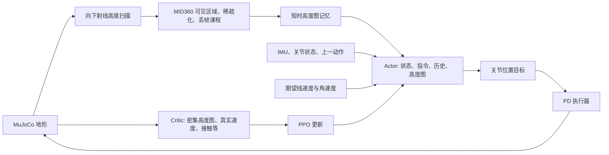

# 仓库感知运控解析与 Go2W 训练迁移

本分支固定 mjlab `8bb2bc9e`、MuJoCo 3.16.0、MuJoCo-Warp 3.16.0.post1（上游 #1771/#1796 修复及 EPA 容量 64）、Warp 1.18.0、RSL-RL 5.5.1。安装采用 Conda + pip，具体步骤和核心版本约束见 [安装说明](setup_zh.md)。

所有碰撞体使用零 margin；非轮/轮子接触维度与优先级分别为 `1/0` 和 `3/1`。轮碰撞默认使用圆柱，也提供原始 `wheel.stl` 网格版本，切换方法见下文；两种版本共用控制、奖励及自碰撞设置。

## 1. 原仓库如何实现感知运控

这是一个速度指令驱动的局部地形感知强化学习控制器。策略直接输出关节动作；当前训练链路没有单独的全局建图、路径规划、落脚点规划模块，也没有独立的点云网络或 teacher/student 蒸馏阶段。



| 环节 | 代码位置 | 实际作用 |
| --- | --- | --- |
| 训练入口 | `scripts/train.py` | 注册任务、构建环境、PPO 学习、恢复 checkpoint |
| 公共任务 | `src/tasks/velocity/velocity_env_cfg.py` | 场景、观测、奖励、随机化、课程、200 Hz 仿真 / 50 Hz 策略 |
| G1 适配 | `src/tasks/velocity/config/g1/env_cfgs.py` | G1 关节、足端接触、楼梯地形、感知 v1/v2 和精调 |
| 仿真感知 | `src/tasks/velocity/mdp/observations.py` | 高度扫描、MID360 可见区域掩码、稀疏化和记忆 |
| PPO | `src/tasks/velocity/config/g1/rl_cfg.py` | Actor/Critic MLP，隐藏层 512/256/128，ELU，观测归一化 |
| 模型导出 | `src/tasks/velocity/rl/runner.py` | 保存 checkpoint 时同步导出 ONNX 和元数据 |
| G1 真机感知 | `deploy/robots/g1/src/State_RLBase.cpp` | 订阅 DDS PointCloud2，外参及姿态变换，局部网格聚合 |

**高度图表达：** 网格大小 1.6 × 1.0 m、分辨率 0.1 m，共 17 × 11 = 187 个采样值，按 `iy * 17 + ix` 展平。数值是射线起点到地形的向下距离，经 `1 / 5` 缩放；缺失值为 5 m。它不是已经减去机体高度的地面绝对高程，也不是直接把原始点云送进网络。

**G1 感知 v2：** Actor 用 3 帧历史，Critic 用 1 帧。500–2500 次迭代逐渐从密集高度图切换到带 MID360 可见区域的高度图，2500–6000 次迭代进一步增加稀疏化和丢帧。这里迭代数按每次 PPO 采样 24 个控制步换算，代码中的课程实际上读取 `common_step_counter`。传感器噪声、延迟、关节编码器偏差、摩擦和质心扰动用于缩小仿真到实机差异。

**记忆：** `bridged_mid360_height_scan_memory` 保存最近 0.8 s 的扫描值，用前向速度积累到 0.1 m 后平移网格，为脚下盲区提供历史数据。现有实现只补偿正向 X 位移，不补偿侧移、倒退、偏航及机体高度变化；大幅转弯或上台阶时存在误差。本次 Go2W 复用此机制，初期采用较慢前进命令；硬件部署前仍需扩展完整位姿补偿。

**奖励和控制：** PPO 根据速度跟踪、身体姿态、动作平滑、关节限制、接触等信号学习。G1 用默认站立姿态加策略动作缩放得到关节目标，再由 PD 执行器产生力矩。Critic 可看真实速度、密集高度图与足端接触；Actor 不依赖这些额外真值。仓库现有 `*-Rough` 任务已经给 Actor 输入密集高度图，不能简单视为“盲走”。

**真机链路的实际边界：** G1 C++ 控制器将点云变换到去偏航的机体坐标系，以每个网格内最高点计算向下距离，再送入 ONNX。检查当前 `LidarHeightScanUpdater::update_once()`，其部署侧使用当前帧网格，没有对应训练中的 0.8 s 历史平移记忆；当前网格代码也是居中裁剪，需要核对 v2 的前移网格。`config.yaml` 中感知状态还开启了 `dry_run_no_actuation: true`。因此仓库提供了训练和部署代码，但不能仅凭 README 就认定任意 v2 模型已与真机感知完全对齐。

## 2. Go2W 迁移内容

Go2W 模型基于 [ZhongL1/unitree_rl_mjlab_go2w](https://github.com/ZhongL1/unitree_rl_mjlab_go2w/blob/fe0deeaef2e6e579db63b782f1082b5d2b4ed071/mjlab/asset_zoo/robots/unitree_go2w/xmls/go2w.xml)，固定参考提交 `fe0deeaef2e6e579db63b782f1082b5d2b4ed071`。两份静态入口 `go2w.xml`（圆柱）和 `go2w_mesh.xml`（原始 mesh）共用 `src/assets/robots/unitree_go2w/xmls/go2w_common.xml` 的机身定义，碰撞体名称、轮毂 site、外观网格禁碰撞和 3 个传感器直接写入 XML；不再通过 Python 增删模型定义。传感器保留 `imu_ang_vel`、`imu_lin_vel`、`root_angmom`，关节状态直接读取仿真数据；角动量奖励仅为测试而移除，其传感器继续保留，后续调整奖励不联动清理传感器。删除运行时适配模块、额外来源清单及 3 个未使用网格，只保留实际使用的 14 份网格。连杆、质量、惯量与关节沿用参考模型；当前四个轮子的碰撞形状默认采用下述圆柱配置，也可切换为原始 mesh，自碰撞继续开启。来源与 BSD 许可证保存在 Go2W 资产目录。

此前的资产配置对齐已采用 [ZhongL1/unitree_rl_mjlab_go2w 的资产配置](https://github.com/ZhongL1/unitree_rl_mjlab_go2w/blob/fe0deeaef2e6e579db63b782f1082b5d2b4ed071/mjlab/asset_zoo/robots/unitree_go2w/go2w_constants.py)，固定参考提交 `fe0deeaef2e6e579db63b782f1082b5d2b4ed071`：出生高度 0.40 m，右髋 +0.1 rad、左髋 -0.1 rad，大腿 0.9 rad、小腿 -1.8 rad，轮角和初始关节速度为零。髋/大腿 KP/KD 为 20/1、力矩上限 23.5 Nm；小腿为 40/2、45 Nm；轮速度增益为 2、力矩上限 45 Nm。髋/大腿 armature 为 0.01，小腿为 0.02，轮子现按用户配置改为 0.0，执行器 frictionloss 为 0。2026-10-24 接触分配改为与本仓库 G1 对应：非轮碰撞体 `condim=1、priority=0`，四轮 `condim=3、priority=1`；摩擦继承 XML 并按任务随机化，自碰撞按用户要求开启。此前物理几何曾与参考对齐，当前默认将四个轮碰撞几何改为圆柱，另提供原始 mesh 版本；来源和接口适配差异记录在 `src/assets/robots/unitree_go2w/SOURCE.md`。这些模型调整本身不能视为 NaN 修复。

轮子现直接配置 `BuiltinVelocityActuatorCfg(target_names_expr=WHEEL_JOINTS, damping=2.0, effort_limit=45.0, armature=0.0, frictionloss=0.0)`。新 mjlab 原生速度执行器已支持连续关节，自动设置 `inheritrange=0.0`、`ctrllimited=False`；旧 1.2.0 环境使用的 `src/utils/mjlab_compat.py` 补丁已移除。显式 `frictionloss=0.0` 保持旧训练的有效摩擦值，避免新版默认继承 XML 摩擦而改变动力学。现按本仓库 G1 基准关闭动作裁剪，轮目标转速为 `20 * action` rad/s，20 不代表最大转速。armature 从 0.02 变为 0.0 是此前用户指定的模型调整，本次版本升级没有再改变它。

| 项目 | Go2W 实现 |
| --- | --- |
| 机器人 | 12 个腿关节 + 4 个连续轮关节，浮动基座 |
| 动作前 12 维 | 腿关节默认姿态 + `0.5 * action` rad |
| 动作后 4 维 | `20 * action` rad/s 的轮子速度目标，零偏置 |
| 动作裁剪 | 与本仓库 G1 一样，`clip_actions=None`，不裁剪策略动作 |
| 执行器 | 腿使用 PD 位置控制，轮子使用速度控制；轮子力矩上限 45 Nm，参数对齐 ZhongL1 参考资产 |
| 关节观测 | 12 维腿位置、12 维腿速度、4 维轮速度；不输入累计轮转角 |
| 奖励 | 姿态和关节位置限制只选腿关节；加入轮子停转与速度代价 |
| 接触打滑 | 参考 `robot_lab.wheel_spin_contact` 的空转公式，以当前总接触力门控轮周速度与轮体 COM 平移速度的差值 |
| 行走先验 | 移除四足固定腾空步态与强制足端抬高奖励，允许自主选择滚动和跨步 |
| 地形 | 按对应 G1 阶段构建，中央平台尺寸可独立配置；v2 上行台阶 4–18 cm，精调上行楼梯占比 60% |
| 感知 | 与 G1 相同：密集扫描居中，另设前移 0.35 m 的 MID360 扫描；稀疏化、丢帧、噪声、延迟和记忆按阶段对齐 |
| 导出 | ONNX 附带每个动作的关节名称、位置/速度类型、缩放、偏置、控制周期和历史长度 |

动作顺序由Go2W显式名称列表和有序动作适配固定；当前与模型自然关节顺序筛选结果一致：

```text
FL_hip, FL_thigh, FL_calf,
FR_hip, FR_thigh, FR_calf,
RL_hip, RL_thigh, RL_calf,
RR_hip, RR_thigh, RR_calf,
FL_wheel, FR_wheel, RL_wheel, RR_wheel
```

上面省略 `_joint` 后缀。这与 SDK 的电机顺序不同，实机适配必须使用导出的 `action_joint_names` 映射，不能直接把 16 维动作按索引发给 SDK。

当前 Go2W 已按实验要求注释 Actor/Critic 的 `phase`，同时注释 Critic 的 `foot_air_time`。感知任务 Actor 单帧 **240 维**；Rough/v1 使用1帧，v2/精调/Step14 使用3帧，即 **720 维**；Critic **263 维**；动作 **16 维**。mjlab 先展平每个观测项的历史再拼接各项，并非把三个完整帧直接拼在一起。平地任务移除高度图并使用1帧，Actor **53 维**、Critic **76 维**。Rough/v1 与 v2 不能直接互相恢复 checkpoint；v2/精调/Step14 的张量形状兼容。移除观测前的旧 v2 为726/269，不能直接加载到当前配置，应新开实验；Go2/G1 checkpoint 也不能直接加载。

当前通用训练设置以本仓库自己的 G1 为基准，详细差异与保留项见 [G1 对齐记录](go2w_g1_alignment_zh.md)。机器人资产、轮足动作与 robot_lab 空转奖励继续使用 Go2W 配置；轮动作缩放保留 20 rad/s。旧 v2 checkpoint 虽保持张量形状兼容，动作处理、扫描布局及训练分布已变化，公平对照应创建新运行从头训练。

新文件入口：

- `src/assets/robots/unitree_go2w/go2w_constants.py`：模型、初始姿态、执行器、碰撞配置。
- `src/tasks/velocity/config/go2w/env_cfgs.py`：场景、动作、观测、地形和感知课程。
- `src/tasks/velocity/config/go2w/rl_cfg.py`：PPO 参数与日志目录。
- `src/tasks/velocity/mdp/rewards/locomotion.py`：跟踪、机身、姿态及足端奖励。
- `src/tasks/velocity/mdp/rewards/wheel.py`：轮侧滑、接触空转、持续悬空超时和停车奖励。
- `src/tasks/velocity/mdp/rewards/smoothness.py`：可选二阶动作与接触力变化代价，当前未配置。
- `src/tasks/velocity/mdp/events.py`：重置与随机化事件；净空检查的边界计算、Warp核函数与缓冲区均封装在 `ensure_spawn_clearance` 类内。
- `src/tasks/velocity/mdp/actions.py`：让关节action实际遵守 `preserve_order=True`，按名称同步重排目标和关节索引。
- `src/tasks/velocity/mdp/sensors.py`：接触传感器按显式primary列表排序，保留原生匹配、排除和数据提取逻辑。
- `src/tasks/velocity/rl/go2w_runner.py`：混合动作 ONNX 元数据。
- `src/tasks/velocity/rl/go2w_symmetry.py`：mjlab观测布局与RSL-RL TensorDict镜像增强。

Go2W 配置直接从公共根层构建：环境以 `make_velocity_env_cfg()` 为起点，在 Go2W 模块内显式配置传感器、默认姿态约束、事件和终止条件；PPO 直接实例化 mjlab 的 `RslRlOnPolicyRunnerCfg`、`RslRlModelCfg`、`RslRlPpoAlgorithmCfg`。六个已注册任务均调用 Go2W 私有基础构建器，通过局部配置函数应用感知与地形阶段，不导入 Go2/G1 等其他机器人的 task 配置，也不串接已注册 task 的工厂函数。

Go2W 的 Actor/Critic 观测项、传感器、地形项、奖励选择、资产名称及六个任务注册均逐项显式配置；配置文件不使用 `for`/`while`、列表/字典推导式或生成器表达式，回归检查会检查这一约束。接触数据在运行时仍使用张量运算做物理归约。

全部 Go2W 阶段的新训练初始 action std 为 `1.0`；恢复 checkpoint 时会加载其中已训练的分布参数。当前用户配置的角速度跟踪 `std=0.5`、`pose.weight=0.75`、`body_orientation_l2.weight=-0.7`。角速度跟踪权重为Flat/Rough 1.0、感知任务0.75、StepUp 1.15。V2及其派生任务的训练启用pose权重课程：初始0.75，超过8000×24控制步后0.6，超过14000×24后0.5；play关闭课程，保留配置权重0.75。`angular_momentum` 继续停用，`root_angmom` 保留。普通步态、足抬高和普通足滑移奖励不用于滚动；其余奖励按当前Go2W配置独立调参。

接触打滑参考本地 `robot_lab`（检查时 HEAD 为 `1a8193f`）中 `source/loco_lab/loco_lab/tasks/physx/mdp/rewards/rewards.py::wheel_spin_contact` 的空转公式；该文件的版权与 Apache-2.0 标识保留在迁移文件头部。按本任务需求，接触门控由参考实现的纯法向力改为共享传感器的总接触力，公式为：

```text
contact_i = ||feet_ground_contact.force_i|| > 1 N
spin_i = max(0.8 * R * abs(wheel_joint_speed_i) - ||wheel_COM_velocity_i|| - 0.1, 0)
reward_term = -1.0 * sum_i(contact_i * spin_i)
```

沿用参考实现的 `0.8` 容差系数、`0.1 m/s` 死区和 `1 N` 阈值；阈值用于过滤微小接触力和数值波动。`R` 使用 Go2W 的 `0.086 m`，当前用户设置权重为 `-1.0`。原先的 `wheel_slip` 和几何接触点速度近似已移除。

空转奖励直接使用普通 `ContactSensorCfg` 配置的 `feet_ground_contact`：`fields=("found", "force")`、`reduce="netforce"`、`num_slots=1`，保留逐轮接触时间跟踪。该总力包含法向反力和切向摩擦；摩擦力本身也由接触产生，只判断是否接触时无需分离法向力。因此无需独立的空转传感器或自定义接触适配器，接触观测、落地奖励、空转与侧滑奖励共用同一份数据。对外接触状态、接触时间均为每轮一个值，力为每轮三维向量，Critic 维度不变。门控只读取当前力，不读取历史力。空转项本身不包含侧滑，侧滑由下面的独立项处理。

2026-10-24 新增 `wheel_lateral_slide`，所有 Go2W 阶段均启用，当前用户设置权重 `-0.5`。参考本地 robot_lab 的 `wheel_lateral_slide_switch`，保留轮子质心速度和轮轴水平投影的定义，接触门控使用上述共享总力。Go2W 的四个轮关节均绕局部 Y 轴旋转：

```text
axle_xy_i = normalize(project_xy(rotate(wheel_link_quaternion_i, [0, 1, 0])))
slide_i = max(abs(dot(wheel_COM_velocity_i, axle_xy_i)) - 0.04 m/s, 0)
reward_term = -0.5 * sum_i(contact_i * slide_i)
```

这是水平侧滑速度的 L1 代价，正常沿滚动方向前进不扣分。投影后不把竖直速度计为侧滑；投影长度用 `1e-6` 下限避免轮轴近乎竖直时除零。它不是按坡面法向建立的完整轮胎接触模型。初始权重未经过训练调优，需关注急转弯及原地转向的必要侧滑，不能直接套用 robot_lab 其他机器人的权重。

2026-10-25 新增 `wheel_air_time_timeout`，全部Go2W任务启用，权重 `-0.5`。逐轮使用共享接触传感器的 `current_air_time`，普通任务允许连续悬空0.5 s，StepUp允许0.7 s；超过阈值后在0.25 s内线性增加到每轮1，再对四轮取平均。即 `cost = mean(clamp((current_air_time - threshold) / 0.25, 0, 1))`，单腿封顶的奖励率为−0.125，四腿均封顶为−0.5；实际每步奖励仍由mjlab乘控制步长。站立和运动时均逐步计罚，不依赖首次落地事件。原生计时按 `found` 判断接触，发生接触或重置对应环境后清零；它不使用空转项的1 N力阈值。`Metrics/wheel_air_time_max_mean`记录各环境当前最长单腿悬空时间的均值。这些初始参数通过数值与接入验证，训练效果仍需对照。

另已实现两项可选代价，但**未向任何任务的 rewards 配置添加条目，包括零权重条目**：

| 函数 | 定义 | 历史与重置 |
| --- | --- | --- |
| `action_smoothness_second_order` | `sum((a_t - 2*a_(t-1) + a_(t-2))**2)` | 使用 action manager 的原始动作历史；每个 episode 前两个控制步不计罚，合法的零动作照常参与后续计算 |
| `grf_smoothness`（有状态类） | `w1*sum((F_t-F_(t-1))**2) + w2*sum((F_t-2*F_(t-1)+F_(t-2))**2)` | 默认 `w1=1`、`w2=0.5`，只取世界 Z 向；保存每个策略步的总接触力，按环境独立清空历史；首次采样不计罚、第二次只算一阶 |

两项均为每控制步的离散差分，不除以 `dt`；若环境开启按 `dt` 缩放，总奖励仍由 reward manager 统一处理。动作项覆盖原始 16 维输出，不混用腿位置和轮速的物理单位。GRF 项要求世界系力（本项目的 `reduce="netforce"` 已满足）；与 robot_lab 的纯法向力输入有区别。默认只取世界 Z，避免直接约束平面牵引；不加接触门控，保留落地和离地的力变化。mjlab 的传感器 history 按物理子步更新，因此本实现自行保存策略步历史，不更改共享传感器的 `history_length`。

### 2.1 左右镜像增强与关节代价实验

参考本地 robot_lab 的 sagittal mirror 思路，具体接入按固定 mjlab 提交与 RSL-RL 5.5.1 源码实现：

- `Go2WPpoAlgorithmCfg` 继承 mjlab 的 PPO 配置类，显式增加 `symmetry_cfg` dataclass 字段，使训练入口的 `asdict()` 保留配置；调用RSL-RL原生 `Symmetry`，`use_data_augmentation=True`、`use_mirror_loss=False`。未修改第三方依赖或 PPO 更新公式。
- 每个mini-batch追加左右镜像样本，Actor/Critic同时增强；模拟环境数不变。根据mjlab observation manager解析后的条目顺序和维度生成镜像索引，逐项处理历史。地形图按实际ray pattern推导左右映射，覆盖密集与MID360记忆扫描的输入布局。
- 交换 `FL↔FR`、`RL↔RR`；hip位置/速度/动作变号，thigh/calf保持符号。四个轮速度动作交换轮位、保持符号。线速度/重力/力向量的Y分量变号，角速度的X/Z分量变号，指令的侧向速度和偏航速度变号。
- Critic接触力改用 `foot_contact_forces_b`：先将共享传感器的世界系总力转到机身系，再做原有 `sign(F)*log1p(abs(F))` 缩放。否则无法仅凭历史观测在任意世界航向下正确镜像。共享传感器及奖励仍读取原始世界系数据。
- Critic的 `foot_height` 使用 `foot_height_above_terrain`：四个轮心site各配置一条世界竖直向下、只命中地形组0/1的射线，按FL/FR/RL/RR显式列出。每轮返回 `site_z - ground_hit_z`，不减轮半径；水平地面且轮轴水平时贴地约0.086 m。射线未命中时返回5 m缺失值。当前观测 `scale=5.0`，所以贴地输入约0.43、缺失值输入为25。Flat、Rough及全部感知变体的训练/play均保留四条射线；观测仍是四维，独立于Actor的MID360稀疏扫描。其他机器人沿用原有足高观测。旧checkpoint的Critic足高输入语义已改变，继续训练时应考虑原归一化统计的差异。
- `phase` 在Actor/Critic中注释，`foot_air_time`在Critic中注释；G1和其他机器人保持原配置。`track_air_time=True`保留，用于soft_landing的首次触地判断和持续悬空超时惩罚。

关节惩罚全部Go2W变体共用，腿与轮分开选择和赋权。当前权重已按用户新配置同步：

| 项目 | 权重 | 作用对象与计算 |
| --- | ---: | --- |
| `leg_torques_l2` | −5.0e−6 | 12个腿执行器，累计实际 `actuator_force²` |
| `wheel_torques_l2` | −5.0e−6 | 4个轮执行器，累计实际 `actuator_force²` |
| `joint_vel_l2` | −5.0e−6 | 12个腿关节，累计实际角速度 `joint_vel²`；本轮新增 |
| `wheel_speed` | −1.0e−5 | 4个轮关节，累计实际角速度 `joint_vel²` |
| `joint_acc_l2` | −2.5e−7 | 12个腿关节，累计实际角加速度 `joint_acc²`；保留已有项 |
| `wheel_acc_l2` | −2.5e−8 | 4个轮关节，累计实际角加速度 `joint_acc²`；用户调整后的当前权重为腿项的1/10 |

使用 mjlab 的内置 `joint_torques_l2`，选择字段为 **actuator_names/actuator_ids**，不是joint_names/joint_ids。Go2W当前采用单位gear的单关节传动，此时标量执行器输出可作为电机作用力矩。上述代价不是四腿力矩均衡项，也没有强制四腿同一时刻等力。此前slide继续启用，二阶action和GRF变化仍不加入配置。

速度/加速度分别使用mjlab内置 `joint_vel_l2` / `joint_acc_l2`，通过 **joint_names/joint_ids** 读取MuJoCo的 `qvel` / `qacc`，单位分别为rad/s、rad/s²；这与原始策略动作的二阶差分不同。模型关节顺序中轮关节穿插在腿关节之间，不能用前12维/后4维切分实际关节状态。轮加速度的数值尺度可能较大，因此单独取较小初始权重，后续应根据分项回报与跟踪表现调整。

验证：50项相关CPU检查通过，覆盖全部Go2W训练/play配置的腿/轮速度和加速度选择、物理量读取与隔离；另以2个实际V2平地环境采样4步并完成一轮PPO更新，Actor/Critic形状为720/263，增强批次翻倍，6项关节代价原始值及所有loss有限。这只验证接入、几何映射与数值流程，没有验证是否已消除右前腿悬空，也没有校准长期训练中的奖励比例。当前配置应新开训练，旧checkpoint输入层和归一化统计不适用。

### 2.2 配置各地形的中央平台尺寸

修改 `src/tasks/velocity/config/go2w/env_cfgs.py` 顶部的 `TERRAIN_PLATFORM_WIDTHS`。`rough`、`v1`、`v2` 可分别设置四类地形原生的 `platform_width`，单位为米，表示中央正方形平台的边长。例如只调整V2：

```python
"v2": {
  "pyramid_stairs": 2.0,
  "pyramid_stairs_inv": 2.0,
  "hf_pyramid_slope": 2.0,
  "hf_pyramid_slope_inv": 2.0,
},
```

`v2`同时用于V2、StepUp、Step14，训练/play共用；Step14只有 `pyramid_stairs_inv` 启用。配置在阶段定制前写入，后续阶段保留这些值，不再用固定坡面平台宽度覆盖。修改后需重新启动训练/play进程。当前V2两类台阶的平台宽度均为2.0 m；该配置只作用于Go2W，不修改mjlab依赖中的全局预设。

平地本身全平，随机粗糙和波浪地形没有原生中央平台，本次不新增平台。台阶按整级数量生成，实际中央平台边长可能略大于设置值；坡面平台边界受高度场网格分辨率影响。`platform_width` 与每块地形的 `size`、踏步宽度 `step_width`、整张地图外沿的 `border_width` 是不同参数。

### 2.3 配置分区与用户参数同步

`env_cfgs.py` 的公共构建器按 Simulation、Scene/Terrain、Sensors、Actions、Observations、Events/Randomization、Commands、Rewards、Terminations、Curriculum、Viewer/Episode 分区。地形、感知和课程辅助配置分别集中成块；奖励集中到 `_configure_rewards`，按跟踪、机身/姿态、腿关节、轮关节、动作、接触/碰撞、停车、失败终止及StepUp附加项分组，每项权重和参数放在同一处。StepUp课程函数只处理课程，奖励和play指令分别在对应分区配置。

同步用户当前设置：V2及其派生任务 `action_rate_l2=-0.02`，所有Go2W任务 `rel_heading_envs=0.8`；V2指令课程的X范围依次为 `(-0.1,0.45)`、`(-0.3,0.65)`、`(-0.5,0.90)`、`(-0.6,1.10)`，Y范围依次为 `±0.1`、`±0.25`、`±0.45`、`±0.6`，转向范围依次为 `±0.15`、`±0.30`、`±0.60`、`±0.8`；切换控制步仍为0、4000×24、9000×24、16000×24。StepUp保留自己的前向精调课程。

Go2W PPO配置统一指定 `wandb_project="go2w_mid360"`、`upload_model=False`。日志沿用mjlab默认的W&B后端；模型仍保存到本地，停止上传模型文件到W&B。

奖励实现统一收进 `mdp/rewards/`，由包导出到公共 `mdp`；配置仍用 `mdp.xxx`。`spawn_clearance.py` 更名为 `events.py`，净空事件相关常量、几何边界函数和Warp核函数都放在类内，保留 `required_lift` 和事件调用接口。重置顺序仍是先迁移地形、再重置机器人、最后保证出生净空。

重构验证：以同步用户粘贴参数后的配置为基线，45个任务的训练/play参数及动作、观测、事件顺序逐项一致；奖励项的展示顺序按新分组排列。64项相关CPU测试通过，覆盖圆柱轮/mesh轮的全地形净空、局部重置、边界和指令；另以2环境、4步采样完成一轮PPO更新，全部loss有限。该验证不代表长期训练效果评估。

### 2.4 显式固定关节与接触顺序

Go2W只在逐列语义需要固定的地方设置 `preserve_order=True`：action、Actor/Critic关节观测和足高观测，以及需与轮接触通道配对的slide body和空转body/joint选择器。`LEG_JOINTS` 和 `WHEEL_JOINTS` 使用逐个列出的名称，腿按FL/FR/RL/RR及每腿hip/thigh/calf排列，轮按FL/FR/RL/RR排列。力矩、速度、加速度、限位、停车等标量求和奖励使用默认顺序；pose容差按解析出的关节名生成，也使用默认顺序。事件随机化/重置、单body奖励及 `terrain_out_of_bounds` 不指定保序。权重和输入维度不变。

固定mjlab版本的原生关节action不传递该开关，原生接触传感器也不提供该字段，因此action使用本地 `OrderedJointPositionActionCfg` / `OrderedJointVelocityActionCfg`，四轮地面接触使用 `OrderedContactSensorCfg`。非轮地面接触和自碰撞使用原生 `ContactSensorCfg`。这些适配只调整名字及其对应索引的解析顺序，执行和传感器数据提取沿用mjlab，不修改第三方依赖。配置继续通过 `mdp.xxx` 使用。

action的 `build()` 创建本地子类；其 `_find_targets()` 先调用原生逻辑筛选有执行器的关节，再在 `preserve_order=True` 时按配置名称列表同步重排关节名与joint IDs。例如配置 `(FR_hip_joint, FL_hip_joint)`，即使模型中的FL在FR之前，得到的目标索引也会是 `[4, 0]`，第0维动作写入FR。缩放、默认姿态偏移、裁剪和目标写入仍使用原生实现。接触传感器的 `build()` 同样创建本地子类；其 `_resolve_primary_names()` 保留原生校验与排除规则后，按配置顺序返回primary名称。原生逻辑随后按该顺序创建传感器槽位，因此 `found`、`force` 和接触/离地时间具有一致的轮子顺序。`True` 遵循名称列表或正则表达式列表的顺序；只有一个匹配四轮的正则时，不会自动推导FL/FR/RL/RR，因此四轮使用显式名称列表。

`variable_posture` 构造容差向量时同样遵守选择器顺序，避免重排后hip/thigh/calf容差与关节值错配。镜像增强除原有action检查外，还检查腿/轮观测、足高site和接触传感器实际primary顺序；与当前镜像约定不一致时直接报错。

验证：74项相关CPU测试通过，覆盖反向名称列表下的位置/速度目标及其关节索引、排除规则后的接触排序、pose容差顺序、错误观测/接触排列的镜像拒绝、全地形净空和ONNX播放兼容性；2环境、4步采样的一轮PPO更新通过，Actor/Critic仍为720/263维。

### 2.5 配置、顺序和镜像的完整核对

检查覆盖Go2W全部6个任务、train/play和圆柱/mesh两种轮模型，共24种组合。真实环境中逐项核对选择器名称与joint/actuator/body/site/geom索引，并进行短步进；这24种组合使用平地隔离地形影响。生成地形另外覆盖7类地形、10个难度行的出生净空，以及完整V2地形上的PPO更新。

本轮修正：

- 首次指令采样：原生速度课程在reset时运行，判断为 `common_step_counter > stage["step"]`；首次reset计数为0，会跳过step=0的初始范围。Go2W现在在构建配置时将初始范围设为最终所选课程的首阶段，StepUp也使用自己的首阶段；后续切换条件与play指令保持各自原有设置。
- 地图边界：课程地形实际按地形种类分列，不使用配置请求的 `num_cols`。边界函数现在读取实际 `terrain_origins` 网格尺寸，避免V2提前截断或Rough越过真实外沿才截断。
- 求解器回归样本：冻结输入来自3 m台阶平台，测试曾误用当前训练的2 m平台重建。历史回放恢复3 m平台后，10/20预算的原告警可复现，50/100预算与100/200参考的加速度一致。当前训练平台继续采用用户配置。

左右镜像核对结果：腿按FL↔FR、RL↔RR交换，hip取负、thigh/calf不变；轮速只交换左右。机身角速度取 `(-wx, wy, -wz)`，重力和线速度取 `(x, -y, z)`，指令取 `(vx, -vy, -wz)`。接触力先从世界系转到机身系，再作有符号log压缩；镜像时交换轮子并取 `(Fx, -Fy, Fz)`。高度图只翻Y，不翻前后X，且每一段term历史单独映射。

`tests/test_go2w_mirror_runtime.py` 使用实际模型构造任意横滚、俯仰、偏航的镜像状态，核对原生动作写入MuJoCo控制槽的数值、增益/力矩范围/gear和软关节限位。接触标记写入真实编译的传感器地址，验证提取顺序和完整观测历史；两种轮模型下23种奖励都至少产生一次非零值，且镜像前后奖励相同。另覆盖感知记忆的丢帧、前向平移和过期。

全量100项CPU测试通过。完整V2生成地形实际为10×7块，2环境、4步采样和小网络的一轮PPO更新通过；本地checkpoint和ONNX导出通过，ONNX参考执行结果与PyTorch最大误差约 `4.47e-8`，`upload_model=False`确实阻止模型上传。Actor/Critic维度仍为Flat 53/76、Rough/V1 240/263、V2及其派生任务720/263。

已确认的设计限制：MID360记忆只沿前进X方向平移，没有倒退、横移和转弯的完整运动补偿；它仍满足左右镜像关系，但允许倒退的V2课程不能据此假设记忆地图在倒退时准确。当前action和本体观测未配置延迟；仅高度扫描配置延迟，V1的play仍保留0—1控制步，V2的play关闭延迟。CPU数值检查不代表GPU长期训练效果或奖励权重已达到最优。

### 2.6 action独立验证及按用途保序

`tests/test_go2w_actions_runtime.py` 额外覆盖2种轮模型×True/False×3类设置，共12种场景，每个场景含2个环境。关节查询故意打乱，并包含只控制部分关节的情况；覆盖当前0.5/20动作尺度、非同值默认姿态、逐环境encoder bias、按名称配置scale/offset/clip及执行器限力。验证基准直接从MuJoCo编译模型的joint transmissions建立关节到actuator映射，不依赖本地action返回的索引或 `Entity.find_*`。控制值符合手工计算，实际actuator_force符合原生PD公式和限力；把同一批关节命令转换为自然顺序后交给未修改的mjlab action，得到相同的控制值和力矩。本地action实现通过验证，无需改动。

`tests/test_go2w_ordering.py` 验证求和类奖励在打乱选择顺序后数值不变，pose在True/False下都按关节名正确生成容差。配置测试只要求有逐列对应关系的选择器保序，防止再次把True扩展到全部选择器。收紧配置后，完整102项CPU测试通过，真实镜像状态下全部23类奖励与观测历史继续通过验证。

### 2.7 数据增强训练全流程与RSL-RL版本

`tests/test_go2w_symmetry_pipeline.py` 用当前V2参数、完整生成地形、4环境、512/256/128网络运行原生 `runner.learn()` 两轮。每轮24步、5 epochs、4 mini-batches，合计192条真实transition、40次优化器更新。额外强制两次timeout，核对reset前观测、原始16维动作、采样value/log_prob、timeout bootstrap及storage的对应关系。

数据流为：原始Actor 720/Critic 263维观测→采样与storage→GAE→原始24行mini-batch→同时镜像Actor、Critic与action，扩为48行→网络内归一化→PPO/value loss→梯度与更新。原始和镜像两半复用对应的old value、old log_prob、advantage、return；old distribution参数保留原始24行，供原始样本的KL计算。归一化统计按RSL-RL 5.5.1仅从真实采样更新，两轮Actor/Critic计数分别为96、192。

在实际backward上，镜像行对Actor log_prob和Critic value都有非零梯度；mirror loss关闭，日志用的symmetry loss明确detach。对完全相同的初始网络、优化器和rollout关闭增强后，Actor/Critic更新参数最大差异分别约0.00431、0.00414，证明镜像样本进入了两者的优化。checkpoint恢复包含Actor、Critic、归一化统计与优化器；推理仅调用Actor，不运行增强。ONNX参考执行与恢复后的PyTorch输出最大误差约3.73e-8。全量109项CPU测试通过。

算法边界必须明确：镜像样本没有重新仿真或重算GAE；固定版本RSL-RL直接复制原样本old log_prob，因此旧网络不严格对称时，镜像分支的初始PPO ratio不一定为1。测试中原始ratio偏离1最多约3.82e-6，镜像分支平均绝对log-ratio约0.59/0.48。这符合当前原生实现，不能解释为多采集了一批严格on-policy轨迹。Critic同时接收镜像观测并学习相同return目标，但普通MLP没有结构上强制 `V(s)=V(Ms)`；`std_type="scalar"` 表示16个动作维度各自学习直接参数化的std，不表示共用一个std。以上检查验证接线和数值流程，不证明增强必然改善长期步态。

项目统一固定 `rsl-rl-lib==5.5.1`。`src/utils/rl_backend.py` 检查版本、重复安装、主包及已加载子模块的实际来源，并记录PPO、Symmetry、storage、runner、model、归一化和分布实现共7份源码的SHA256。train/play/evaluate启动检查，训练写入 `params/rl_backend.json`；Go2W runner直接构造时也检查。新checkpoint和ONNX保存版本、源码记录；checkpoint恢复时已记录的版本或源码不同会拒绝加载。旧checkpoint没有记录时会明确警告：只能核对当前运行环境，无法追溯原训练版本。

### 2.8 用户配置同步与观测噪声清理（2026-10-25）

本次按用户粘贴配置合并参数，保留仓库已有的四轮地形相对足高实现及四条射线，并应用 `foot_height.scale=5.0`。Critic轮速缩放改为0.1，Actor仍为0.05；V2及派生任务的轮地摩擦随机化范围改为0.6—1.8。奖励中的pose容差、速度分段阈值、权重课程、关节限位−3.0、轮空转−1.0、侧滑−0.5、感知停车−0.8、轮停车−0.01及V2落地−0.001均同步用户配置。

Go2W仅在Actor的模拟传感器观测声明噪声。指令和上一帧原始action不加噪；Critic各项显式不声明noise，同时保留 `enable_corruption=False`。旧配置中Critic虽然写有noise，mjlab在初始化关闭噪声的组时会把它清空，因此这些声明原本没有实际加噪；本次删除消除歧义。Actor的上一帧action原先在V2实际加了±0.03噪声，现已移除。

| Actor观测的均匀加性噪声半幅 | Flat/Rough | V1 | V2及派生任务 |
| --- | ---: | ---: | ---: |
| 机身角速度，rad/s | 0.2 | 0.25 | 0.3 |
| 投影重力，单位向量分量 | 0.05 | 0.06 | 0.08 |
| 腿关节位置，rad | 0.01 | 0.012 | 0.015 |
| 腿关节速度与轮速，rad/s | 1.5 | 1.8 | 2.0 |
| 高度扫描，m | Rough 0.1；Flat无此项 | 0.12 | 0.15 |

固定mjlab版本的处理顺序为 `compute → noise → clip → scale → delay → history`。噪声先按观测函数输出的物理单位添加，再缩放；例如V2轮速噪声±2 rad/s乘以0.05后，输入扰动为±0.1；高度扫描±0.15 m乘以0.2后，输入扰动为±0.03。网络内的观测归一化位于此后。play通过Actor组的 `enable_corruption=False` 关闭这些加性噪声；该开关不会自行关闭扫描函数内部的稀疏化或延迟，两者仍由感知分区参数控制。

`tests/test_go2w_observation_noise.py` 使用原生ObservationManager和UniformNoiseCfg，核对所有六个任务的train/play噪声声明，以及受控随机数下的加噪、缩放、延迟和历史顺序；同时检查指令、action、Critic和原始数据不被加噪或原地改写。pose课程另验证原生严格大于阈值时才切换权重。

本次提交前使用项目固定的MuJoCo-Warp 3.16.0.post1后端，全量126项CPU测试通过，包括持续悬空超时、真实状态镜像、Actor/Critic两轮PPO更新、checkpoint恢复和ONNX导出；ONNX参考执行与PyTorch输出通过一致性检查。镜像测试已加入非零的逐轮滞空计时，同时覆盖零指令时的超时惩罚。上述结果验证配置接入和数值流程，未评估长期训练表现。

## 3. 安装与训练

建议使用 Ubuntu、Python 3.11 和 NVIDIA CUDA 环境。按 [安装说明](setup_zh.md) 创建环境后，在仓库根目录执行：

```bash
pip install -e .
python scripts/list_envs.py
python -m unittest discover -s tests -v
```

固定后端通过依赖安装，不需要 PYTHONPATH、容量参数或手动补丁。出生净空、求解器收敛、NaN 转储和碰撞回归保留在 `tests/`。

### 选择轮子碰撞模型

在 `src/assets/robots/unitree_go2w/go2w_constants.py` 中修改一行：

```python
GO2W_XML = GO2W_CYLINDER_XML  # 默认圆柱，半径 86 mm、全宽 45 mm
# 或替换为：
GO2W_XML = GO2W_MESH_XML      # 原 wheel.stl 的碰撞凸包，轴向宽度约 51.815 mm
```

两种模型的轮子 margin 都为 0；共用机身、质量惯量、控制和奖励。修改后重新启动训练或回放，全部六个 Go2W 任务都会使用选定模型，无需 CLI 参数。mesh 保留原始宽度，因此与 45 mm 圆柱的对比同时包含外形与宽度差异。

### 推荐：直接训练 v2

v2 自带密集到稀疏课程，可以从随机初始化开始，不必先训练 Flat 或加载其他机器人权重。

```bash
python scripts/train.py Unitree-Go2W-Perceptive-Rough-v2 \
  --env.scene.num-envs=4096
```

日志：`logs/rsl_rl/go2w_perceptive/<时间>_v2/`。当前默认W&B项目 `go2w_mid360`，模型保留本地；需要纯本地TensorBoard时追加 `--agent.logger=tensorboard`。

### NaN 定位与 W&B 日志

RSL-RL 的 `The observation group 'critic' ... contains NaN` 只指出组名，不能据此确定出错项，也不能仅从前一轮的平均奖励定位原因。当前 mjlab 支持逐项观测检查：Actor、Critic 分别设置 `nan_policy=error`、`nan_check_per_term=True`。这会在观测进入延迟/历史缓冲之前检查 NaN 和 Inf，并给出类似以下信息（这是人为注入 NaN 后验证的示例，不代表实际故障来源）：

```text
NaN/Inf detected in observation 'critic/foot_contact_forces' for environments: [1]
```

开启物理 NaN guard 后，`scripts/train.py` 会安装本仓库的 `PhysicsNanCapture`，覆盖每个物理 `step()` 和控制步末尾额外的 `forward()`。它检查位置、速度、加速度、warmstart、传感器、控制输入与力；首次检出 NaN/Inf 时先保存现场，再抛出异常停止训练，防止自动 reset 覆盖异常。观测逐项检查仍需配合开启；不应通过 `sanitize` 或 `nan_to_num` 掩盖尚未定位的错误。

旧版 mjlab guard 的采集顺序是“保存步前状态 → 执行 step → 检测”，并未保存触发检测的步后状态。它虽然检查加速度和传感器，旧 NPZ 却只保留 `qpos/qvel/act`。因此旧回放末尾姿态正常是采集方式的结果，不能说明实际故障时关节角或其他字段正常；旧文件也无法补回漏记的数据。

上传 W&B 前，在训练机 Conda 环境中安装依赖并登录。本分支已升级到 RSL-RL 5.5.1，W&B 跟随该 mjlab 主线的依赖声明，不再沿用旧 RSL-RL 5.0.1 的版本约束。更新仓库后执行：

```bash
pip install -e .
wandb login
export WANDB_USERNAME='你的W&B用户名或团队名'
export WANDB_MODE=online
mkdir -p logs
```

`WANDB_USERNAME` 是当前 RSL-RL 接口读取的 W&B entity，并非 GitHub 用户名；不指定时使用登录账号默认设置。[W&B 官方快速开始](https://github.com/wandb/wandb#quickstart) 说明了登录和查看运行记录的方法。

下面同时开启具体观测项定位、物理状态保存与 W&B 曲线/checkpoint 记录。环境数、seed 和恢复来源应与待排查的训练保持一致；示例沿用 4096 个环境：

```bash
python scripts/train.py Unitree-Go2W-Perceptive-Rough-v2 \
  --env.scene.num-envs=4096 \
  --enable-nan-guard=True \
  --env.sim.nan-guard.output-dir=logs/go2w_nan_dump \
  --env.observations.actor.nan-policy=error \
  --env.observations.actor.nan-check-per-term=True \
  --env.observations.critic.nan-policy=error \
  --env.observations.critic.nan-check-per-term=True \
  --agent.logger=wandb \
  --agent.wandb-project=go2w_mid360 \
  --agent.upload-model=True \
  --agent.run-name=v2_nan_debug \
  2>&1 | tee logs/go2w_nan_debug.log
```

多 GPU 排查应为各进程分别指定 dump 目录，避免同时写入同名文件；上面的命令默认单 GPU。逐项检查与状态捕获会增加同步和存储开销，正常训练时可移除诊断参数。W&B 会记录训练指标、配置和 `.pt` checkpoint；物理 `.npz` / `.mjb` 转储仍保存在本地，不自动上传。只想上传指标时使用 `--agent.upload-model=False`。

| 首个报错项 | 优先检查 |
| --- | --- |
| `critic/foot_contact_forces` | `feet_ground_contact.data.force` 原始逐轮总力、接触传感器与求解器输出 |
| `joint_pos`、`joint_vel`、`projected_gravity`、`base_ang_vel`、`base_lin_vel` | 对应环境的物理状态和 IMU 数据，判断状态是否已发散 |
| `height_scan` | 射线命中、地形高度、机体位姿与高度图计算 |
| `foot_air_time`、`foot_contact` | 接触状态和时间跟踪 |
| `actions` | 策略输出、网络参数及上一次 PPO 更新 |

这张表是检查入口，首个报错项也可能是上游错误的结果，不能只凭项名判定根因。保存终端中第一条 NaN/Inf 报错、环境编号和此前的 MuJoCo/Warp warning；若 guard 产生了转储，保留同一时间的 `.npz` 与 `.mjb`。可用以下命令在浏览器回看发散前的状态：

```bash
python scripts/viz_nan.py logs/go2w_nan_dump/nan_dump_latest.npz
```

本地回放默认停在最后一帧，区分 `PRE-OPERATION STATE` 与 `RECORDED FAILURE`，并显示异常字段的非有限值数量和 `before/after_step/forward` 阶段。在 `Groups → Geoms` 中关闭 `G2`（Go2W 外观网格），开启 `G3`（真实碰撞体），保留 `G0/G1` 地形。场景仅用 CPU 重建接触位置，不运行接触力求解；力箭头不可用。通过 `Playback → Step` 逐帧查看，页面 `Environment` 信息显示原始环境编号；只转储一个环境时，回放索引 0 就是该环境，不需要选择其原始编号。

新版 NPZ 在步前历史之后额外追加故障帧，保留实际 NaN/Inf。`failure_qpos/qvel/qacc/qacc_warmstart/sensordata/ctrl` 等为原始设备结果，`failure_contact_*` 按原始环境编号保存 Warp 接触几何、点、距离、局部坐标系和约束地址，`failure_efc_*` 保留约束雅可比和约束力（有效行数见 `failure_nefc`）。每帧 `inputs_step_*` 保存原始控制、warmstart 和外力；`model_*` 保存选中环境的展开模型字段，MJB 仍是基础模型。旁边的 JSON 记录错误阶段、环境和依赖版本。这些数据用于定位，尚不是完整可确定重现训练的 checkpoint。

关节角已经 NaN 时不存在可绘制的有效姿态，回放会明确提示并显示同一环境最近的有限姿态；不会把 NaN 角度改成零或伪造“炸飞”动画。加速度或传感器先 NaN、关节角尚有限时，画面仍可能正常，应以 `RECORDED FAILURE` 的原始字段为准。旧 NPZ 会标注缺少故障结果。可直接查看记录摘要：

```bash
python scripts/inspect_nan_dump.py logs/go2w_nan_dump/nan_dump_latest.npz --summary-only
```

新版文件默认摘要故障帧；需要对步前有限状态做合成 hold-control 探针时使用 `--frame=-2`。该探针仍使用合成控制，不会自动恢复记录的随机化模型或原始训练动作。

例如旧日志记录的环境 610，应打开同一时间配套的 `nan_dump_20261023_115651.npz` 与 `model_20261023_115651.mjb`；把最后若干帧来回拖动，查看轮、腿、机身与台阶的相对位置。检查时应看碰撞体，而非只看外观网格之间是否重叠。该旧文件的末帧是步前状态，没有异常后的加速度、原始控制、GPU 接触和逐环境随机化参数；CPU 重建接触不能替代原始 Warp 数据。若要对比 Newton/CG，先保留原设置抓一次，再用 `--env.sim.mujoco.solver=cg` 单独做对照，不能将换求解器后暂未报错当作根因已确认。

训练机暂时无法联网时，将 `WANDB_MODE=offline`，其余 W&B 参数保留；联网后运行 `wandb sync wandb/offline-run-<本次运行目录>`。W&B 离线目录与 `logs/rsl_rl/...` 目录是两种不同的数据，不应把普通 TensorBoard 目录直接当作 W&B 离线运行目录同步。

对于已经完成或崩溃的纯 TensorBoard 运行，兼容范围内的 W&B 0.28.2 仍支持以下旧版导入选项（SDK 会打印弃用提示）；将路径替换为含 `events.out.tfevents.*` 的实际运行目录：

```bash
wandb sync --sync-tensorboard \
  --project go2w_mid360 --entity "$WANDB_USERNAME" \
  'logs/rsl_rl/go2w_perceptive/你的旧运行目录'
```

此方式导入旧事件数据，不会自动附带 `.pt` checkpoint 或 NaN 转储。后续新训练直接使用 `--agent.logger=wandb`。

### 地图边界重置与外圈检查

Go2W感知训练配置请求10行×6列，但mjlab课程模式实际按7类地形生成10行×7列，每块8 m×8 m，因此当前内部网格边界为X ±40 m、Y ±28 m。训练 `border_width=20`，普通play为10；均生成四块顶面z=0的BOX。play使用随机地形模式，实际列数遵循其配置；Step14单独使用1×1。旧NaN转储使用它配套的旧MJB回放，不能用当前配置反推旧地图边界。

Go2W保留用户要求的 `terrain_out_of_bounds`，将border计入整张地图，距地图最外沿保留 `distance_buffer=3.0` m。当前感知训练网格在 `abs(x) > 57` 或 `abs(y) > 45` 时重置；阈值从实际生成网格和border计算，跨内部接缝不会触发。Flat无限平面不触发边界重置。该项明确配置 `time_out=True`，仅越界时为 `truncated`，不产生 `is_terminated` 惩罚；同一步若也翻倒，失败惩罚仍生效。原额外的 `illegal_contact` 提前终止已移除，终止机制对齐G1的time_out/fell_over后仅增加边界超时。终端和W&B可查看 `Episode_Termination/terrain_out_of_bounds`。`--inspect-border=True` 或 `--no-terminations=True` 仍会关闭自动终止，供受控检查使用。

对实际 `nan_dump_20261023_115651.npz` 与配套模型的分析发现：环境 610 最后两帧机身 Y 从 -23.9999027 m 移到 -24.0025921 m，紧邻下侧外圈；最后两帧 CPU 重建中，左前轮同时接触内部平地 `terrain_2` 与下侧 border `terrain_781`。右前轮更早已接触该 border，100 帧中 CPU 重建的最负接触距离约 -20.45 mm。保存状态全部有限，最后一帧最大关节速度约 18.74 rad/s。它支持优先排查接缝，但不能单凭 CPU 接触重建确认原始 GPU NaN 的算法根因；转储没有保留异常后的加速度、GPU 接触记录或原始动作。

`scripts/viz_nan.py` 会自动识别标准四块外圈，以橙色线框标出，并提供 `Border inspection` 面板：显示各帧机身坐标、内部网格边界和 CPU 重建的 border 接触名称/距离。负距离代表几何侵入；该数值不是原始 GPU 求解结果。

默认外沿截断允许驶入 border，不能避开内部接缝，也不能当作 NaN 修复。直接把 `border-width` 设为 0 会移除外圈地面，不能作为无其他影响的等价修复。

### 训练时实时可视化

在训练命令中加入 `--viewer=viser`，启动浏览器实时查看实际训练 rollout：

```bash
python scripts/train.py Unitree-Go2W-Perceptive-Rough-v2 \
  --env.scene.num-envs=4096 \
  --viewer=viser
```

本机浏览器打开终端打印的地址，默认 `http://127.0.0.1:8080`。服务器训练时，可在自己电脑执行 `ssh -N -L 8080:127.0.0.1:8080 用户名@服务器地址`，再打开同一地址；也可以显式设置 `--viewer-host=0.0.0.0` 后访问 `http://服务器地址:8080`。端口可用 `--viewer-port=8081` 修改，以终端打印的实际端口为准。

页面用 `Training environment` 选择训练环境，也可用 `--env.viewer.env-idx=610` 指定初始查看环境。`Groups → Geoms` 中关闭 `G2`、开启 `G3` 可直接查看 Go2W 碰撞体；检查某次 NaN 的异常环境优先使用上面的逐帧回放，因为实时显示会跳过大量加速仿真步，且后续运行的同一环境编号未必再次异常。开启 `Sensors and commands` 显示已启用调试绘制的射线和指令，并可切换接触点/力与相机跟随。接触显示沿用 mjlab 的 CPU MuJoCo 可视化重算，不应当作训练 Warp 接触数据的逐值验证。页面只同步所选环境，默认最多每秒 15 帧，可用 `--viewer-fps=10` 调低；无浏览器连接时跳过后续画面同步。可视化增加一定同步开销，显示的是加速训练过程，PPO 更新阶段画面会暂时停留。

默认 `--viewer=none`。多 GPU 仅 rank 0 创建页面；页面不会额外执行策略、推进仿真或重置训练环境，Go2W 的显式配置保持不变。训练结束或中断时自动关闭查看服务。

若只需定期录像，可使用原有选项，视频保存在本次运行的 `videos/train/` 下：

```bash
python scripts/train.py Unitree-Go2W-Perceptive-Rough-v2 \
  --env.scene.num-envs=4096 \
  --video=True --video-interval=2000 --video-length=200
```

### 可选：分阶段训练

先学轮腿粗糙地形控制，或者使用 v1 密集感知预训练：

```bash
python scripts/train.py Unitree-Go2W-Rough --env.scene.num-envs=4096
# 或
python scripts/train.py Unitree-Go2W-Perceptive-Rough-v1 --env.scene.num-envs=4096
```

Rough、v1、v2、精调共用 `go2w_perceptive` 实验目录。当前 v2 的恢复来源应选择 v2/精调/Step14，不要选择单帧 Rough/v1。恢复时显式选择来源运行，避免误选最近一次实验：

```bash
python scripts/train.py Unitree-Go2W-Perceptive-Rough-v2 \
  --env.scene.num-envs=4096 \
  --agent.resume=True \
  --agent.load-run='<来源运行目录名>' \
  --agent.load-checkpoint='model_5000.pt'

python scripts/train.py Unitree-Go2W-Perceptive-Rough-v2-StepUp-Finetune \
  --env.scene.num-envs=4096 \
  --agent.resume=True \
  --agent.load-run='<已训练的v2运行目录名>' \
  --agent.load-checkpoint='model_30000.pt'
```

来源目录名指 `logs/rsl_rl/go2w_perceptive/` 下的子目录。恢复会同时恢复优化器、迭代数和感知课程计数；长时间预训练后切换 v2 可能直接进入稀疏阶段。推荐直接从 v2 开始训练，让课程与策略共同推进。

平地基础验证：

```bash
python scripts/train.py Unitree-Go2W-Flat --env.scene.num-envs=4096
```

### 回放与台阶测试

```bash
python scripts/play.py Unitree-Go2W-Perceptive-Rough-v2 \
  --checkpoint-file=logs/rsl_rl/go2w_perceptive/<运行目录>/model_30000.pt

python scripts/play.py Unitree-Go2W-Perceptive-Rough-v2-Step14-Up \
  --checkpoint-file=logs/rsl_rl/go2w_perceptive/<运行目录>/model_30000.pt
```

`Step14-Up` 将地形固定为 14 cm 上行台阶。它提供测试场景，不能保证未经充分训练的策略一定能够通过。

### 使用 ONNX 交互检查边界

默认圆柱版本的四轮碰撞体半径均为 86 mm、全宽 45 mm（XML 的第二个 size 值为半宽 `0.0225`）；圆柱中心与轴向仍根据原有 STL 的包围盒和轮关节轴对齐。此次仅从 51.814914 mm 缩窄到 45 mm，每侧收进约 3.407457 mm，轮心、质量、惯量与控制参数不变；宽度对照基线为 `4699c76`。最初纯圆柱替换提交为 `ea0e9a8`，圆柱前版本为 `6ff9526`，之后又进行了上述 G1 通用设置对齐。形状 A/B 应在同一套训练配置下比较，不能将前后多项调整一起归因于圆柱。其他开源仓库的形状和参数见[轮足接触配置调研](wheeled_contact_survey_zh.md)。

```bash
python scripts/play.py Unitree-Go2W-Perceptive-Rough-v2 \
  --onnx-file=../policy.onnx \
  --device=cpu --viewer=viser --viewer-port=8096 \
  --start-paused=True --inspect-border=True --perception-step=0
```

旧 `model_20261023_115651.mjb` 使用网格轮碰撞体，与当前圆柱模型有意不同，因此此命令不传旧 `--reference-model`；传入时严格几何检查会拒绝继续。该检查仍保留，只有与当前实验匹配的模型才应传入。旧转储逐帧回放仍使用它原本配套的 MJB。已经启动的 play 进程需要重启才能加载新 XML。

训练圆柱对照组时可在原训练命令上增加 `--agent.run-name=v2_cylinder`，保留其余 NaN guard、观测检查、随机种子与 W&B 参数。优先从相同初始条件重新训练以比较故障发生情况；旧策略可用于接缝交互检查，但动力学已经改变，不能用短时未报错证明 GPU NaN 已解决。

ONNX 播放复用 mjlab 的观测、逐项历史及动作管理器；导出图内部负责观测归一化，环境负责动作裁剪、缩放和偏置。入口校验输入输出、观测顺序、历史长度、关节顺序、KP/KD、初始关节角与动作元数据。当前导出文件固定 batch=1，使用一个环境；ONNX 自带 CPU ReferenceEvaluator 可运行，无需另装 onnxruntime。

当前默认关闭动作裁剪，ONNX 中 `action_clip` 为字符串 `None`。旧策略记录为 `1.0` 时会被新默认配置拒绝，避免静默更改策略动作语义。复查旧策略应使用其原配置；新训练后再导出用于当前配置的策略。

`--inspect-border=True` 是受控接触检查：以 seed 42 重建训练地形，关闭自动终止、物理随机化及扰动，从世界坐标 `(-24.2,-23,0.4)` 朝 -Y 出发，保留原始边界。可用 `--spawn-position`、`--spawn-yaw` 改出生位置和朝向。可选 `--reference-model` 会逐项检查几何、网格顶点/面和高度场内容与转储模型一致，若不同则拒绝继续；它不恢复原始 GPU 环境的随机化状态或动作历史，也不覆盖当前配置的碰撞掩码。

打开页面后点击 Play，再使用“前进／后退／左转／右转／停车”；Commands → Twist 可连续调节速度。Slower 慢放，Pause 暂停，Step 前进一个 0.02 s 控制步，Reset Environment 回到接缝前。Groups 中关闭 G2、开启 G3 可检查碰撞体。橙线标出地形与外圈接缝；面板显示世界位置、轮心高度、CPU 重建的接触距离和机器人碰撞掩码。负距离为穿入，不能把它当作原始 GPU 接触力。

`--perception-step=0` 对应前 500 轮的密集高度扫描阶段；训练迭代数乘 24 可得到相应课程步数。不传该参数则沿用 play 的最终感知阶段。ONNX 元数据不包含训练迭代数，需按导出时所处阶段选择。

按用户要求，当前全部 Go2W 任务已启用自碰撞：命名碰撞体 `contype=1, conaffinity=1`，可视网格仍禁碰撞，MuJoCo 的同刚体及直接父子连杆默认过滤保持开启。旧转储模型为 `1/0`，不会被修改。旧 ONNX 的接口兼容，但接触动力学不同，后续应使用开启自碰撞的配置重新训练或微调。

## 4. 范围与验证

当前提供 Go2W 的训练、回放和策略导出，保留六个 Go2W 任务及仓库其他机器人任务。Go2W 尚无实机控制程序；硬件对接需要 SDK 电机映射、轮速度下发、与训练一致的扫描网格和历史顺序、点云外参、完整位姿补偿及感知超时处理。模型尚未加入实际 MID360 负载质量。

回归检查集中在 `tests/`，覆盖模型与执行器、任务注册、观测和动作接口、轮接触奖励、感知记忆、ONNX、出生/重置净空、冻结碰撞与求解器状态，以及完整任务的 NaN 注入和转储容错。阶段性的迁移、容量/FMA 扫描和后端矩阵脚本已删除。后端算法来源、训练保护和当前验证边界见 [安装说明](setup_zh.md)；历史试验可从 Git 历史查看。

本机 CPU 检查与短程 PPO 用于验证程序链路，不代表策略已经收敛或可以部署。原 4090 的冻结 NaN 输入已经验证组合修复保持接触和有限计算；目标设备的长期训练和实机效果仍需评估。
