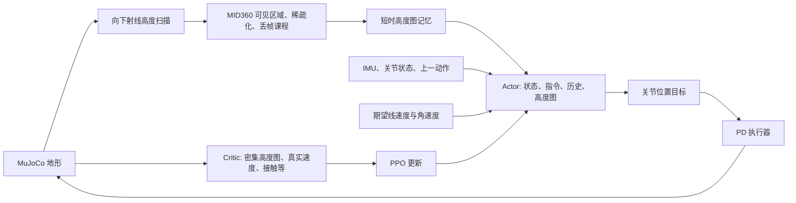

# 仓库感知运控解析与 Go2W 训练迁移

## 1. 原仓库如何实现感知运控

这是一个速度指令驱动的局部地形感知强化学习控制器。策略直接输出关节动作；当前训练链路没有单独的全局建图、路径规划、落脚点规划模块，也没有独立的点云网络或 teacher/student 蒸馏阶段。



| 环节 | 代码位置 | 实际作用 |
| --- | --- | --- |
| 训练入口 | `scripts/train.py` | 注册任务、构建环境、PPO 学习、恢复 checkpoint |
| 公共任务 | `src/tasks/velocity/velocity_env_cfg.py` | 场景、观测、奖励、随机化、课程、200 Hz 仿真 / 50 Hz 策略 |
| G1 适配 | `src/tasks/velocity/config/g1/env_cfgs.py` | G1 关节、足端接触、楼梯地形、感知 v1/v2 和精调 |
| 仿真感知 | `src/tasks/velocity/mdp/observations.py` | 高度扫描、MID360 可见区域掩码、稀疏化和记忆 |
| PPO | `src/tasks/velocity/config/g1/rl_cfg.py` | Actor/Critic MLP，隐藏层 512/256/128，ELU，观测归一化 |
| 模型导出 | `src/tasks/velocity/rl/runner.py` | 保存 checkpoint 时同步导出 ONNX 和元数据 |
| G1 真机感知 | `deploy/robots/g1/src/State_RLBase.cpp` | 订阅 DDS PointCloud2，外参及姿态变换，局部网格聚合 |

**高度图表达：** 网格大小 1.6 × 1.0 m、分辨率 0.1 m，共 17 × 11 = 187 个采样值，按 `iy * 17 + ix` 展平。数值是射线起点到地形的向下距离，经 `1 / 5` 缩放；缺失值为 5 m。它不是已经减去机体高度的地面绝对高程，也不是直接把原始点云送进网络。

**G1 感知 v2：** Actor 用 3 帧历史，Critic 用 1 帧。500–2500 次迭代逐渐从密集高度图切换到带 MID360 可见区域的高度图，2500–6000 次迭代进一步增加稀疏化和丢帧。这里迭代数按每次 PPO 采样 24 个控制步换算，代码中的课程实际上读取 `common_step_counter`。传感器噪声、延迟、关节编码器偏差、摩擦和质心扰动用于缩小仿真到实机差异。

**记忆：** `bridged_mid360_height_scan_memory` 保存最近 0.8 s 的扫描值，用前向速度积累到 0.1 m 后平移网格，为脚下盲区提供历史数据。现有实现只补偿正向 X 位移，不补偿侧移、倒退、偏航及机体高度变化；大幅转弯或上台阶时存在误差。本次 Go2W 复用此机制，初期采用较慢前进命令；硬件部署前仍需扩展完整位姿补偿。

**奖励和控制：** PPO 根据速度跟踪、身体姿态、动作平滑、关节限制、接触等信号学习。G1 用默认站立姿态加策略动作缩放得到关节目标，再由 PD 执行器产生力矩。Critic 可看真实速度、密集高度图与足端接触；Actor 不依赖这些额外真值。仓库现有 `*-Rough` 任务已经给 Actor 输入密集高度图，不能简单视为“盲走”。

**真机链路的实际边界：** G1 C++ 控制器将点云变换到去偏航的机体坐标系，以每个网格内最高点计算向下距离，再送入 ONNX。检查当前 `LidarHeightScanUpdater::update_once()`，其部署侧使用当前帧网格，没有对应训练中的 0.8 s 历史平移记忆；当前网格代码也是居中裁剪，需要核对 v2 的前移网格。`config.yaml` 中感知状态还开启了 `dry_run_no_actuation: true`。因此仓库提供了训练和部署代码，但不能仅凭 README 就认定任意 v2 模型已与真机感知完全对齐。

## 2. Go2W 迁移内容

Go2W 模型基于 [ZhongL1/unitree_rl_mjlab_go2w](https://github.com/ZhongL1/unitree_rl_mjlab_go2w/blob/fe0deeaef2e6e579db63b782f1082b5d2b4ed071/mjlab/asset_zoo/robots/unitree_go2w/xmls/go2w.xml)，固定参考提交 `fe0deeaef2e6e579db63b782f1082b5d2b4ed071`。仅维护一份最终 `src/assets/robots/unitree_go2w/xmls/go2w.xml`，碰撞体名称、轮毂 site、外观网格禁碰撞和 3 个传感器直接写入 XML；不再通过 Python 增删模型定义。传感器保留 `imu_ang_vel`、`imu_lin_vel`、`root_angmom`，关节状态直接读取仿真数据；角动量奖励仅为测试而移除，其传感器继续保留，后续调整奖励不联动清理传感器。删除运行时适配模块、额外来源清单及 3 个未使用网格，只保留实际使用的 14 份网格。连杆、质量、惯量、关节与物理形状沿用参考模型，自碰撞设置保持不变。来源与 BSD 许可证保存在 Go2W 资产目录。

此前的资产配置对齐已采用 [ZhongL1/unitree_rl_mjlab_go2w 的资产配置](https://github.com/ZhongL1/unitree_rl_mjlab_go2w/blob/fe0deeaef2e6e579db63b782f1082b5d2b4ed071/mjlab/asset_zoo/robots/unitree_go2w/go2w_constants.py)，固定参考提交 `fe0deeaef2e6e579db63b782f1082b5d2b4ed071`：出生高度 0.40 m，右髋 +0.1 rad、左髋 -0.1 rad，大腿 0.9 rad、小腿 -1.8 rad，轮角和初始关节速度为零。髋/大腿 KP/KD 为 20/1、力矩上限 23.5 Nm；小腿为 40/2、45 Nm；轮速度增益为 2、力矩上限 45 Nm。髋/大腿 armature 为 0.01，小腿为 0.02，轮子现按用户配置改为 0.0，执行器 frictionloss 为 0。当前碰撞使用 `condim=3`、`priority=0`，摩擦继承 XML，自碰撞按用户要求开启。原模型的物理几何及网格内容已经与参考一致，替换本身不能视为 NaN 修复；来源和接口适配差异记录在 `src/assets/robots/unitree_go2w/SOURCE.md`。

轮子现直接配置 `BuiltinVelocityActuatorCfg(target_names_expr=WHEEL_JOINTS, damping=2.0, effort_limit=45.0, armature=0.0)`。官方 mjlab 1.2.0 的速度执行器默认从关节位置限位继承控制范围；连续轮关节的空范围会导致 `invalid control range for actuator`。Go2W 资产包导入时自动启用 `src/utils/mjlab_compat.py` 中的兼容处理，各训练子进程导入资产时也会执行，按 ZhongL1 的方式对连续关节设置 `inheritrange=0.0`、`ctrllimited=False`，保留内置执行器类型、速度伺服和力矩限制，有界关节仍沿用原行为。不需要修改训练环境的 `site-packages` 或重新安装 mjlab。原自定义轮执行器已删除；目标转速仍经动作裁剪和缩放限制在 ±20 rad/s。armature 从 0.02 变为 0.0 会改变轮关节的等效惯量，这是独立于编译修复的动力学参数变化。

| 项目 | Go2W 实现 |
| --- | --- |
| 机器人 | 12 个腿关节 + 4 个连续轮关节，浮动基座 |
| 动作前 12 维 | 腿关节默认姿态 + `0.5 * action` rad |
| 动作后 4 维 | `20 * action` rad/s 的轮子速度目标，零偏置 |
| 动作裁剪 | 归一化动作限制在 [-1, 1]，在缩放之前裁剪 |
| 执行器 | 腿使用 PD 位置控制，轮子使用速度控制；轮子力矩上限 45 Nm，参数对齐 ZhongL1 参考资产 |
| 关节观测 | 12 维腿位置、12 维腿速度、4 维轮速度；不输入累计轮转角 |
| 奖励 | 姿态和关节位置限制只选腿关节；加入轮子停转与速度代价 |
| 接触打滑 | 参考 `robot_lab.wheel_spin_contact` 的空转公式，以当前总接触力门控轮周速度与轮体 COM 平移速度的差值 |
| 行走先验 | 移除四足固定腾空步态与强制足端抬高奖励，允许自主选择滚动和跨步 |
| 地形 | 2–14 cm 渐进台阶、坡道和粗糙地形；上台阶精调将上行楼梯占比设为 60% |
| 感知 | v2 使用与 G1 相同的稀疏化课程、丢帧和短时记忆；密集/稀疏观测共用同一前移网格和射线结果 |
| 导出 | ONNX 附带每个动作的关节名称、位置/速度类型、缩放、偏置、控制周期和历史长度 |

动作顺序由 mjlab 1.2.0 按模型自然关节顺序解析：

```text
FL_hip, FL_thigh, FL_calf,
FR_hip, FR_thigh, FR_calf,
RL_hip, RL_thigh, RL_calf,
RR_hip, RR_thigh, RR_calf,
FL_wheel, FR_wheel, RL_wheel, RR_wheel
```

上面省略 `_joint` 后缀。这与 SDK 的电机顺序不同，实机适配必须使用导出的 `action_joint_names` 映射，不能直接把 16 维动作按索引发给 SDK。

感知任务 Actor 单帧 242 维，3 帧展平后 **726 维**；Critic **269 维**；动作 **16 维**。mjlab 先展平每个观测项的历史再拼接各项，并非把三个完整帧直接拼在一起。平地任务移除高度图，Actor **165 维**、Critic **82 维**。粗糙地形 / v1 / v2 / 精调的观测项顺序与维度保持一致，可以恢复同一 Go2W 系列 checkpoint。Go2/G1 checkpoint 不能直接加载，Go2W Flat checkpoint 也不能直接用于感知任务。

本次对齐范围是机器人资产与初始状态。感知课程、robot_lab 空转奖励及现有动作/观测顺序继续使用本仓库配置；轮动作缩放保留 20 rad/s，参考仓库混合动作 task 使用的是 35 rad/s。对齐前后的 checkpoint 张量形状相同，但默认姿态偏置和执行器动力学已改变，建议使用新运行从头训练，避免把旧策略行为当作新配置的验证结果。

新文件入口：

- `src/assets/robots/unitree_go2w/go2w_constants.py`：模型、初始姿态、执行器、碰撞配置。
- `src/tasks/velocity/config/go2w/env_cfgs.py`：场景、动作、观测、地形和感知课程。
- `src/tasks/velocity/config/go2w/rl_cfg.py`：PPO 参数与日志目录。
- `src/tasks/velocity/mdp/wheel_rewards.py`：滚动接触和停车奖励。
- `src/tasks/velocity/rl/go2w_runner.py`：混合动作 ONNX 元数据。

Go2W 配置直接从公共根层构建：环境以 `make_velocity_env_cfg()` 为起点，在 Go2W 模块内显式配置传感器、默认姿态约束、事件和终止条件；PPO 直接实例化 mjlab 的 `RslRlOnPolicyRunnerCfg`、`RslRlModelCfg`、`RslRlPpoAlgorithmCfg`。六个已注册任务均调用 Go2W 私有基础构建器，通过局部配置函数应用感知与地形阶段，不导入 Go2/G1 等其他机器人的 task 配置，也不串接已注册 task 的工厂函数。

Go2W 的 Actor/Critic 观测项、传感器、地形项、奖励选择、资产名称及六个任务注册均逐项显式配置；配置文件不使用 `for`/`while`、列表/字典推导式或生成器表达式，回归检查会检查这一约束。接触数据在运行时仍使用张量运算做物理归约。

全部 Go2W 阶段的新训练初始 action std 为 `1.0`；恢复 checkpoint 时会加载其中已训练的分布参数。移除 `angular_momentum` 奖励，角速度跟踪奖励的 `std=0.5`、权重仍为 `0.75`，`pose` 权重为 `0.5`，`body_orientation_l2` 权重为 `-0.7`。

接触打滑参考本地 `robot_lab`（检查时 HEAD 为 `1a8193f`）中 `source/loco_lab/loco_lab/tasks/physx/mdp/rewards/rewards.py::wheel_spin_contact` 的空转公式；该文件的版权与 Apache-2.0 标识保留在迁移文件头部。按本任务需求，接触门控由参考实现的纯法向力改为共享传感器的总接触力，公式为：

```text
contact_i = ||feet_ground_contact.force_i|| > 1 N
spin_i = max(0.8 * R * abs(wheel_joint_speed_i) - ||wheel_COM_velocity_i|| - 0.1, 0)
reward_term = -0.15 * sum_i(contact_i * spin_i)
```

沿用参考实现的 `0.8` 容差系数、`0.1 m/s` 死区和 `1 N` 阈值；阈值用于过滤微小接触力和数值波动。`R` 使用 Go2W 的 `0.086 m`，权重保留本次迁移初值 `-0.15`，并非照搬其他机器人的训练权重。原先的 `wheel_slip` 和几何接触点速度近似已移除。

空转奖励直接使用普通 `ContactSensorCfg` 配置的 `feet_ground_contact`：`fields=("found", "force")`、`reduce="netforce"`、`num_slots=1`，保留逐轮接触时间跟踪。该总力包含法向反力和切向摩擦；摩擦力本身也由接触产生，只判断是否接触时无需分离法向力。因此无需独立的空转传感器或自定义接触适配器，接触观测、落地奖励与空转奖励共用同一份数据。对外接触状态、接触时间均为每轮一个值，力为每轮三维向量，Critic 维度不变。门控只读取当前力，不读取历史力。这一项衡量接触时的过度空转，不包含单独的侧滑惩罚。

## 3. 安装与训练

建议按原仓库使用 Ubuntu、Python 3.11 和 NVIDIA CUDA 环境。`setup.py` 固定 `mjlab==1.2.0`、`mujoco==3.5.0`、`mujoco-warp==3.5.0`、`warp-lang==1.12.0`，并补上地形模块需要的 SciPy；避免新版本 MuJoCo 删除旧版 Warp 所需枚举导致导入失败。先按 mjlab 安装说明准备 CUDA 版 PyTorch，再在仓库根目录执行：

```bash
pip install -e .
python scripts/list_envs.py
python -m unittest discover -s tests -v
python scripts/smoke_go2w.py --task Unitree-Go2W-Perceptive-Rough-v2
```

冒烟脚本默认使用 4 个环境，检查 reset、32 个控制步、有限观测/奖励、1 次 PPO 更新和 ONNX 导出。输出位于 `logs/go2w_smoke/`；它不是训练收敛或过台阶成功率测试。

可加 `--device cpu --num-envs 2` 进行小规模 CPU 验证，或加 `--fully-sparse` 立即检查最终稀疏感知阶段。`--checkpoint <路径>` 用于检查从兼容 Go2W 感知 checkpoint 恢复。

### 推荐：直接训练 v2

v2 自带密集到稀疏课程，可以从随机初始化开始，不必先训练 Flat 或加载其他机器人权重。

```bash
python scripts/train.py Unitree-Go2W-Perceptive-Rough-v2 \
  --env.scene.num-envs=4096
```

日志：`logs/rsl_rl/go2w_perceptive/<时间>_v2/`，默认本地 TensorBoard，不依赖 W&B 登录。

### NaN 定位与 W&B 日志

RSL-RL 的 `The observation group 'critic' ... contains NaN` 只指出组名，不能据此确定出错项，也不能仅从前一轮的平均奖励定位原因。mjlab 1.2.0 已支持逐项观测检查：Actor、Critic 分别设置 `nan_policy=error`、`nan_check_per_term=True`。这会在观测进入延迟/历史缓冲之前检查 NaN 和 Inf，并给出类似以下信息（这是人为注入 NaN 后验证的示例，不代表实际故障来源）：

```text
NaN/Inf detected in observation 'critic/foot_contact_forces' for environments: [1]
```

物理 NaN guard 则检查 `qpos`、`qvel`、`qacc`、`qacc_warmstart` 和 `sensordata`，保存发散前的状态序列与模型。两种检查配合使用；不应通过 `sanitize` 或 `nan_to_num` 掩盖尚未定位的错误。

上传 W&B 前，在训练机环境中安装兼容依赖并登录。当前 RSL-RL 5.0.1 的 W&B 接口传入 `start_method`，该参数从 [W&B 0.29.0](https://github.com/wandb/wandb/releases/tag/v0.29.0) 起被删除；本仓库约束 `wandb>=0.22.3,<0.29`，本地使用 0.28.2 验证。更新仓库后执行：

```bash
pip install -e .
wandb login
export WANDB_USERNAME='你的W&B用户名或团队名'
export WANDB_MODE=online
mkdir -p logs
```

`WANDB_USERNAME` 是当前 RSL-RL 接口读取的 W&B entity，并非 GitHub 用户名；不指定时使用登录账号默认设置。[W&B 官方快速开始](https://github.com/wandb/wandb#quickstart) 说明了登录和查看运行记录的方法。

下面同时开启具体观测项定位、物理状态保存与 W&B 曲线/checkpoint 记录。环境数、seed 和恢复来源应与待排查的训练保持一致；示例沿用 4096 个环境：

```bash
python scripts/train.py Unitree-Go2W-Perceptive-Rough-v2 \
  --env.scene.num-envs=4096 \
  --enable-nan-guard=True \
  --env.sim.nan-guard.output-dir=logs/go2w_nan_dump \
  --env.observations.actor.nan-policy=error \
  --env.observations.actor.nan-check-per-term=True \
  --env.observations.critic.nan-policy=error \
  --env.observations.critic.nan-check-per-term=True \
  --agent.logger=wandb \
  --agent.wandb-project=go2w_mid360 \
  --agent.upload-model=True \
  --agent.run-name=v2_nan_debug \
  2>&1 | tee logs/go2w_nan_debug.log
```

多 GPU 排查应为各进程分别指定 dump 目录，避免同时写入同名文件；上面的命令默认单 GPU。逐项检查与状态捕获会增加同步和存储开销，正常训练时可移除诊断参数。W&B 会记录训练指标、配置和 `.pt` checkpoint；物理 `.npz` / `.mjb` 转储仍保存在本地，不自动上传。只想上传指标时使用 `--agent.upload-model=False`。

| 首个报错项 | 优先检查 |
| --- | --- |
| `critic/foot_contact_forces` | `feet_ground_contact.data.force` 原始逐轮总力、接触传感器与求解器输出 |
| `joint_pos`、`joint_vel`、`projected_gravity`、`base_ang_vel`、`base_lin_vel` | 对应环境的物理状态和 IMU 数据，判断状态是否已发散 |
| `height_scan` | 射线命中、地形高度、机体位姿与高度图计算 |
| `foot_air_time`、`foot_contact` | 接触状态和时间跟踪 |
| `actions` | 策略输出、网络参数及上一次 PPO 更新 |

这张表是检查入口，首个报错项也可能是上游错误的结果，不能只凭项名判定根因。保存终端中第一条 NaN/Inf 报错、环境编号和此前的 MuJoCo/Warp warning；若 guard 产生了转储，保留同一时间的 `.npz` 与 `.mjb`。可用以下命令在浏览器回看发散前的状态：

```bash
python scripts/viz_nan.py logs/go2w_nan_dump/nan_dump_latest.npz
```

本地回放入口沿用 mjlab 的 NaN 查看器，并补上 `Groups` 几何分组控制。在 `Groups → Geoms` 中关闭 `G2`（Go2W 外观网格），开启 `G3`（真实碰撞体），保留 `G0/G1` 地形。`Contacts → Points/Forces` 显示 CPU 重算的接触点和力。通过 `Playback → Step` 逐帧查看，页面 `Environment` 信息显示原始环境编号；只转储一个环境时，回放索引 0 就是该环境，不需要选择其原始编号。

例如日志记录的环境 610，应打开同一时间配套的 `nan_dump_20261023_115651.npz` 与 `model_20261023_115651.mjb`；把最后若干帧来回拖动，查看轮、腿、机身与台阶的相对位置。检查时应看碰撞体，而非只看外观网格之间是否重叠。guard 在每个物理步执行前捕获状态，最后一帧未必包含异常发生后的姿态；没有看到明显穿透也不能排除单步接触数值异常。该回放不包含完整训练随机状态、动作序列和每个 GPU 环境的随机化参数，CPU 重算的接触也不等于原始 Warp 接触记录。若要对比 Newton/CG，先保留原设置抓一次，再用 `--env.sim.mujoco.solver=cg` 单独做对照，不能将换求解器后暂未报错当作根因已确认。

训练机暂时无法联网时，将 `WANDB_MODE=offline`，其余 W&B 参数保留；联网后运行 `wandb sync wandb/offline-run-<本次运行目录>`。W&B 离线目录与 `logs/rsl_rl/...` 目录是两种不同的数据，不应把普通 TensorBoard 目录直接当作 W&B 离线运行目录同步。

对于已经完成或崩溃的纯 TensorBoard 运行，兼容范围内的 W&B 0.28.2 仍支持以下旧版导入选项（SDK 会打印弃用提示）；将路径替换为含 `events.out.tfevents.*` 的实际运行目录：

```bash
wandb sync --sync-tensorboard \
  --project go2w_mid360 --entity "$WANDB_USERNAME" \
  'logs/rsl_rl/go2w_perceptive/你的旧运行目录'
```

此方式导入旧事件数据，不会自动附带 `.pt` checkpoint 或 NaN 转储。后续新训练直接使用 `--agent.logger=wandb`。

### 地图边界重置与外圈检查

Go2W 默认网格为 10 行 × 6 列，每块 8 m × 8 m，因此内部网格边界为 X ±40 m、Y ±24 m。`border_width=10` 生成四块顶面 z=0 的 BOX，向外延伸 10 m；它不是高出地面的围墙。

Go2W 的训练和普通 play 现在默认启用 `terrain_out_of_bounds`，按 IsaacLab 的逻辑将 border 计入整张地图，距地图最外沿保留 `distance_buffer=3.0` m。因此当前训练网格在 `abs(x) > 47` 或 `abs(y) > 31` 时重置；阈值随网格尺寸和 border 自动变化，跨相邻地形块或内部网格与 border 的接缝不会触发。Flat 无限平面不触发边界重置。该项明确配置 `time_out=True`，仅越界时为 `truncated`，不产生 `is_terminated` 惩罚，RSL-RL 仍按超时进行价值补偿；同一步若也翻倒或触发非法接触，失败惩罚仍生效。终端和 W&B 可查看 `Episode_Termination/terrain_out_of_bounds`。`--inspect-border=True` 或 `--no-terminations=True` 仍会关闭自动终止，供受控检查使用。

对实际 `nan_dump_20261023_115651.npz` 与配套模型的分析发现：环境 610 最后两帧机身 Y 从 -23.9999027 m 移到 -24.0025921 m，紧邻下侧外圈；最后两帧 CPU 重建中，左前轮同时接触内部平地 `terrain_2` 与下侧 border `terrain_781`。右前轮更早已接触该 border，100 帧中 CPU 重建的最负接触距离约 -20.45 mm。保存状态全部有限，最后一帧最大关节速度约 18.74 rad/s。它支持优先排查接缝，但不能单凭 CPU 接触重建确认原始 GPU NaN 的算法根因；转储没有保留异常后的加速度、GPU 接触记录或原始动作。

`scripts/viz_nan.py` 会自动识别标准四块外圈，以橙色线框标出，并提供 `Border inspection` 面板：显示各帧机身坐标、内部网格边界和 CPU 重建的 border 接触名称/距离。负距离代表几何侵入；该数值不是原始 GPU 求解结果。

默认外沿截断允许驶入 border，不能避开内部接缝，也不能当作 NaN 修复。直接把 `border-width` 设为 0 会移除外圈地面，不能作为无其他影响的等价修复。

### 训练时实时可视化

在训练命令中加入 `--viewer=viser`，启动浏览器实时查看实际训练 rollout：

```bash
python scripts/train.py Unitree-Go2W-Perceptive-Rough-v2 \
  --env.scene.num-envs=4096 \
  --viewer=viser
```

本机浏览器打开终端打印的地址，默认 `http://127.0.0.1:8080`。服务器训练时，可在自己电脑执行 `ssh -N -L 8080:127.0.0.1:8080 用户名@服务器地址`，再打开同一地址；也可以显式设置 `--viewer-host=0.0.0.0` 后访问 `http://服务器地址:8080`。端口可用 `--viewer-port=8081` 修改，以终端打印的实际端口为准。

页面用 `Training environment` 选择训练环境，也可用 `--env.viewer.env-idx=610` 指定初始查看环境。`Groups → Geoms` 中关闭 `G2`、开启 `G3` 可直接查看 Go2W 碰撞体；检查某次 NaN 的异常环境优先使用上面的逐帧回放，因为实时显示会跳过大量加速仿真步，且后续运行的同一环境编号未必再次异常。开启 `Sensors and commands` 显示已启用调试绘制的射线和指令，并可切换接触点/力与相机跟随。接触显示沿用 mjlab 的 CPU MuJoCo 可视化重算，不应当作训练 Warp 接触数据的逐值验证。页面只同步所选环境，默认最多每秒 15 帧，可用 `--viewer-fps=10` 调低；无浏览器连接时跳过后续画面同步。可视化增加一定同步开销，显示的是加速训练过程，PPO 更新阶段画面会暂时停留。

默认 `--viewer=none`。多 GPU 仅 rank 0 创建页面；页面不会额外执行策略、推进仿真或重置训练环境，Go2W 的显式配置保持不变。训练结束或中断时自动关闭查看服务。

若只需定期录像，可使用原有选项，视频保存在本次运行的 `videos/train/` 下：

```bash
python scripts/train.py Unitree-Go2W-Perceptive-Rough-v2 \
  --env.scene.num-envs=4096 \
  --video=True --video-interval=2000 --video-length=200
```

### 可选：分阶段训练

先学轮腿粗糙地形控制，或者使用 v1 密集感知预训练：

```bash
python scripts/train.py Unitree-Go2W-Rough --env.scene.num-envs=4096
# 或
python scripts/train.py Unitree-Go2W-Perceptive-Rough-v1 --env.scene.num-envs=4096
```

Rough、v1、v2、精调共用 `go2w_perceptive` 实验目录。恢复时显式选择来源运行，避免误选最近一次实验：

```bash
python scripts/train.py Unitree-Go2W-Perceptive-Rough-v2 \
  --env.scene.num-envs=4096 \
  --agent.resume=True \
  --agent.load-run='<来源运行目录名>' \
  --agent.load-checkpoint='model_5000.pt'

python scripts/train.py Unitree-Go2W-Perceptive-Rough-v2-StepUp-Finetune \
  --env.scene.num-envs=4096 \
  --agent.resume=True \
  --agent.load-run='<已训练的v2运行目录名>' \
  --agent.load-checkpoint='model_30000.pt'
```

来源目录名指 `logs/rsl_rl/go2w_perceptive/` 下的子目录。恢复会同时恢复优化器、迭代数和感知课程计数；长时间预训练后切换 v2 可能直接进入稀疏阶段。推荐直接从 v2 开始训练，让课程与策略共同推进。

平地基础验证：

```bash
python scripts/train.py Unitree-Go2W-Flat --env.scene.num-envs=4096
```

### 回放与台阶测试

```bash
python scripts/play.py Unitree-Go2W-Perceptive-Rough-v2 \
  --checkpoint-file=logs/rsl_rl/go2w_perceptive/<运行目录>/model_30000.pt

python scripts/play.py Unitree-Go2W-Perceptive-Rough-v2-Step14-Up \
  --checkpoint-file=logs/rsl_rl/go2w_perceptive/<运行目录>/model_30000.pt
```

`Step14-Up` 将地形固定为 14 cm 上行台阶。它提供测试场景，不能保证未经充分训练的策略一定能够通过。

### 使用 ONNX 交互检查边界

```bash
python scripts/play.py Unitree-Go2W-Perceptive-Rough-v2 \
  --onnx-file=../policy.onnx \
  --device=cpu --viewer=viser --viewer-port=8096 \
  --start-paused=True --inspect-border=True --perception-step=0 \
  --reference-model=../model_20261023_115651.mjb
```

ONNX 播放复用 mjlab 的观测、逐项历史及动作管理器；导出图内部负责观测归一化，环境负责动作裁剪、缩放和偏置。入口校验输入输出、观测顺序、历史长度、关节顺序、KP/KD、初始关节角与动作元数据。当前导出文件固定 batch=1，使用一个环境；ONNX 自带 CPU ReferenceEvaluator 可运行，无需另装 onnxruntime。

`--inspect-border=True` 是受控接触检查：以 seed 42 重建训练地形，关闭自动终止、物理随机化及扰动，从世界坐标 `(-24.2,-23,0.4)` 朝 -Y 出发，保留原始边界。可用 `--spawn-position`、`--spawn-yaw` 改出生位置和朝向。可选 `--reference-model` 会逐项检查几何、网格顶点/面和高度场内容与转储模型一致，若不同则拒绝继续；它不恢复原始 GPU 环境的随机化状态或动作历史，也不覆盖当前配置的碰撞掩码。

打开页面后点击 Play，再使用“前进／后退／左转／右转／停车”；Commands → Twist 可连续调节速度。Slower 慢放，Pause 暂停，Step 前进一个 0.02 s 控制步，Reset Environment 回到接缝前。Groups 中关闭 G2、开启 G3 可检查碰撞体。橙线标出地形与外圈接缝；面板显示世界位置、轮心高度、CPU 重建的接触距离和机器人碰撞掩码。负距离为穿入，不能把它当作原始 GPU 接触力。

`--perception-step=0` 对应前 500 轮的密集高度扫描阶段；训练迭代数乘 24 可得到相应课程步数。不传该参数则沿用 play 的最终感知阶段。ONNX 元数据不包含训练迭代数，需按导出时所处阶段选择。

按用户要求，当前全部 Go2W 任务已启用自碰撞：命名碰撞体 `contype=1, conaffinity=1`，可视网格仍禁碰撞，MuJoCo 的同刚体及直接父子连杆默认过滤保持开启。旧转储模型为 `1/0`，不会被修改。旧 ONNX 的接口兼容，但接触动力学不同，后续应使用开启自碰撞的配置重新训练或微调。

## 4. 本次迁移的边界与验证

本次实现目标是 Go2W 的训练、回放和策略导出。没有复用 G1 C++ 程序去驱动 Go2W，也没有创建 Go2W 实机控制程序。后续实机对接需要实现 SDK 电机映射、轮速度下发、与训练一致的前移网格和历史顺序、点云外参、完整位姿补偿及感知超时处理；当前模型也未加入实际 MID360 的负载质量。奖励参数和控制增益需要实训调整。

`tests/test_go2w.py` 提供无需 GPU 的模型与配置回归检查：关节/执行器模式、六个任务注册与阶段兼容、接触顺序、固定台阶、robot_lab 空转公式对齐、当前总接触力门控、停车制动和分环境高度图记忆重置。`scripts/smoke_go2w.py` 提供在目标 CUDA 机器上运行的仿真/PPO/导出检查。完整数千至数万迭代训练及真机性能需要在目标设备上另行评估。

2026-10-22 本地验证结果（Windows、CPU、隔离 Python 环境）：

- 13 项回归检查全部通过，包含配置独立性、任务工厂不串接、与 robot_lab 数值用例对齐、接触力阈值、多接触法向力求和及摩擦力排除；Go2W 完整 mjlab 实体可编译为 23 维 `qpos`、22 维 `qvel`、16 个执行器。
- Flat 和感知 v2：各 2 个环境，完成重置、仿真步进、1 次 PPO 更新、checkpoint 和 ONNX 导出。实测 v2 观测形状为 Actor `(2, 726)`、Critic `(2, 269)`。
- 固定 14 cm 台阶任务：加载 v2 checkpoint，在最终稀疏阶段完成步进和 1 次 PPO 更新；高度图记忆填充指标正常产生。
- 正式 `scripts/train.py` 入口以 2 个环境、1 次迭代跑通配置解析、配置保存、训练及导出；随后通过该入口加载 v2 checkpoint，在 StepUp-Finetune 继续完成 1 次更新。
- 当前机器无可用 NVIDIA CUDA 驱动，未进行 GPU 性能验证、完整收敛训练或真机测试。上述冒烟模型仅用于验证程序链路，不是可部署的训练成果。
- 替换为 robot_lab 接触空转奖励后，重新通过 11 项回归检查，并在 2 个环境、最终稀疏感知阶段完成 8 步仿真、1 次 PPO 更新和 ONNX 校验；观测及动作维度保持兼容。
- 移除 Go2 任务配置依赖后，逐项对比六个任务的训练环境、回放环境及 PPO 配置，共 18 组完整配置与修改前完全一致；另在 2 个环境、最终稀疏感知阶段加载已有 checkpoint，完成 8 步仿真、1 次 PPO 更新及 ONNX 校验。

2026-10-23 参考资产对齐后的本地验证（Windows、CPU）：

- 15 项回归检查通过，新增编译后初始 `qpos` 的逐关节校验，以及碰撞维度、优先级和可视网格禁碰撞检查；执行器的 KP/KD、力矩上限、armature 和 frictionloss 均检查实际编译值。
- 对照固定参考提交逐项检查，17 个机体的变换、惯量和几何、17 份网格的 Git blob 哈希、16 个关节初值及执行器参数匹配。六个任务共 18 组对比确认，机器人资产以外的环境配置和 PPO 配置没有变化。
- 正式 `scripts/train.py` 入口以 16 个环境完成 32 次 PPO 迭代，开启物理 NaN guard 和 Actor/Critic 逐项严格检查，全程未出现 NaN/Inf，checkpoint 与 ONNX 正常生成。使用当前默认 Newton 求解器，没有附加 CG 覆盖。
- 最终稀疏感知阶段以 4 个环境完成 16 个控制步、1 次 PPO 更新和 ONNX 格式/动作元数据校验，观测维度仍为 Actor `(4, 726)`、Critic `(4, 269)`。
- 历史法向力适配方案及显式配置改造后，19 项回归检查通过；当时新增配置无循环/推导式检查、多接触总力/法向力分离、反向接触坐标轴、逐轮接触时间和每轮单一打包后端传感器检查。六个任务的 18 组对比确认，除接触传感器与空转奖励的传感器引用外，其余配置一致。该自定义接触适配方案现已移除，改用上述普通 `netforce` 传感器。
- 历史适配方案曾以 4 个环境执行 64 步随机动作，与同场景的原始 `netforce` 传感器对照：逐轮总力、接触数量、腾空/接触时间及首次接触事件一致，实测总力最大误差为 0 N；随后通过最终稀疏阶段的 16 步仿真、1 次 PPO 更新和 ONNX 校验。
- 简化为普通 `feet_ground_contact` 总力门控后，当前 16 项回归检查全部通过，覆盖严格 `> 1 N` 阈值、任意方向总力及脱离后历史力不生效。最终稀疏阶段以 4 个 CPU 环境完成 16 步仿真、1 次 PPO 更新和 ONNX 校验，Actor/Critic 维度保持 `(4, 726)` / `(4, 269)`。
- 加入训练实时查看后，19 项回归检查通过。2 个 CPU 环境在最终稀疏阶段完成 16 次画面同步，验证网页 HTTP 响应、训练环境切换、射线/指令及接触显示，关闭后端口释放；正式 `scripts/train.py --viewer=viser` 入口完成 1 次 PPO 更新并正常关闭服务。尚未在目标训练机验证 GPU 或多 GPU 可视化性能。
- 验证严格 NaN 定位时，向环境 1 的接触力观测人为注入 NaN，实际报错准确包含 `critic/foot_contact_forces` 与 `[1]`；物理 `qpos/qvel` 仍有限。兼容 W&B 0.28.2 后，2 个 CPU 环境在开启物理 guard 和 Actor/Critic 逐项检查时完成 1 次 PPO 更新，W&B 离线运行写入指标、配置和 `.pt` checkpoint；19 项检查及依赖一致性检查通过。没有使用账号做云端上传测试，这些验证也不代表训练机第 234 轮 NaN 的根因已确认。
- 补上实时查看的几何分组控制，并新增 `scripts/viz_nan.py` 回放入口后，CPU 实际场景验证了 G2 外观/G3 碰撞体开关和 16 步画面同步；用合成转储验证了原始环境编号映射、回放滑块、网页响应及服务关闭。当时尚未取得训练机环境 610 的实际转储，此项验证不代表已确认该故障由穿透导致。
- 收到环境 610 的实际转储后，确认保存姿态位于平地与下侧外圈接缝；外圈识别、高亮、逐帧接触报告已用该文件验证。24 项检查通过，边界对照选项通过 2 个 CPU 环境的短训练/ONNX 校验，以及实际越界后触发 timeout、回到网格内部且观测有限的检查。GPU 原始 NaN 的算法根因仍未复现确认。
- 新增 ONNX 交互播放并启用自碰撞后，28 项检查通过。用户提供的 726→16 策略通过元数据校验，单个 MJWarp CPU 环境完成 150 个控制步（3 s 仿真）并跨过 Y=-24 接缝，观测和策略输出有限，重置回到指定位置。默认站姿无自身接触；折叠腿部测试在开启 1/1 掩码时产生轮轮接触，切回 1/0 时消失。该短测试不代表完整训练稳定性或 GPU NaN 根因已确认。
- 固定为最终 XML 后，32 项检查通过：模型加载不再增删接口，只读取 XML 与网格；无用传感器和 3 份未使用网格已从文件中删除。155 个编译物理/接口字段与原实现一致，14 份保留网格的内容与参考一致；32 个 CPU MuJoCo 步的状态及全部传感器输出逐值一致。2 个 MJWarp CPU 环境完成 32 步，观测仍为 `(2, 726)` / `(2, 269)` 且有限。六个任务的训练、回放及 PPO 配置共 18 组保持一致；旧 MJB 几何检查已支持清理无用网格后的编号变化，同时继续校验实际使用的网格内容。
- 当前验证规模不能确认用户训练机的 GPU、大规模环境下第 19 轮 NaN 已解决，仍需在目标训练机复测。
