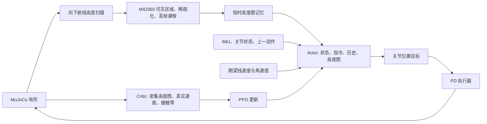

# 仓库感知运控解析与 Go2W 训练迁移

## 1. 原仓库如何实现感知运控

这是一个速度指令驱动的局部地形感知强化学习控制器。策略直接输出关节动作；当前训练链路没有单独的全局建图、路径规划、落脚点规划模块，也没有独立的点云网络或 teacher/student 蒸馏阶段。



| 环节 | 代码位置 | 实际作用 |
| --- | --- | --- |
| 训练入口 | `scripts/train.py` | 注册任务、构建环境、PPO 学习、恢复 checkpoint |
| 公共任务 | `src/tasks/velocity/velocity_env_cfg.py` | 场景、观测、奖励、随机化、课程、200 Hz 仿真 / 50 Hz 策略 |
| G1 适配 | `src/tasks/velocity/config/g1/env_cfgs.py` | G1 关节、足端接触、楼梯地形、感知 v1/v2 和精调 |
| 仿真感知 | `src/tasks/velocity/mdp/observations.py` | 高度扫描、MID360 可见区域掩码、稀疏化和记忆 |
| PPO | `src/tasks/velocity/config/g1/rl_cfg.py` | Actor/Critic MLP，隐藏层 512/256/128，ELU，观测归一化 |
| 模型导出 | `src/tasks/velocity/rl/runner.py` | 保存 checkpoint 时同步导出 ONNX 和元数据 |
| G1 真机感知 | `deploy/robots/g1/src/State_RLBase.cpp` | 订阅 DDS PointCloud2，外参及姿态变换，局部网格聚合 |

**高度图表达：** 网格大小 1.6 × 1.0 m、分辨率 0.1 m，共 17 × 11 = 187 个采样值，按 `iy * 17 + ix` 展平。数值是射线起点到地形的向下距离，经 `1 / 5` 缩放；缺失值为 5 m。它不是已经减去机体高度的地面绝对高程，也不是直接把原始点云送进网络。

**G1 感知 v2：** Actor 用 3 帧历史，Critic 用 1 帧。500–2500 次迭代逐渐从密集高度图切换到带 MID360 可见区域的高度图，2500–6000 次迭代进一步增加稀疏化和丢帧。这里迭代数按每次 PPO 采样 24 个控制步换算，代码中的课程实际上读取 `common_step_counter`。传感器噪声、延迟、关节编码器偏差、摩擦和质心扰动用于缩小仿真到实机差异。

**记忆：** `bridged_mid360_height_scan_memory` 保存最近 0.8 s 的扫描值，用前向速度积累到 0.1 m 后平移网格，为脚下盲区提供历史数据。现有实现只补偿正向 X 位移，不补偿侧移、倒退、偏航及机体高度变化；大幅转弯或上台阶时存在误差。本次 Go2W 复用此机制，初期采用较慢前进命令；硬件部署前仍需扩展完整位姿补偿。

**奖励和控制：** PPO 根据速度跟踪、身体姿态、动作平滑、关节限制、接触等信号学习。G1 用默认站立姿态加策略动作缩放得到关节目标，再由 PD 执行器产生力矩。Critic 可看真实速度、密集高度图与足端接触；Actor 不依赖这些额外真值。仓库现有 `*-Rough` 任务已经给 Actor 输入密集高度图，不能简单视为“盲走”。

**真机链路的实际边界：** G1 C++ 控制器将点云变换到去偏航的机体坐标系，以每个网格内最高点计算向下距离，再送入 ONNX。检查当前 `LidarHeightScanUpdater::update_once()`，其部署侧使用当前帧网格，没有对应训练中的 0.8 s 历史平移记忆；当前网格代码也是居中裁剪，需要核对 v2 的前移网格。`config.yaml` 中感知状态还开启了 `dry_run_no_actuation: true`。因此仓库提供了训练和部署代码，但不能仅凭 README 就认定任意 v2 模型已与真机感知完全对齐。

## 2. Go2W 迁移内容

机器人来自宇树官方 [unitree_mujoco Go2W 模型](https://github.com/unitreerobotics/unitree_mujoco/tree/1eb6642e3f3fdfb7fb13a9794fd6a2dd93ea0e7d/unitree_robots/go2w)，保留链路变换、质量、惯量与关节范围。来源和 BSD 许可证保存在 `src/assets/robots/unitree_go2w/`。网格文件可直接使用，共用的 Go2 外观网格通过相对路径引用。

| 项目 | Go2W 实现 |
| --- | --- |
| 机器人 | 12 个腿关节 + 4 个连续轮关节，浮动基座 |
| 动作前 12 维 | 腿关节默认姿态 + `0.5 * action` rad |
| 动作后 4 维 | `20 * action` rad/s 的轮子速度目标，零偏置 |
| 动作裁剪 | 归一化动作限制在 [-1, 1]，在缩放之前裁剪 |
| 执行器 | 腿使用 PD 位置控制，轮子使用速度控制；轮子力矩上限 15 Nm |
| 关节观测 | 12 维腿位置、12 维腿速度、4 维轮速度；不输入累计轮转角 |
| 奖励 | 姿态和关节位置限制只选腿关节；加入轮子停转与速度代价 |
| 接触打滑 | 参考 `robot_lab.wheel_spin_contact`，以当前法向接触力门控轮周速度与轮体 COM 平移速度的差值 |
| 行走先验 | 移除四足固定腾空步态与强制足端抬高奖励，允许自主选择滚动和跨步 |
| 地形 | 2–14 cm 渐进台阶、坡道和粗糙地形；上台阶精调将上行楼梯占比设为 60% |
| 感知 | v2 使用与 G1 相同的稀疏化课程、丢帧和短时记忆；密集/稀疏观测共用同一前移网格和射线结果 |
| 导出 | ONNX 附带每个动作的关节名称、位置/速度类型、缩放、偏置、控制周期和历史长度 |

动作顺序由 mjlab 1.2.0 按模型自然关节顺序解析：

```text
FL_hip, FL_thigh, FL_calf,
FR_hip, FR_thigh, FR_calf,
RL_hip, RL_thigh, RL_calf,
RR_hip, RR_thigh, RR_calf,
FL_wheel, FR_wheel, RL_wheel, RR_wheel
```

上面省略 `_joint` 后缀。这与 SDK 的电机顺序不同，实机适配必须使用导出的 `action_joint_names` 映射，不能直接把 16 维动作按索引发给 SDK。

感知任务 Actor 单帧 242 维，3 帧展平后 **726 维**；Critic **269 维**；动作 **16 维**。mjlab 先展平每个观测项的历史再拼接各项，并非把三个完整帧直接拼在一起。平地任务移除高度图，Actor **165 维**、Critic **82 维**。粗糙地形 / v1 / v2 / 精调的观测项顺序与维度保持一致，可以恢复同一 Go2W 系列 checkpoint。Go2/G1 checkpoint 不能直接加载，Go2W Flat checkpoint 也不能直接用于感知任务。

新文件入口：

- `src/assets/robots/unitree_go2w/go2w_constants.py`：模型、初始姿态、执行器、碰撞配置。
- `src/tasks/velocity/config/go2w/env_cfgs.py`：场景、动作、观测、地形和感知课程。
- `src/tasks/velocity/config/go2w/rl_cfg.py`：PPO 参数与日志目录。
- `src/tasks/velocity/mdp/wheel_rewards.py`：滚动接触和停车奖励。
- `src/tasks/velocity/rl/go2w_runner.py`：混合动作 ONNX 元数据。

接触打滑采用本地 `robot_lab`（检查时 HEAD 为 `1a8193f`）中 `source/loco_lab/loco_lab/tasks/physx/mdp/rewards/rewards.py::wheel_spin_contact` 的定义；该文件的版权与 Apache-2.0 标识保留在迁移文件头部。此处做了 mjlab 数据接口适配，公式为：

```text
contact_i = ||sum_j (normal_force_ij * normal_direction_ij)|| > 1 N
spin_i = max(0.8 * R * abs(wheel_joint_speed_i) - ||wheel_COM_velocity_i|| - 0.1, 0)
reward_term = -0.15 * sum_i(contact_i * spin_i)
```

沿用参考实现的 `0.8` 容差系数、`0.1 m/s` 死区和 `1 N` 阈值；`R` 使用 Go2W 的 `0.086 m`，权重保留本次迁移初值 `-0.15`，并非照搬其他机器人的训练权重。原先的 `wheel_slip` 和几何接触点速度近似已移除。mjlab 新增独立的 `wheel_spin_contact` 传感器，每轮 8 个原始接触槽，从真实接触法向和接触坐标系的法向力分量求和，排除切向摩擦力；原有接触观测的维度不变。这一项衡量接触时的过度空转，不包含单独的侧滑惩罚。

## 3. 安装与训练

建议按原仓库使用 Ubuntu、Python 3.11 和 NVIDIA CUDA 环境。`setup.py` 固定 `mjlab==1.2.0`、`mujoco==3.5.0`、`mujoco-warp==3.5.0`、`warp-lang==1.12.0`，并补上地形模块需要的 SciPy；避免新版本 MuJoCo 删除旧版 Warp 所需枚举导致导入失败。先按 mjlab 安装说明准备 CUDA 版 PyTorch，再在仓库根目录执行：

```bash
pip install -e .
python scripts/list_envs.py
python -m unittest discover -s tests -v
python scripts/smoke_go2w.py --task Unitree-Go2W-Perceptive-Rough-v2
```

冒烟脚本默认使用 4 个环境，检查 reset、32 个控制步、有限观测/奖励、1 次 PPO 更新和 ONNX 导出。输出位于 `logs/go2w_smoke/`；它不是训练收敛或过台阶成功率测试。

可加 `--device cpu --num-envs 2` 进行小规模 CPU 验证，或加 `--fully-sparse` 立即检查最终稀疏感知阶段。`--checkpoint <路径>` 用于检查从兼容 Go2W 感知 checkpoint 恢复。

### 推荐：直接训练 v2

v2 自带密集到稀疏课程，可以从随机初始化开始，不必先训练 Flat 或加载其他机器人权重。

```bash
python scripts/train.py Unitree-Go2W-Perceptive-Rough-v2 \
  --env.scene.num-envs=4096
```

日志：`logs/rsl_rl/go2w_perceptive/<时间>_v2/`，默认本地 TensorBoard，不依赖 W&B 登录。

### 可选：分阶段训练

先学轮腿粗糙地形控制，或者使用 v1 密集感知预训练：

```bash
python scripts/train.py Unitree-Go2W-Rough --env.scene.num-envs=4096
# 或
python scripts/train.py Unitree-Go2W-Perceptive-Rough-v1 --env.scene.num-envs=4096
```

Rough、v1、v2、精调共用 `go2w_perceptive` 实验目录。恢复时显式选择来源运行，避免误选最近一次实验：

```bash
python scripts/train.py Unitree-Go2W-Perceptive-Rough-v2 \
  --env.scene.num-envs=4096 \
  --agent.resume=True \
  --agent.load-run='<来源运行目录名>' \
  --agent.load-checkpoint='model_5000.pt'

python scripts/train.py Unitree-Go2W-Perceptive-Rough-v2-StepUp-Finetune \
  --env.scene.num-envs=4096 \
  --agent.resume=True \
  --agent.load-run='<已训练的v2运行目录名>' \
  --agent.load-checkpoint='model_30000.pt'
```

来源目录名指 `logs/rsl_rl/go2w_perceptive/` 下的子目录。恢复会同时恢复优化器、迭代数和感知课程计数；长时间预训练后切换 v2 可能直接进入稀疏阶段。推荐直接从 v2 开始训练，让课程与策略共同推进。

平地基础验证：

```bash
python scripts/train.py Unitree-Go2W-Flat --env.scene.num-envs=4096
```

### 回放与台阶测试

```bash
python scripts/play.py Unitree-Go2W-Perceptive-Rough-v2 \
  --checkpoint-file=logs/rsl_rl/go2w_perceptive/<运行目录>/model_30000.pt

python scripts/play.py Unitree-Go2W-Perceptive-Rough-v2-Step14-Up \
  --checkpoint-file=logs/rsl_rl/go2w_perceptive/<运行目录>/model_30000.pt
```

`Step14-Up` 将地形固定为 14 cm 上行台阶。它提供测试场景，不能保证未经充分训练的策略一定能够通过。

## 4. 本次迁移的边界与验证

本次实现目标是 Go2W 的训练、回放和策略导出。没有复用 G1 C++ 程序去驱动 Go2W，也没有创建 Go2W 实机控制程序。后续实机对接需要实现 SDK 电机映射、轮速度下发、与训练一致的前移网格和历史顺序、点云外参、完整位姿补偿及感知超时处理；当前模型也未加入实际 MID360 的负载质量。奖励参数和控制增益需要实训调整。

`tests/test_go2w.py` 提供无需 GPU 的模型与配置回归检查：关节/执行器模式、六个任务注册与阶段兼容、接触顺序、固定台阶、robot_lab 空转公式对齐、当前法向接触力门控、停车制动和分环境高度图记忆重置。`scripts/smoke_go2w.py` 提供在目标 CUDA 机器上运行的仿真/PPO/导出检查。完整数千至数万迭代训练及真机性能需要在目标设备上另行评估。

2026-10-22 本地验证结果（Windows、CPU、隔离 Python 环境）：

- 11 项回归检查全部通过，包含与 robot_lab 数值用例对齐、接触力阈值、多接触法向力求和及摩擦力排除；Go2W 完整 mjlab 实体可编译为 23 维 `qpos`、22 维 `qvel`、16 个执行器。
- Flat 和感知 v2：各 2 个环境，完成重置、仿真步进、1 次 PPO 更新、checkpoint 和 ONNX 导出。实测 v2 观测形状为 Actor `(2, 726)`、Critic `(2, 269)`。
- 固定 14 cm 台阶任务：加载 v2 checkpoint，在最终稀疏阶段完成步进和 1 次 PPO 更新；高度图记忆填充指标正常产生。
- 正式 `scripts/train.py` 入口以 2 个环境、1 次迭代跑通配置解析、配置保存、训练及导出；随后通过该入口加载 v2 checkpoint，在 StepUp-Finetune 继续完成 1 次更新。
- 当前机器无可用 NVIDIA CUDA 驱动，未进行 GPU 性能验证、完整收敛训练或真机测试。上述冒烟模型仅用于验证程序链路，不是可部署的训练成果。
- 替换为 robot_lab 接触空转奖励后，重新通过 11 项回归检查，并在 2 个环境、最终稀疏感知阶段完成 8 步仿真、1 次 PPO 更新和 ONNX 校验；观测及动作维度保持兼容。
