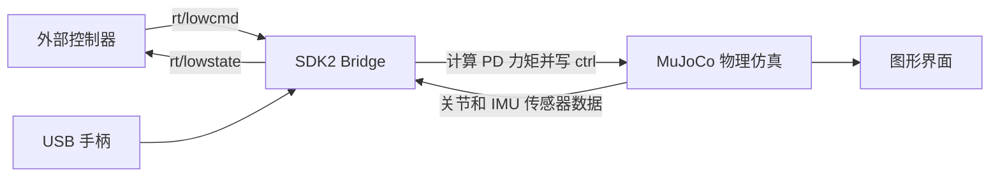
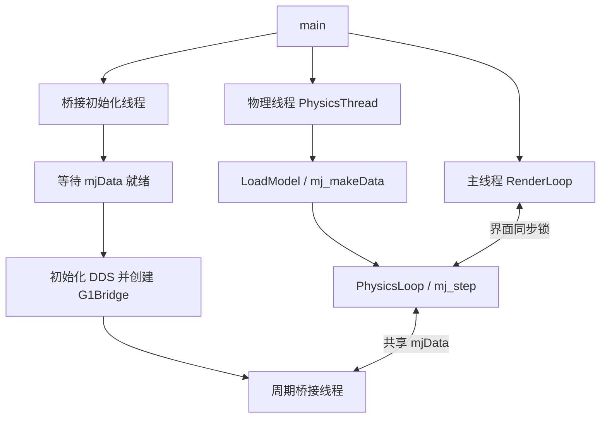
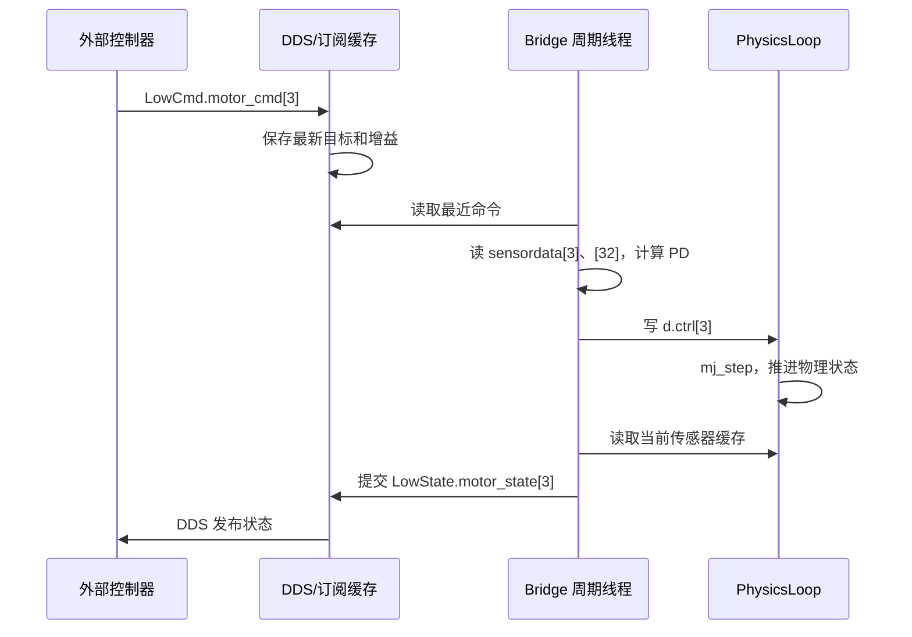

# Unitree MuJoCo 开发者实战手册与 G1 源码参考

核对日期：2026-10-26。本文对应本仓库 `simulate/` 集成的 C++ Unitree MuJoCo 实现，源码位置、字段和值以这份本地实现为准。不同版本的上游 Unitree MuJoCo 可能有不同目录、参数和桥接方式。

本文从开发者的使用与扩展需求出发：怎样构建并启动仿真、创建自己的控制工程、收发 SDK2 消息、接入算法或 ONNX 策略、修改机器人场景、增加传感器，以及调试完整闭环。前半部分按开发步骤组织；后半部分保留源码参考，在需要时解释相应接口。求解器内部推导不作为学习前提。

本文没有修改仿真和控制代码，也没有进行真机操作。后文分别标明源码事实、本地模型核对结果，以及尚未通过完整 C++ 运行复现的实现问题。

## 建议先读：开发实践

| 顺序 | 开发任务 | 可获得的结果 |
| --- | --- | --- |
| A1 | [选择工程边界](#dev01) | 确定自己的代码应该放在哪里 |
| A2 | [构建 SDK 与仿真器](#dev02) | 得到可运行的 G1 仿真进程 |
| A3 | [创建最小控制工程](#dev03) | 一份包含 CMake 和 C++ 主程序的示例 |
| A4 | [理解并改造自己的算法接口](#dev04) | 把通信与控制算法分开 |
| A5 | [接入已有状态机](#dev05) | 给仓库控制器增加自己的状态 |
| A6 | [接入 ONNX 策略](#dev06) | 明确模型、观测、动作和部署配置契约 |
| A7 | [添加地形或机器人模型](#dev07) | 选择和修改自己的 XML 场景 |
| A8 | [增加传感器与 MID360 输入](#dev08) | 理解传感器数据从生成到消费的完整流程 |
| A9 | [调试、复位、退出与真机迁移](#dev09) | 建立可定位问题的开发流程 |
| A10 | [开发验收与源码入口](#dev10) | 按行为验收自己的工程 |

## 源码参考目录

1. [先确定 Unitree MuJoCo 的职责](#s01)
2. [建立源码地图与阅读顺序](#s02)
3. [构建系统：最终运行了什么](#s03)
4. [从 main 开始理解启动流程](#s04)
5. [mjModel、mjData 与 G1 数据结构](#s05)
6. [模型加载与界面交接](#s06)
7. [PhysicsLoop：物理、现实时间与暂停](#s07)
8. [G1 XML：刚体、关节、执行器和传感器](#s08)
9. [桥接类的继承、模板与启动](#s09)
10. [从 LowCmd 到关节力矩](#s10)
11. [从仿真状态到 LowState](#s11)
12. [DDS 订阅和发布的内部路径](#s12)
13. [手柄输入如何进入外部控制器](#s13)
14. [界面、虚拟吊带和复位](#s14)
15. [沿左膝追踪一次完整闭环](#s15)
16. [与部署程序、真机及 MID360 的边界](#s16)
17. [当前集成实现中的限制与问题](#s17)
18. [分阶段学习与调试练习](#s18)
19. [附录：G1 完整索引对照](#s19)
20. [核对方式和验证范围](#s20)

<a id="dev01"></a>
## A1. 先确定自己的代码应该写在哪一层

对开发者，最重要的边界是：**Unitree MuJoCo 运行机器人和场景；自己的程序通过 SDK2 接收状态、发送电机命令。** 大多数控制算法不需要修改仿真器。

| 你要实现的功能 | 首选代码位置 | 是否需要改仿真器 |
| --- | --- | --- |
| 读取 G1 状态、记录日志 | 自己的 SDK2 程序 | 否 |
| 关节 PD、轨迹、步态算法 | 自己的控制程序 | 否 |
| 推理 ONNX 策略 | 自己的控制程序或仓库的 RL 状态 | 通常否 |
| 在已有遥控器状态机中增加算法 | 部署控制器的 FSM | 否 |
| 新地形、障碍物、改变物理参数 | 场景/机器人 XML | 通常只改 XML |
| 新机器人且现有协议、映射仍适用 | 新 XML 与配置 | 先核对协议与索引 |
| 改变消息字段与仿真数据映射 | SDK2 Bridge | 是 |
| 增加需要仿真端生成的传感器数据 | XML、Bridge 和对应发布器 | 是 |
| 设计按物理步同步的控制接口 | 物理/桥接调度层 | 是 |

建议先用独立程序跑通最小闭环，再决定是否迁入仓库状态机。这样通信问题、控制算法问题和框架初始化问题能够分开定位。

### A1.1 三个可以独立开发的模块

```text
RobotIO：SDK2 状态接收、命令发送、时效检查
Controller：用状态和用户指令计算目标
Robot/Scene：XML 里的机器人、地面、障碍与传感器
```

开发自己的 Controller 时，只应关心清楚定义的状态和目标，不应到处访问 DDS 回调对象或 MuJoCo 的全局指针。

### A1.2 先决定使用哪一种接入路线

| 路线 | 适用情况 | 第一步 |
| --- | --- | --- |
| 独立 C++17 + SDK2 | 希望完全掌握接口，自行构建算法 | 按 A2–A4 搭建最小工程 |
| 扩展当前 G1 FSM | 希望复用遥控器、站立、策略切换 | 按 A5 增加状态 |
| 保留现有 RL 部署逻辑 | 已有匹配的 ONNX 与部署参数 | 先按 A6 校验策略契约 |

本文以当前仓库使用的 C++17 路线提供完整示例。已有 Python 算法也可以通过单独的 SDK2 Python 接入层封装，但 Python SDK 的安装和 API 不由这里的 C++ 头文件保证；不要把 Python MuJoCo API 直接当作 SDK2 API。

<a id="dev02"></a>
## A2. 构建 SDK2、启动 G1 仿真

本节命令面向 Linux。它们是供开发者执行的步骤，本次文档整理没有替你安装依赖或执行这些构建。

### A2.1 明确各个构建产物

| 产物 | 谁生成 | 谁使用 |
| --- | --- | --- |
| SDK2 安装目录中的头文件与库 | SDK2 安装流程 | 仿真器、自定义控制工程 |
| `simulate/build/unitree_mujoco` | 仿真器 CMake | 单独启动的仿真进程 |
| `my_g1_ctrl/build/my_g1_ctrl` | 自定义工程 CMake | 单独启动的控制进程 |
| G1 XML 和 assets | 仓库模型资源 | 仿真进程 |
| ONNX、部署 YAML、可选动作文件 | 训练导出及部署准备 | 使用策略的控制进程 |

最小关节控制不需要 ONNX Runtime、训练框架或 GPU。SDK2、仿真器与自定义工程是三个可分别构建/检查的部分。

### A2.2 安装与本仓库匹配的 SDK2

SDK2 的 [CMakeLists.txt](../unitree_sdk2/CMakeLists.txt) 会按架构导入已有 `libunitree_sdk2.a`，并安装头文件、DDS 库和 CMake 包。它不是在这里重新编译全部 SDK 内部实现。

在仓库根目录执行：

```bash
REPO="$(pwd)"
SDK_PREFIX="$HOME/.local/unitree_sdk2_mj"

cmake -S unitree_sdk2 -B unitree_sdk2/build \
  -DBUILD_EXAMPLES=OFF \
  -DCMAKE_INSTALL_PREFIX="$SDK_PREFIX"
cmake --build unitree_sdk2/build -j
cmake --install unitree_sdk2/build
```

独立安装前缀有助于让当前工程明确使用哪一份 SDK。若已有可用安装，可以直接设置 `SDK_PREFIX` 指向它。

需要核对：

- CPU 架构与导入的库目录匹配，例如 x86_64 或 aarch64。
- 安装目录包含 `lib/cmake/unitree_sdk2/unitree_sdk2Config.cmake`。
- 安装的 SDK2、DDS 头文件与库来自匹配的一套安装。
- 仿真器还依赖 GLFW、yaml-cpp、Boost program_options、fmt 等，详见源码参考第 3 节。

### A2.3 构建并运行仿真器

仍在仓库根目录：

```bash
cmake -S simulate -B simulate/build \
  -DCMAKE_BUILD_TYPE=Debug \
  -DCMAKE_PREFIX_PATH="$SDK_PREFIX"
cmake --build simulate/build -j

export LD_LIBRARY_PATH="$SDK_PREFIX/lib:$REPO/simulate/mujoco/lib:$LD_LIBRARY_PATH"
./simulate/build/unitree_mujoco --network=lo --domain_id=0
```

使用 `simulate/build` 这个布局，与程序从可执行文件位置寻找 `simulate/config.yaml` 的逻辑一致。

### A2.4 第一次启动的配置

先使用当前 G1 29DoF 场景：

```yaml
robot: "g1"
robot_scene: "src/assets/robots/unitree_g1/xmls/scene_g1.xml"
domain_id: 0
interface: "lo"
print_scene_information: 1
```

如果有 Xbox 手柄，保留现有的 `use_joystick: 1` 并核对设备路径。无手柄、准备运行 A3 的独立控制程序时，可以把该项改成 0；该独立程序不依赖遥控器切换状态。

当前程序先读取 YAML，再覆盖命令行。`--robot` 不是自动切换 XML 的快捷开关，模型由 `robot_scene` 或 `--scene` 决定。

### A2.5 本阶段的成功标准

成功不是“编译没有报错”这一项，而是：

1. 窗口显示当前 G1 模型。
2. 控制台打印正确的执行器和传感器信息。
3. 出现 `Mujoco data is prepared` 一类桥接就绪输出。
4. 用下一节的只读程序能收到 `rt/lowstate`。

仅启动仿真器时，G1 没有自动站立控制。若想先准备控制程序，可在窗口暂停物理，建立通信和目标后再恢复运行。

<a id="dev03"></a>
## A3. 创建自己的最小 G1 控制工程

这个例子完成两种模式：

- 默认/`--observe`：只订阅状态，不创建电机命令发布器。
- `--stand`：在仿真中，用 3 秒仿真时间将当前关节角插值到本仓库 FixStand 参考姿态。

程序固定连接 domain 0、`lo`，示例目标是当前 G1 29DoF 仿真。它使用 SDK2 通用 Channel API，不依赖仓库的 FSM 或 RL 管理器。参考姿态与增益取自当前 G1 FixStand 配置；动作效果仍需在实际 Linux 仿真环境验证。

### A3.1 工程结构

在仓库旁建立一个自己的目录：

```text
my_g1_ctrl/
├── CMakeLists.txt
└── src/
    └── main.cpp
```

与仿真器分开构建，能明确区分“机器人仿真进程”和“自己的控制进程”。下列代码是文档示例，没有自动写入仓库源码。

### A3.2 CMakeLists.txt

将下面内容保存为自己工程的 `CMakeLists.txt`：

```cmake
cmake_minimum_required(VERSION 3.16)
project(my_g1_ctrl LANGUAGES CXX)

find_package(Threads REQUIRED)
find_package(unitree_sdk2 CONFIG REQUIRED)

add_executable(my_g1_ctrl src/main.cpp)
target_compile_features(my_g1_ctrl PRIVATE cxx_std_17)
target_link_libraries(my_g1_ctrl PRIVATE unitree_sdk2 Threads::Threads)
target_compile_options(my_g1_ctrl PRIVATE -Wall -Wextra)
```

SDK2 的导入目标会传递其头文件和 DDS 链接依赖。不要在每个工程中手动复制一套不匹配的 DDS 库。

### A3.3 src/main.cpp

此示例显式包含状态快照、首次连接超时、状态过期判断、机型检查、单写入方检查、命令 CRC、插值、复位检测和退出前阻尼指令。

```cpp
#include <algorithm>
#include <array>
#include <atomic>
#include <chrono>
#include <cmath>
#include <csignal>
#include <cstdint>
#include <cstring>
#include <iostream>
#include <memory>
#include <mutex>
#include <stdexcept>
#include <string>
#include <thread>

#include <unitree/robot/channel/channel_factory.hpp>
#include <unitree/robot/channel/channel_publisher.hpp>
#include <unitree/robot/channel/channel_subscriber.hpp>
#include <unitree/idl/hg/LowCmd_.hpp>
#include <unitree/idl/hg/LowState_.hpp>

using LowCmd = unitree_hg::msg::dds_::LowCmd_;
using LowState = unitree_hg::msg::dds_::LowState_;
using Clock = std::chrono::steady_clock;
using namespace std::chrono_literals;

constexpr std::size_t kJoints = 29;
volatile std::sig_atomic_t running = 1;
void on_signal(int) { running = 0; }

const std::array<float, kJoints> home = {
    -0.1f, 0, 0, 0.3f, -0.2f, 0,
    -0.1f, 0, 0, 0.3f, -0.2f, 0,
    0, 0, 0,
    0.35f, 0.18f, 0, 0.87f, 0, 0, 0,
    0.35f, -0.18f, 0, 0.87f, 0, 0, 0
};
const std::array<float, kJoints> kp = {
    100,100,100,150,40,40, 100,100,100,150,40,40,
    200,200,200, 40,40,40,40,40,40,40, 40,40,40,40,40,40,40
};
const std::array<float, kJoints> kd = {
    2,2,2,4,2,2, 2,2,2,4,2,2,
    5,5,5, 10,10,10,10,10,10,10, 10,10,10,10,10,10,10
};

// 与当前 SDK G1 示例的 CRC32 算法和消息布局约定一致。
// 这是消息对象上的 SDK 约定，不是通用的 DDS 序列化格式。
uint32_t command_crc(const LowCmd& cmd) {
    static_assert(sizeof(LowCmd) % 4 == 0);
    const auto* bytes = reinterpret_cast<const unsigned char*>(&cmd);
    uint32_t crc = 0xFFFFFFFFu;
    for (std::size_t i = 0; i < sizeof(LowCmd) / 4 - 1; ++i) {
        uint32_t word = 0;
        std::memcpy(&word, bytes + 4 * i, sizeof(word));
        for (uint32_t bit = 0x80000000u; bit != 0; bit >>= 1) {
            const bool top = (crc & 0x80000000u) != 0;
            crc <<= 1;
            if (top) crc ^= 0x04c11db7u;
            if ((word & bit) != 0) crc ^= 0x04c11db7u;
        }
    }
    return crc;
}

struct Snapshot {
    LowState msg{};
    Clock::time_point received{};
    bool valid = false;
};

bool finite_joints(const LowState& state) {
    for (std::size_t i = 0; i < kJoints; ++i) {
        if (!std::isfinite(state.motor_state()[i].q()) ||
            !std::isfinite(state.motor_state()[i].dq())) return false;
    }
    return true;
}

int main(int argc, char** argv) {
    const std::string mode = argc == 2 ? argv[1] : "--observe";
    if (argc > 2 || (mode != "--observe" && mode != "--stand")) {
        std::cerr << "Usage: my_g1_ctrl [--observe|--stand]\n";
        return 1;
    }
    const bool actuate = mode == "--stand";
    std::signal(SIGINT, on_signal);
    std::signal(SIGTERM, on_signal);

    try {
        unitree::robot::ChannelFactory::Instance()->Init(0, "lo");
        Snapshot latest;
        std::mutex state_mutex;

        // 回调只保存快照，不做策略推理或持续打印。
        unitree::robot::ChannelSubscriber<LowState> subscriber("rt/lowstate");
        subscriber.InitChannel([&](const void* data) {
            std::lock_guard<std::mutex> lock(state_mutex);
            latest.msg = *static_cast<const LowState*>(data);
            latest.received = Clock::now();
            latest.valid = true;
        });
        auto read_state = [&]() {
            std::lock_guard<std::mutex> lock(state_mutex);
            return latest;  // 返回副本，离开锁后再计算
        };

        const auto connect_deadline = Clock::now() + 5s;
        Snapshot state = read_state();
        while (running && !state.valid && Clock::now() < connect_deadline) {
            std::this_thread::sleep_for(10ms);
            state = read_state();
        }
        if (!running) return 0;
        if (!state.valid) throw std::runtime_error("No LowState within 5 s");
        if (!finite_joints(state.msg))
            throw std::runtime_error("Invalid joint state");
        if (actuate && state.msg.mode_machine() != 5)
            throw std::runtime_error("This example expects G1-29DoF mode 5");

        std::unique_ptr<unitree::robot::ChannelPublisher<LowCmd>> publisher;
        if (actuate) {
            // 在创建自己的发布器之前，短暂检查已有命令。
            // 这不是跨进程互斥锁；运行时仍需保证只有一个控制器。
            std::atomic<bool> busy{false};
            unitree::robot::ChannelSubscriber<LowCmd> guard("rt/lowcmd");
            guard.InitChannel([&](const void*) { busy.store(true); });
            std::this_thread::sleep_for(200ms);
            guard.CloseChannel();
            if (busy.load())
                throw std::runtime_error("Another controller publishes LowCmd");

            publisher = std::make_unique<
                unitree::robot::ChannelPublisher<LowCmd>>("rt/lowcmd");
            publisher->InitChannel();
        }

        state = read_state();
        if (!state.valid || Clock::now() - state.received > 100ms ||
            !finite_joints(state.msg))
            throw std::runtime_error("Invalid state before controller start");
        std::array<float, kJoints> start{};
        for (std::size_t i = 0; i < kJoints; ++i)
            start[i] = state.msg.motor_state()[i].q();
        const uint32_t initial_tick = state.msg.tick();
        uint32_t previous_tick = initial_tick;
        auto next = Clock::now();
        std::size_t iteration = 0;
        int result = 0;

        while (running) {
            next += 2ms;  // 通信/控制循环目标周期 2 ms
            state = read_state();
            if (Clock::now() - state.received > 100ms ||
                !finite_joints(state.msg)) {
                std::cerr << "Stale or invalid LowState\n";
                result = 2;
                break;
            }

            if (publisher) {
                if (state.msg.mode_machine() != 5 ||
                    state.msg.tick() < previous_tick) {
                    std::cerr << "Robot mode changed or simulation reset\n";
                    result = 2;
                    break;
                }
                previous_tick = state.msg.tick();
                // 使用仿真 tick，使暂停/慢放时插值也跟随仿真时间。
                const float alpha = std::clamp(
                    static_cast<float>(state.msg.tick() - initial_tick) / 3000.0f,
                    0.0f, 1.0f);
                LowCmd cmd{};
                cmd.mode_pr() = 0;
                cmd.mode_machine() = 5;
                for (std::size_t i = 0; i < kJoints; ++i) {
                    auto& motor = cmd.motor_cmd()[i];
                    motor.mode() = 1;
                    motor.q() = (1.0f - alpha) * start[i] + alpha * home[i];
                    motor.dq() = 0;
                    motor.kp() = kp[i];
                    motor.kd() = kd[i];
                    motor.tau() = 0;
                }
                cmd.crc() = command_crc(cmd);
                if (!publisher->Write(cmd)) {
                    std::cerr << "DDS Write failed\n";
                    result = 2;
                    break;
                }
            }

            if (iteration++ % 250 == 0) {
                std::cout << "tick=" << state.msg.tick()
                          << " knee_q=" << state.msg.motor_state()[3].q()
                          << " mode=" << static_cast<int>(state.msg.mode_machine())
                          << (publisher ? " control\n" : " observe\n");
            }
            std::this_thread::sleep_until(next);
            if (Clock::now() > next + 20ms) next = Clock::now();
        }

        // 仿真 Bridge 没有命令超时停用逻辑，退出前主动替换旧目标。
        // 多次发送也不等同于对方已确认收到。
        if (publisher) {
            LowCmd brake{};
            brake.mode_pr() = 0;
            brake.mode_machine() = 5;
            for (std::size_t i = 0; i < kJoints; ++i) {
                brake.motor_cmd()[i].mode() = 1;
                brake.motor_cmd()[i].kp() = 0;
                brake.motor_cmd()[i].kd() = 3;
            }
            brake.crc() = command_crc(brake);
            for (int i = 0; i < 10; ++i) {
                publisher->Write(brake);
                std::this_thread::sleep_for(2ms);
            }
            publisher->CloseChannel();
        }
        subscriber.CloseChannel();
        return result;
    } catch (const std::exception& error) {
        std::cerr << error.what() << "\n";
        return 3;
    }
}
```

### A3.4 构建和运行自己的工程

在 `my_g1_ctrl` 目录执行，`SDK_PREFIX` 指向 A2 的 SDK 安装目录：

```bash
SDK_PREFIX="$HOME/.local/unitree_sdk2_mj"

cmake -S . -B build \
  -DCMAKE_BUILD_TYPE=Debug \
  -DCMAKE_PREFIX_PATH="$SDK_PREFIX"
cmake --build build -j

export LD_LIBRARY_PATH="$SDK_PREFIX/lib:$LD_LIBRARY_PATH"

# 终端 1 已经启动 Unitree MuJoCo；此处在终端 2 执行
./build/my_g1_ctrl --observe
```

预期能看到 `tick`、左膝角度和机型。暂停仿真时 `tick` 可以保持不变，但状态消息仍持续到达，因此消息新鲜度检查不必然超时。

退出观察模式，确保没有其他电机命令发布程序，然后运行：

```bash
./build/my_g1_ctrl --stand
```

如果先暂停物理，可以先让程序接收状态和发布初始目标，再恢复物理。插值使用仿真 `tick`，暂停时不会提前消耗三秒插值时间。

### A3.5 这个例子中，哪些地方是你自己的代码

| 模块 | 示例实现 | 后续如何替换 |
| --- | --- | --- |
| 状态接收 | SDK2 回调拷贝 Snapshot | 增加需要的 IMU/传感器状态 |
| 状态时效 | 本地接收时间与当前时间比较 | 加入业务所需的状态有效性规则 |
| 算法 | `start → home` 线性插值 | 换成轨迹、步态或策略 |
| 电机输出 | q/dq/kp/kd/tau 五个字段 | 保持接口，改变目标生成方式 |
| 计时 | 现实时间调度 + 仿真 tick 插值 | 按任务选择时钟和暂停行为 |
| 退出 | 主动发阻尼目标 | 按控制任务定义结束状态 |

SDK 消息给了 35 个电机槽位，当前 G1 模型只有 29 个执行器。示例只启用前 29 个，其余由默认初始化保留为未启用状态；不要把数组容量当成机型实际关节数。

### A3.6 示例的验证范围

示例 API、消息字段、CRC 规则及增益来源按当前仓库头文件和 G1 示例核对。当前整理环境未完成该示例的 Linux C++ 编译、DDS 运行和站立闭环测试，因此它是完整的开发起点，不是已验证的动作效果报告。

代码中 200 ms 的命令监听只用于发现已经存在的发布器，不能阻止之后新启动的另一个控制器。接收状态时也没有增加 LowState CRC 校验；正式工程可参照 SDK 的 G1 低层示例补充，并为异常路径设计统一的输出收尾。

<a id="dev04"></a>
## A4. 把示例改成自己的控制算法

### A4.1 首先分开三种数据

```cpp
struct RobotState {
    std::array<float, 29> q;
    std::array<float, 29> dq;
    std::array<float, 4> quat_wxyz;
    std::array<float, 3> gyro;
    uint32_t tick;
};

struct JointTargets {
    std::array<float, 29> q;
    std::array<float, 29> dq;
    std::array<float, 29> kp;
    std::array<float, 29> kd;
    std::array<float, 29> tau_ff;
};

// 接口设计示意：实现时定义自己的 Command 类型。
// JointTargets Controller::update(
//     const RobotState& state, const Command& command, double dt);
```

- `RobotState` 是测量状态，算法只读。
- `JointTargets` 是目标和增益，交给 RobotIO 编码到 SDK2 消息。
- 神经网络原始动作另存为 `raw_action`，不能与上述两者混用。

### A4.2 从最小示例拆出工程结构

```text
my_g1_ctrl/
├── CMakeLists.txt
├── include/
│   ├── robot_types.hpp
│   ├── robot_io.hpp
│   └── controller.hpp
├── src/
│   ├── main.cpp
│   ├── robot_io.cpp
│   └── controller.cpp
└── config/
    └── controller.yaml
```

`main` 负责配置和生命周期，`RobotIO` 负责收发，`Controller` 负责算法。增益、目标姿态、周期和模型路径移入自己的配置，避免以后每次调参数都修改通信实现。

### A4.3 先用简单轨迹验证映射

在已稳定保持的姿态附近，让某个关节目标为：

```text
q_target[i] = q_reference[i] + amplitude * sin(2*pi*frequency*t)
```

开发顺序应为：先确认参考姿态与电机映射，再引入小幅轨迹，记录目标与实测曲线，最后接入更复杂的算法。目标可达性、力矩饱和和接触影响属于控制系统行为，不能只看程序是否持续发送消息。

不要直接在 DDS 回调里运行长时间算法。回调更新快照，计算线程取副本后运行，再把完整目标一次性交给发送线程。

### A4.4 自己选择控制周期

假设算法 50 Hz、命令发送 500 Hz：

```text
算法线程每 20 ms 更新一份 JointTargets
命令线程每 2 ms 发送最近完整目标
仿真 Bridge 按自己的周期执行
物理线程按 timestep 推进
```

实现时对目标快照使用互斥锁、双缓冲或其他明确的数据交接。一次性发布完整快照，避免发送时读到一半新、一半旧的关节目标。

如果只需要简单控制，一个线程完成“取状态 → 计算 → Write”最容易调试。只有测得算法耗时影响发送周期后，再拆线程。

### A4.5 配置并发边界

| 共享对象 | 写入方 | 读取方 | 需要保证什么 |
| --- | --- | --- | --- |
| 最新机器人状态 | DDS 回调 | 控制线程 | 完整快照及接收时间一致 |
| 最新关节目标 | 算法线程 | 发送线程 | 一整帧目标一致 |
| 运行状态/退出标记 | 主线程/信号处理 | 工作线程 | 使用匹配的同步方式 |
| 策略历史 | 推理线程 | 推理线程 | 不被发送线程随意修改 |

最小示例中的 Snapshot 已展示第一项。不要把它替换成所有线程直接读取一个不断被修改的消息对象。

<a id="dev05"></a>
## A5. 在仓库现有 G1 状态机中加入自己的状态

独立程序跑通后，可以选择复用现有的 Passive、FixStand 和遥控器切换。

### A5.1 需要读和改的文件

| 目的 | 位置 |
| --- | --- |
| 添加状态类 | 自己的新头文件/实现文件 |
| 注册状态 | `REGISTER_FSM(State_MyControl)` |
| 让注册代码进入主程序 | 在 G1 `main.cpp` 中 include 新状态头文件 |
| 启用状态并分配 ID | G1 `config.yaml` 的 `FSM._` |
| 配置切换 | 当前状态和新状态的 `transitions` |
| 编译新实现 | G1 CMake 对源文件的收集；新增文件后重新运行 CMake |

源码入口：[BaseState.h](../deploy/include/FSM/BaseState.h)、[FSMState.h](../deploy/include/FSM/FSMState.h)、[CtrlFSM.h](../deploy/include/FSM/CtrlFSM.h)、[G1 main.cpp](../deploy/robots/g1/main.cpp)。

### A5.2 状态生命周期

```text
构造函数：读取配置、分配资源、注册切换条件
enter()：记录当前状态，准备增益和控制目标，启动必要工作线程
run()：当前状态的周期操作
exit()：停止并回收该状态的工作线程
析构：释放对象资源
```

`CtrlFSM` 每个周期执行 `pre_run → run → post_run`，然后检查切换。状态切换的主要次序为 `旧 exit → 新 enter`。

构造并不等于进入状态：当前框架会在启动时构造所有启用状态。因此，未使用的动作文件或模型缺失，也可能阻止整个控制器启动。

### A5.3 配置示意

在已有配置中增加条目，而不是用以下片段覆盖整个文件：

```yaml
FSM:
  _:
    MyControl:
      id: 7
      type: MyControl

  FixStand:
    transitions:
      MyControl: RB + X.on_pressed

  MyControl:
    transitions:
      Passive: LT + B.on_pressed
    # 这里添加自己的姿态、增益、轨迹等参数
```

`type: MyControl` 对应注册名 `State_MyControl`。状态 ID 必须与其他已启用状态不同。配置里的目标状态也必须实际启用。

### A5.4 状态类接入示意

下面演示职责划分，不是一份独立可编译的完整控制算法：

```cpp
class State_MyControl : public FSMState {
public:
    State_MyControl(int id, std::string name)
        : FSMState(id, name) {
        // 从 param::config["FSM"][name] 读取自己的参数。
    }

    void enter() override {
        // 从 lowstate 取得一致的初始快照；
        // 准备目标姿态、增益和算法状态。
    }

    void run() override {
        // 运行自己的算法，填写本帧电机目标。
        // 完整发送与共享数据的持锁方式要遵守控制器整体设计。
    }

    void exit() override {
        // 停止并 join 本状态创建的线程。
    }
};
REGISTER_FSM(State_MyControl)
```

当前 G1 的共享发布路径调用 `unlockAndPublish()` 的位置与发布类要求的持锁约定需要核对，不能因为继承了 FSMState 就认为所有并发边界已经处理完成。A3 使用通用 `ChannelPublisher::Write`，可以先避开这一框架耦合。

### A5.5 构建与启动原控制器

```bash
# 在仓库根目录，依赖已按 G1 CMake 的安装路径配置
cmake -S deploy/robots/g1 -B deploy/robots/g1/build \
  -DCMAKE_BUILD_TYPE=Debug
cmake --build deploy/robots/g1/build -j

# 另一个终端已经运行仿真器
./deploy/robots/g1/build/g1_ctrl --network=lo
```

当前 G1 CMake 与仿真器的 SDK 查找方式不同，包含若干固定 include 路径及裸库名。若 SDK 安装在自定义前缀，需要让该控制器的包含/库搜索路径也匹配，或在自己的工程中采用 A3 的导入目标方式。仅给它传 `CMAKE_PREFIX_PATH`，不保证所有硬编码路径都会自动改变。

### A5.6 当前默认 G1 配置的启动障碍

本次核对发现，默认启用了舞蹈状态，但对应 `dance1_subject2.npz` 不在配置引用目录。由于所有启用状态在初始化阶段构造，控制器可能在进入 Passive 前就因动作文件缺失退出。

开发自己的状态时，应只启用当前确实具备资源的状态，并同步调整切换关系。不要一开始就把“整个默认控制器成功启动”作为理解 SDK2 通信的前提。

<a id="dev06"></a>
## A6. 把自己的 ONNX 策略接入控制闭环

接入策略的开发任务，是把已有算法接口的“目标生成”替换为推理，并保证输入输出与训练一致。

### A6.1 从训练到部署需要交付什么

```text
训练 checkpoint
→ 导出 ONNX
→ 固定观测定义、历史顺序、动作定义和控制参数
→ 准备部署目录
→ 在控制程序加载
→ Unitree MuJoCo 闭环验证
→ 核对硬件条件后迁移真机
```

当前 G1 [VelocityOnPolicyRunner.save](../src/tasks/velocity/rl/runner.py) 会导出 ONNX 并附加部分元数据，但该函数没有同步生成部署使用的全部 YAML。部署参数不能假定由 ONNX 文件自动替你恢复。

推荐自己的部署包包含：

```text
policy_version/
├── exported/
│   ├── policy.onnx
│   └── policy.onnx.data    # 仅当模型使用外部数据时
├── params/
│   └── deploy.yaml
└── 版本说明与验证结果
```

### A6.2 必须逐项匹配的契约

| 项目 | 不匹配时常见表现 |
| --- | --- |
| 输入名称、dtype、shape | 推理接口报错 |
| 观测项顺序 | 维度正确但行为错误 |
| q 的关节顺序与默认姿态 | 相对角度含义错误 |
| IMU 坐标系与四元数排列 | 倾斜/转向响应异常 |
| 观测缩放、裁剪和归一化 | 网络看到的分布不同 |
| 历史长度与堆叠布局 | shape 错误或时序含义改变 |
| 控制周期与步态相位 | 运动节奏不同 |
| 动作顺序、scale、offset、clip | 目标角度错误 |
| PD 增益与执行器语义 | 同样目标得到不同动态响应 |
| 高度扫描网格、缺失值、记忆 | 感知输入含义不同 |

### A6.3 仓库现有 G1 推理链

```text
State_RLBase::enter
→ 设置增益、重置策略状态、启动推理线程
→ ManagerBasedRLEnv::step
→ BaseArticulation::update
→ ObservationManager::compute
→ OrtRunner::act
→ ActionManager::process_action
→ 状态机 run 读取 processed_actions
→ 写 LowCmd.q
→ SDK2 发布
```

这些 C++ 类的 `isaaclab` 命名空间是仓库的部署抽象，不表示运行 G1 控制器需要启动 Isaac Sim。

### A6.4 自己构造 G1 本体观测

普通单帧 G1 速度观测通常在当前配置中为：

```text
角速度 3
+ 重力投影 3
+ 速度指令 3
+ 相位 sin/cos 2
+ 相对关节角 29
+ 关节速度 29
+ 上一次原始动作 29
= 98
```

相对角度是 `q - q_default`；上一次动作是网络原始动作，不是已经缩放后的目标角。重力投影由姿态和世界重力方向计算。速度指令是“希望怎样运动”，不等于实测速度。

当前部署里的 `base_lin_vel` 观测函数返回三个零，不能因有这个函数名就认为已经提供可靠的机身速度估计。

### A6.5 历史堆叠与观测处理

默认 ObservationManager 按项拼历史：

```text
[角速度旧帧, 角速度中间帧, 角速度当前帧,
 重力旧帧,   重力中间帧,   重力当前帧, ...]
```

这不同于按完整时间帧拼接。`use_gym_history` 会改变拼接路径，使用时还要保证各项历史长度满足该实现的假设。

`ObservationTermCfg` 默认先 clip 再 scale；`scale_first` 为真时顺序相反。配置解析按 YAML 项顺序处理该开关，应把组级开关放在需要其生效的观测项之前。

重置历史时会用当前观测填充历史窗口，不是自动读取过去真实发生的若干帧。

### A6.6 输出转换只做一次

```text
raw_action = policy(observation)
q_target   = scale * raw_action + offset
LowCmd.q   = q_target
```

如果 ONNX 已经包含某些预处理或动作转换，控制代码不能再次重复执行。当前自带两个速度 ONNX 的计算图包含归一化相关运算，开发时应检查模型实际图结构和导出方式。

`JointPositionAction` 中的 clip 作用于处理后的目标；它与在原始动作上裁剪不是同一种操作。零原始动作通常对应 offset 姿态。

### A6.7 当前自带模型不能直接当成一致性模板

| 策略目录 | 实际模型输入 | 当前 YAML 构造 | 开发判断 |
| --- | --- | --- | --- |
| velocity/v0 | `[1,98]` | 98 × 3 = 294 | 历史长度不匹配 |
| velocity/unitree_blind_walking | `[1,285]` | 98 + 187 = 285 | 维度匹配，仍需核对感知语义 |
| mimic/dance1_subject2 | `[1,154]` | 154 | 还需要动作 NPZ 资源 |

当前工作区的 [OrtRunner](../deploy/include/isaaclab/algorithms/algorithms.h) 已在推理前检查实际观测长度及有限值，因此 v0 的这一不匹配会触发检查，而不是应被理解为正常可部署。它还提供元数据校验方法，但 G1 的现有加载路径没有因此自动完成全部元数据校验。

v0 模型元数据中的默认姿态与对应 YAML 也不一致。自己的模型应使用一套同时保存并校验的配置，不要把改动后的任意 YAML 与旧模型拼在一起。

### A6.8 推理与发送的线程边界

当前 G1 RL 状态的推理线程更新 ActionManager，而状态机线程读取处理后动作；该管理器中没有看到完整的跨线程快照锁。自己的程序应在推理完成后交出一份完整目标，再由发送线程取副本。

异常也要跨线程处理：推理失败应保存错误并通知主循环进入结束状态，而不是让工作线程中的异常未经处理直接终止进程。

<a id="dev07"></a>
## A7. 给自己添加地形或机器人模型

### A7.1 增加一个 G1 场景

最简单的做法是复制当前 `scene_g1.xml` 到同一目录，例如 `scene_g1_stairs.xml`，保留现有机器人、执行器和传感器排列，然后只增加场景物体。文件放在同一目录可继续使用相同的相对 mesh 路径。

在已有的场景 `worldbody` 内加入以下障碍物，而不是再添加一个根 `mujoco`：

```xml
<geom name="step_10cm"
      type="box"
      pos="1.2 0 0.05"
      size="0.4 0.5 0.05"
      rgba="0.6 0.6 0.6 1"/>
```

box 的 size 是半尺寸。这个物体长 0.8 m、宽 1.0 m、高 0.1 m，底部位于 z=0。

然后从仓库根目录运行：

```bash
./simulate/build/unitree_mujoco \
  --robot=g1 \
  --scene=src/assets/robots/unitree_g1/xmls/scene_g1_stairs.xml \
  --network=lo --domain_id=0
```

增加台阶不等于控制策略会爬台阶；先验证物体位置和接触，再验证对应控制算法。

### A7.2 加入自己的机器人前要准备什么

| 内容 | 开发要求 |
| --- | --- |
| body/joint | 运动链、质量和惯量合理 |
| actuator | 每个输出对应哪个关节、输入是什么单位 |
| sensor | 位置、速度、力等来源与维度 |
| SDK2 消息类型 | GO/HG 或自己的协议不能混用 |
| 关节映射 | 策略顺序、XML 顺序、SDK 顺序明确对应 |
| 机型字段 | 不能仅依赖当前场景文件名约定 |
| 初始状态 | 与控制程序的起始目标一致或可平滑过渡 |

当前仿真按执行器数量大于 20 选择 G1Bridge。它不是通用机器人自动识别系统。新机器人的关节数和消息类型不符合这个约定时，应显式扩展桥接选择和映射。

### A7.3 不要让模型变化静默破坏协议

当前桥接假定关节传感器按“全部位置 → 全部速度 → 全部力矩”排列。换模型时，至少核对：

```text
nu
执行器名称及顺序
每个执行器指向的 joint
传感器名称、维度、地址
motor_cmd[i] 与实际关节的对应关系
```

完整 G1 索引见源码参考第 19 节。若希望支持多机器人，建议启动时按名称构建显式映射并校验，而不是把 29、偏移量和顺序散落在业务代码中。

<a id="dev08"></a>
## A8. 增加传感器，或接入 MID360

### A8.1 增加 MuJoCo 传感器的完整工作

一个传感器从模型到算法，至少经过四个环节：

```text
XML 定义 sensor/site
→ 仿真计算 sensordata
→ Bridge 按名称取地址并编码消息
→ 控制程序订阅、转换并交给算法
```

只改 XML，不会自动扩展 SDK2 消息或外部控制器状态结构。

例如，在现有 sensor 列表末尾增加：

```xml
<framepos name="debug_torso_position"
          objtype="body"
          objname="torso_link"/>
```

放在末尾可以保留当前已使用的关节传感器前缀地址，但仍应重新打印并核对。

读取时按名称查找，并检查维度：

```cpp
const int id = mj_name2id(model, mjOBJ_SENSOR, "debug_torso_position");
if (id < 0 || model->sensor_dim[id] != 3) {
    throw std::runtime_error("Missing or incompatible torso position sensor");
}
const int address = model->sensor_adr[id];
// 在拥有一致物理快照的线程/同步区域读取：
// data->sensordata[address + 0 ... address + 2]
```

不要从一个未经同步的第三方线程任意访问共享 mjData。

### A8.2 传感器数据如何发送给自己的程序

可以映射到现有消息中语义匹配的字段，也可以新建独立 topic。新消息需要 DDS 可识别的消息类型和相应类型支持，不能把任意 C++ struct 直接作为已经可通信的 DDS 类型。

为新 topic 写清楚：名称、类型、单位、参考坐标系、时间戳来源、发布频率、有效性与缺失表示。控制算法收到数据时，再按这些约定检查时效和转换坐标。

### A8.3 当前 MID360 部署代码已经做了什么

G1 [State_RLBase.cpp](../deploy/robots/g1/src/State_RLBase.cpp) 中的 LidarHeightScanUpdater 实现：

```text
订阅 PointCloud2
→ 查 float32 x/y/z 字段
→ 外参变换到 pelvis
→ 去除整体偏航，得到 yaw 对齐的相对坐标
→ 区域与高度过滤
→ 分到 17 × 11 格
→ 每格保留最高点
→ 高度距离与缺失值处理
→ 写高度扫描快照
→ 观测管理器读取并缩放
```

默认点云处理 10 Hz，策略 50 Hz，输入更新频率并不相同。格子输出使用 `clip(-z_max,0,5)`，缺失格填 5，观测配置再乘 0.2。

### A8.4 哪些工作仍需要开发者实现

| 使用场景 | 你需要接入的生产者 |
| --- | --- |
| 真实 MID360 | 驱动产生的点云以及正确的 DDS/ROS 2 桥接配置 |
| Unitree MuJoCo 仿真感知 | 仿真端的射线/点云生成与 PointCloud2 发布 |
| 直接使用高度网格接口 | 自己定义并统一网格消息与控制侧处理 |

当前普通 Unitree MuJoCo 没有 MID360 点云生产链路。现有控制侧订阅器不会让仿真端自动获得雷达。

还需逐项核对：安装外参、topic 与消息类型、坐标系、时间戳、网格中心和排序、缺失值，以及稀疏化/记忆。当前 G1 V2 训练中的前移网格、三帧历史和记忆机制，不等于当前 285 维部署包已经实现了相同处理。

### A8.5 调试感知时如何区分故障

```text
完全收不到消息 → 先查生产者、类型、domain、topic、网络
收到消息但有效格为零 → 查字段类型、外参、坐标轴、过滤范围
有效格有值但运动异常 → 查网格顺序、缩放、历史、模型训练契约
```

当前 `dry_run_no_actuation: true` 会使推理继续，但输出增益和前馈为零；它不会保持 FixStand 支撑。不能把“只看感知调试”理解为电机仍在执行原站立控制。

<a id="dev09"></a>
## A9. 调试、复位、退出与真机迁移

### A9.1 按层建立调试信息

| 层 | 建议观察的数据 | 能定位的问题 |
| --- | --- | --- |
| 模型加载 | XML 路径、nu、传感器表 | 模型/资源与映射 |
| DDS 收发 | 接收计数、接收年龄、mode_machine、tick | 连接和时效 |
| 算法输入 | 观测维度、分项值、有效性 | 预处理错误 |
| 算法输出 | 原始动作、处理后目标 | 模型与动作转换 |
| 电机接口 | q/dq/kp/kd/tau | 输出编码和增益 |
| 仿真执行 | ctrl、实际 q/dq、限幅 | 映射、动力学和接触 |

高频循环不应每一帧打印大量内容。按较低频率显示摘要，或由单独日志线程记录快照。

### A9.2 一个关节不按预期运动，按什么顺序查

1. 收到的状态对应的是当前 G1、当前运行实例吗？
2. 目标与实测是不是同一个关节、同一个单位？
3. 写入的是原始动作还是已经转换后的目标角？
4. kp/kd/tau 是否符合预期，是否被另一个状态重写？
5. 同一 topic 是否有另一个命令发布者？
6. Bridge 写入的 ctrl 对应哪个 actuator？
7. 模型是否暂停、执行器是否限幅、关节是否碰到限制或障碍？

这里每一步都能对应到明确变量，而不是反复更换策略文件。

### A9.3 复位要同时考虑哪些状态

窗口 Backspace 只重置物理数据。自己的程序应定义如何识别复位，并处理：

- 起始姿态和轨迹起点。
- 策略历史、上一次动作、相位和记忆。
- 最近发送命令。
- 时间基准与接收状态。

A3 通过 tick 回退结束当前控制，而不是继续使用复位前的轨迹。长期运行时 tick 回绕与业务复位的区分也应加入正式设计。

### A9.4 退出不等于机器人命令自动失效

当前仿真 Bridge 会继续使用最后缓存命令，没有基于 LowCmd 超时自动停用它。自己的程序应定义结束输出；A3 在正常循环退出时发送阻尼命令。

控制进程被强制终止、程序崩溃或网络断开时，这段收尾不一定执行。因此，正式系统还需要机器人/桥接接收端的命令时效设计，不能只依赖发送端退出函数。

仿真器关闭窗口的当前路径也不是所有工作线程逐一停止、join、再释放的完整服务生命周期。开发热重载或长驻服务时，需要先停用 Bridge，再释放它仍引用的模型和数据。

### A9.5 真机迁移时，哪些代码可以复用

可以复用 RobotState/JointTargets、算法、模型加载和部分 SDK2 编码；状态生产者和电机执行端由仿真换成真实 G1。

但仍需完成具体硬件的机型/控制模式、底层控制器独占、关节顺序、限幅、增益、传感器坐标与偏差、状态/命令超时及退出行为核对。真机运行还要遵循该设备实际版本的低层控制准备流程。

A3 固定使用 lo，不能作为原样执行的真机程序。把网卡改成实体接口，只解决通信路径，不等于上述硬件工作已经完成。

<a id="dev10"></a>
## A10. 用可观察行为验收自己的工程

### A10.1 逐步验收

| 阶段 | 输入 | 应看到的结果 | 失败时返回哪一层 |
| --- | --- | --- | --- |
| 仿真启动 | 当前 G1 XML | 模型与传感器信息正确 | 配置、资源、构建 |
| 只读通信 | --observe | tick 与关节状态持续输出 | SDK2 类型、domain、网卡 |
| 目标插值 | --stand | 目标按仿真时间变化，实际状态有响应 | 目标、增益、映射 |
| 自己的轨迹 | 小幅轨迹目标 | 目标/实测曲线可解释 | 控制算法及物理限制 |
| 策略推理 | 匹配 ONNX+YAML | 维度和数值检查通过，目标可解释 | 观测、动作契约 |
| 感知接入 | 有效点云/网格 | 生产者到观测全链路可追踪 | 消息、坐标、网格 |
| 生命周期 | 暂停、复位、正常退出 | 行为符合事先定义 | 时钟、缓存、收尾 |

### A10.2 开发时最常查的源码入口

| 开发问题 | 直接查阅 |
| --- | --- |
| 自己如何订阅和发布 | [channel_subscriber.hpp](../unitree_sdk2/include/unitree/robot/channel/channel_subscriber.hpp)、[channel_publisher.hpp](../unitree_sdk2/include/unitree/robot/channel/channel_publisher.hpp) |
| G1 字段类型和容量 | [LowCmd_.hpp](../unitree_sdk2/include/unitree/idl/hg/LowCmd_.hpp)、[LowState_.hpp](../unitree_sdk2/include/unitree/idl/hg/LowState_.hpp) |
| 命令如何作用于仿真 | [unitree_sdk2_bridge.h](../simulate/src/unitree_sdk2_bridge.h) |
| 自己怎样增加状态 | [BaseState.h](../deploy/include/FSM/BaseState.h)、[G1 config.yaml](../deploy/robots/g1/config/config.yaml) |
| 策略输入如何计算 | [observations.h](../deploy/include/isaaclab/envs/mdp/observations/observations.h)、[ObservationManager](../deploy/include/isaaclab/manager/observation_manager.h) |
| 推理与动作转换 | [OrtRunner](../deploy/include/isaaclab/algorithms/algorithms.h)、[joint_actions.h](../deploy/include/isaaclab/envs/mdp/actions/joint_actions.h) |
| 手柄如何变成宇树输入 | [physics_joystick.h](../simulate/src/physics_joystick.h) |
| 模型结构如何改变 | [scene_g1.xml](../src/assets/robots/unitree_g1/xmls/scene_g1.xml) |

实际阅读顺序建议为：**A2 构建 → A3 最小工程 → A4 自己的算法 → 按需要进入 A5/A6/A7/A8 → A9 生命周期。** 后面的源码参考用于回答具体接口为什么这样工作，而不是要求先学完全部内部实现才开始开发。

---

<a id="s01"></a>
## 1. 先确定 Unitree MuJoCo 的职责

可以把系统拆为三层：

```text
外部控制程序：站立、RL 策略、动作模仿等
                │ LowCmd / LowState
                ▼
Unitree MuJoCo：场景加载、图形界面、手柄、SDK2 桥接、电机接口转换
                │ mjModel / mjData / MuJoCo API
                ▼
MuJoCo 引擎：动力学、碰撞检测、接触约束、执行器计算和数值积分
```

Unitree MuJoCo 将一个 MuJoCo 物理机器人，通过 SDK2 消息接口提供给控制程序使用。加载 G1 模型并不自动提供行走算法。没有控制程序时，模型仍会受重力、关节被动力和接触影响。

三种常见运行方式的验证对象不同：

| 方式 | 物理/状态来源 | 控制算法位置 | 验证对象 |
| --- | --- | --- | --- |
| mjlab 的 `scripts/play.py` | mjlab 环境 | Python | 策略在训练框架中的表现 |
| Unitree MuJoCo 仿真部署 | 独立 C++ 仿真器 | 外部部署程序 | SDK2 通信、部署观测、电机接口和策略闭环 |
| 真机部署 | 真实传感器和机器人 | 外部部署程序 | 实际机器人上的完整控制效果 |

本指南重点讲第二行中的仿真器。

### 1.1 两个消息方向

| 通道 | 仿真器角色 | 内容 |
| --- | --- | --- |
| `rt/lowcmd` | 订阅 | 电机目标位置、目标速度、PD 增益、前馈力矩等 |
| `rt/lowstate` | 发布 | 关节位置、速度、执行器力矩读数、IMU、遥控器数据等 |

对当前 G1，两者主要使用 `unitree_hg` 消息类型。话题名相同还不够，通信双方也需要匹配 DDS domain、可达网络及消息类型。



<a id="s02"></a>
## 2. 建立源码地图与阅读顺序

下列路径均以仓库根目录为基准。链接从本文所在的 `doc/` 目录解析，便于随仓库移动。

| 文件 | 职责 | 第一遍阅读要回答的问题 |
| --- | --- | --- |
| [simulate/CMakeLists.txt](../simulate/CMakeLists.txt) | 编译、链接、可执行目标 | 主程序包含哪些源文件和库？ |
| [simulate/config.yaml](../simulate/config.yaml) | 场景、DDS、手柄、吊带配置 | 仿真器将加载谁、连接哪里？ |
| [simulate/src/param.h](../simulate/src/param.h) | YAML 与命令行解析 | 配置如何进入内存？ |
| [simulate/src/main.cc](../simulate/src/main.cc) | 启动、模型加载、物理循环、键盘回调 | 哪些线程在做什么？ |
| [simulate/src/unitree_sdk2_bridge.h](../simulate/src/unitree_sdk2_bridge.h) | MuJoCo 与 SDK2 双向转换 | 命令如何变成控制输入？ |
| [scene_g1.xml](../src/assets/robots/unitree_g1/xmls/scene_g1.xml) | G1 物理模型与场景 | 电机和传感器按什么顺序排列？ |
| [simulate/src/physics_joystick.h](../simulate/src/physics_joystick.h) | Xbox/Switch 到宇树手柄的映射 | 原始轴和按钮怎样被解释？ |
| [simulate/src/joystick/joystick.cc](../simulate/src/joystick/joystick.cc) | Linux 手柄设备读取 | 输入事件从哪里来？ |
| [simulate/mujoco/simulate/simulate.cc](../simulate/mujoco/simulate/simulate.cc) | 图形界面与显示同步 | 渲染线程如何接收和显示状态？ |
| [Subscription.h](../unitree_sdk2/include/unitree/dds_wrapper/common/Subscription.h) | 消息订阅缓存和超时判断 | DDS 回调怎样保存新命令？ |
| [Publisher.h](../unitree_sdk2/include/unitree/dds_wrapper/common/Publisher.h) | 发布线程与数据交接 | 填好消息后由谁真正发送？ |
| [g1_pub.h](../unitree_sdk2/include/unitree/dds_wrapper/robots/g1/g1_pub.h) | G1 发布包装 | 遥控器和 CRC 在哪里加入？ |
| [g1_sub.h](../unitree_sdk2/include/unitree/dds_wrapper/robots/g1/g1_sub.h) | G1 订阅包装 | G1 的 LowCmd/LowState 使用哪些类型？ |

`main.cc` 中平台路径处理、插件扫描和图形界面样板占了不少篇幅。第一遍先抓以下函数，再补细节：

| 函数/类 | 当前源码起始行 | 职责 |
| --- | ---: | --- |
| `ElasticBand` | `main.cc:54` | 计算虚拟弹簧与阻尼外力 |
| `LoadModel()` | `main.cc:269` | 加载 XML 或二进制模型 |
| `PhysicsLoop()` | `main.cc:328` | 物理推进和现实时间同步 |
| `PhysicsThread()` | `main.cc:539` | 初始模型加载及物理循环入口 |
| `UnitreeSdk2BridgeThread()` | `main.cc:574` | DDS 初始化及桥接创建 |
| `user_key_cb()` | `main.cc:622` | 自定义键盘操作 |
| `main()` | `main.cc:642` | 程序入口与线程启动 |
| `UnitreeSDK2BridgeBase` | `unitree_sdk2_bridge.h:19` | 模型、传感器、手柄公共初始化 |
| `RobotBridge` | `unitree_sdk2_bridge.h:152` | 通用命令和状态转换 |
| `G1Bridge` | `unitree_sdk2_bridge.h:259` | G1 专用附加消息 |

行号用于本次学习快照定位；源码修改后应优先搜索函数名。

<a id="s03"></a>
## 3. 构建系统：最终运行了什么

### 3.1 两个可执行文件

`simulate/CMakeLists.txt` 中的核心目标是：

```cmake
add_executable(unitree_mujoco ${SIM_SRC} src/main.cc)
add_executable(jstest src/joystick/jstest.cc src/joystick/joystick.cc)
```

- `unitree_mujoco` 是仿真主程序。
- `jstest` 用于查看和排查手柄设备输入。

`SIM_SRC` 包含 MuJoCo 的 GLFW/平台界面代码、`simulate.cc`、手柄驱动和 PNG 相关代码。CMake 特意没有使用 MuJoCo 自带的另一个 `main.cc`，实际程序入口由本仓库提供。

### 3.2 主要依赖

| 依赖 | 用途 |
| --- | --- |
| `mujoco` | 物理引擎与相关 API |
| `glfw` | 窗口、输入事件及图形上下文 |
| `unitree_sdk2` | DDS 通信和宇树消息接口 |
| `yaml-cpp` | 配置读取 |
| `Boost program_options` | 命令行参数 |
| `pthread` | 线程支持 |
| `fmt` | 格式化支持 |

头文件来自 `simulate/mujoco/include`，链接搜索路径包含 `simulate/mujoco/lib`。当前附带头文件的 `mjVERSION_HEADER` 为 `336`，对应 3.3.6，库目录也包含 `libmujoco.so.3.3.6`。

实际装载到哪个共享库还会受构建和运行时搜索路径影响。`main()` 会比较头文件版本与 `mj_version()`，不匹配时直接报错。

`find_package(unitree_sdk2 REQUIRED)` 搜索的是已安装 SDK2；仓库中存在 SDK2 源码，并不等于 CMake 一定使用这份源码构建的安装。阅读包装头文件时，也要核对实际安装版本是否包含对应接口。

### 3.3 Linux 构建示例

以下是供已配好依赖的 Linux 环境使用的命令，本文未执行完整 C++ 构建：

```bash
# 在仓库根目录执行
cmake -S simulate -B simulate/build -DCMAKE_BUILD_TYPE=Debug
cmake --build simulate/build -j

./simulate/build/unitree_mujoco
```

当前集成代码依赖 Linux 手柄设备、POSIX 接口和 `.so` 库。它不能仅靠在 Windows 中安装 Python MuJoCo 包，就按上述方式运行完整 C++ 仿真器。

<a id="s04"></a>
## 4. 从 main 开始理解启动流程

### 4.1 main 的执行顺序

以下为按源码整理的阅读伪代码，省略了平台兼容和错误显示细节：

```cpp
检查 MuJoCo 头文件和动态库版本;
扫描插件;
初始化相机、显示选项和交互扰动;

读取 simulate/config.yaml;
解析命令行参数;
将相对场景路径转换为绝对路径;

创建 mujoco::Simulate 界面对象;
启动 UnitreeSdk2BridgeThread;
启动 PhysicsThread;
安装自定义按键回调;

主线程执行 RenderLoop;
```

`mjvCamera`、`mjvOption`、`mjvPerturb` 分别承接相机、显示选项、交互扰动。它们不会自行创建控制策略。

### 4.2 配置文件在哪里

程序通过可执行文件的位置反推目录。对常规布局：

```text
<仓库>/simulate/build/unitree_mujoco
          │
          └─ 配置：<仓库>/simulate/config.yaml

robot_scene 为相对路径时：
<仓库> + src/assets/robots/unitree_g1/xmls/scene_g1.xml
```

因此，把二进制复制到任意目录，可能破坏配置和场景资源定位。当前布局把目录关系也作为运行约定的一部分。

### 4.3 YAML 与命令行的覆盖关系

源码先执行：

```cpp
param::config.load_from_yaml(proj_dir / "config.yaml");
param::helper(argc, argv);
```

命令行绑定到同一个 `param::config`，所以显式提供的参数会覆盖对应 YAML 值。

| 参数 | 修改字段 |
| --- | --- |
| `--domain_id` / `-i` | `domain_id` |
| `--network` / `-n` | `interface` |
| `--robot` / `-r` | `robot` |
| `--scene` / `-s` | `robot_scene` |

当前默认 G1 配置的主要内容是：

```yaml
robot: "g1"
robot_scene: "src/assets/robots/unitree_g1/xmls/scene_g1.xml"
domain_id: 0
interface: "lo"
use_joystick: 1
joystick_type: "xbox"
joystick_device: "/dev/input/js0"
joystick_bits: 16
enable_elastic_band: 0
```

`robot` 与 `robot_scene` 是独立字段。只传 `--robot=go2` 不会自动选择 Go2 XML。桥接类型的选择也不是只看这个字符串，详见第 9 节。

### 4.4 启动后的线程关系



SDK2 内部还会有订阅回调及发布线程。因此，图中展示的是主要职责分组，并不是进程全部线程的数量。

<a id="s05"></a>
## 5. mjModel、mjData 与 G1 数据结构

### 5.1 两个对象的职责

```cpp
mjModel* m = nullptr;
mjData* d = nullptr;
```

| 对象 | 含义 | 典型内容 |
| --- | --- | --- |
| `mjModel` | 编译后的模型结构和参数 | 刚体参数、关节、执行器、传感器地址、步长 |
| `mjData` | 一份运行状态与计算工作区 | 位置、速度、控制输入、传感器结果、接触、仿真时间 |

把 `mjModel` 理解为模型描述，把 `mjData` 理解为这份模型当前的一次运行状态。模型参数也可以在运行时被修改，但模型维度和内存布局不是任意可改的普通业务数据。

### 5.2 关键字段

| 字段 | 大小 | 含义 |
| --- | --- | --- |
| `m->nq` | 标量 | 广义位置维度 |
| `m->nv` | 标量 | 广义速度维度 |
| `m->nu` | 标量 | 执行器/控制输入数量 |
| `m->opt.timestep` | 标量 | 每步推进的仿真时间 |
| `d->qpos` | `nq` | 广义位置 |
| `d->qvel` | `nv` | 广义速度 |
| `d->ctrl` | `nu` | 执行器控制输入 |
| `d->sensordata` | `nsensordata` | 按传感器输出维度拼接的数组 |
| `d->time` | 标量 | 仿真时间 |
| `d->xfrc_applied` | `nbody × 6` | 各刚体上的外力和外力矩 |

定义可在 [mjmodel.h](../simulate/mujoco/include/mujoco/mjmodel.h) 和 [mjdata.h](../simulate/mujoco/include/mujoco/mjdata.h) 核对。

### 5.3 G1 为什么是 36/35/29

当前场景包含一个自由浮动基座和 29 个单轴转动关节：

```text
nq = 3 个基座平移量 + 4 个基座四元数分量 + 29 个关节角 = 36
nv = 3 个基座线速度 + 3 个基座角速度 + 29 个关节速度 = 35
nu = 29 个 motor 执行器控制输入
```

四元数使用四个数表示三维姿态，对应的角速度只有三个数。因此 `nq != nv` 是正常情况。

对当前 XML 的自然关节顺序，关节电机编号为 `i` 时：

```text
关节角地址：qpos[7 + i]
关节速度地址：qvel[6 + i]
```

这是当前模型成立的排列关系。通用代码应从 `jnt_qposadr`、`jnt_dofadr` 取地址，而不是假定所有机器人都有相同偏移。

### 5.4 joint ID、actuator ID 和数组地址不是同一种编号

左膝的核对结果：

| 项目 | 值 |
| --- | ---: |
| actuator ID | 3 |
| joint ID | 4 |
| `qpos` 地址 | 10 |
| `qvel` 地址 | 9 |
| 位置传感器地址 | 3 |
| 速度传感器地址 | 32 |
| 力矩传感器地址 | 61 |

根部的 free joint 占用一个 joint ID，但占七个 `qpos` 和六个 `qvel` 元素。不要把这三种计数混用。

```cpp
int jid = mj_name2id(m, mjOBJ_JOINT, "left_knee_joint");
if (jid >= 0) {
    int qadr = m->jnt_qposadr[jid];
    int vadr = m->jnt_dofadr[jid];
    // d->qpos[qadr]、d->qvel[vadr] 才是这个单轴关节的状态。
}
```

<a id="s06"></a>
## 6. 模型加载与界面交接

### 6.1 LoadModel 负责什么

`LoadModel()` 接收文件路径，按扩展名选择：

```cpp
// .mjb：二进制模型
mj_loadModel(filename, nullptr);

// 其他路径：按 XML 加载
mj_loadXML(filename, nullptr, loadError, kErrorLength);
```

XML 加载包含模型编译、网格等资源解析和检查。失败时返回空指针并记录错误；如果出现编译警告，当前代码会将 `sim.run` 设为 0，让模型以暂停状态进入界面。

### 6.2 PhysicsThread 的核心顺序

```cpp
m = LoadModel(filename, *sim);
if (m)
    d = mj_makeData(m);

if (d) {
    sim->Load(m, d, filename);
    mj_forward(m, d);
}

PhysicsLoop(*sim);
```

| 步骤 | 作用 |
| --- | --- |
| `LoadModel` | 得到编译后的模型 |
| `mj_makeData` | 根据模型分配运行状态和工作区 |
| `sim->Load` | 将模型交给界面侧建立显示资源 |
| `mj_forward` | 计算当前状态对应的派生量 |
| `PhysicsLoop` | 持续运行或暂停物理计算 |

### 6.3 sim->Load 不是单纯赋值

在 `simulate.cc` 的 `Simulate::Load()` 中，物理侧把待加载模型交给界面，并通过条件变量等待渲染线程处理完成。

```text
物理线程：提交新模型和数据
       → 设置 loadrequest
       → 等待条件变量

渲染线程：发现加载请求
       → LoadOnRenderThread()
       → 建立显示资源、完成交接
       → 通知物理线程继续
```

这是理解主线程为什么要进入 `RenderLoop()` 的一个具体例子：模型初次加载过程中就涉及两条线程的协作。

### 6.4 四个容易混淆的 API

| API | 作用 | 是否推进时间 |
| --- | --- | --- |
| `mj_makeData(m)` | 分配和初始化运行数据 | 否 |
| `mj_forward(m,d)` | 按当前状态计算动力学等派生结果 | 否 |
| `mj_step(m,d)` | 执行动力学计算并数值积分 | 是 |
| `mj_resetData(m,d)` | 恢复模型默认运行状态 | 重置时间与状态 |

`mj_resetData` 不会自动重置另一个进程中的 RL 历史、状态机或策略时钟。这里也没有调用 `mj_resetDataKeyframe`，因此不能把当前复位理解为加载了外部控制器的站立目标。

<a id="s07"></a>
## 7. PhysicsLoop：物理、现实时间与暂停

### 7.1 先看循环职责

`PhysicsLoop()` 主要处理：

1. 拖拽或界面触发的模型重新加载。
2. 适当休眠或让出处理器。
3. 在 `sim.mtx` 锁内访问物理与界面共享数据。
4. 根据运行/暂停状态调用 `mj_step` 或 `mj_forward`。
5. 将仿真时间与现实时间进行同步。
6. 保存界面回看使用的历史状态。

### 7.2 现实时间与仿真时间

```cpp
syncCPU   // 上次同步时的现实时间
syncSim   // 上次同步时的仿真时间

elapsedCPU = 当前现实时间 - syncCPU;
elapsedSim = d->time - syncSim;
```

正常 100% 速度下，希望两个经过时间大致相同。仿真落后时，当前循环中可以连续调用多个 `mj_step()`；追上后再等待。

`slowdown = 100 / percentRealTime[...]` 表示界面指定的减速比例。比较时会使用该比例，把仿真时间与现实时间换算到一致尺度。

以下情况会重新建立同步基准：

- 仿真时间回退，例如复位。
- 初次运行，尚无同步起点。
- 时间错位超过 `syncMisalign = 0.1` 秒。
- 用户修改仿真速度。

### 7.3 循环的简化伪代码

```cpp
while (!exit_requested) {
    处理模型加载请求;
    yield 或 sleep;

    lock(sim.mtx);
    if (model_exists) {
        if (sim.run) {
            if (需要重新同步) {
                重设时间起点;
                mj_step(m, d);
            } else {
                while (仿真落后于现实时间 && 未耗尽本轮计算时间) {
                    按配置施加虚拟吊带外力;
                    mj_step(m, d);
                }
            }
            按需保存界面历史;
        } else {
            mj_forward(m, d);
        }
    }
    unlock(sim.mtx);
}
```

真实代码中控制噪声、时间测量和错误处理等也位于循环内；上面只保留调度主线。

### 7.4 步长、桥接频率、策略频率、FPS 是四回事

| 环节 | 当前值/来源 | 解释 |
| --- | --- | --- |
| 物理步长 | 当前 G1 XML 本地解析为 0.002 s | 每次 `mj_step` 推进 2 ms 仿真时间 |
| 桥接周期 | `RecurrentThread(..., 1000, ...)` | 目标每 1000 微秒执行一次桥接 |
| 外部 G1 策略周期 | 部署 YAML 中 `step_dt=0.02` | 目标每 20 ms 推理一次 |
| 图形刷新 | 窗口、刷新率、计算负载 | 不直接等于前三者 |

当前 G1 XML 没有显式写出 `option timestep`，0.002 来自模型默认值。核对自己的构建时，直接打印 `m->opt.timestep` 最可靠。

在约 1 倍实时速度下，可能出现下面的关系；图只表达异步关系，不代表严格固定的调度顺序：

```text
现实时间       0 ms   1 ms   2 ms   3 ms   4 ms  ...  20 ms
桥接尝试       B      B      B      B      B            B
物理步进       P             P             P            P
策略更新       A                                        A
```

两个桥接周期可能读到相同物理状态；也可能在桥接更新之间执行多个物理步。当前实现没有让一条命令严格配对一个物理步。

### 7.5 暂停和慢放会怎样

- `sim.run=0` 时，物理循环使用 `mj_forward`，不继续积分。
- 桥接线程没有以 `sim.run` 为条件暂停，因此仍可发布重复状态和接收新命令。
- 外部控制器按自己的时钟运行，通常不会自动跟随仿真减速。
- `LowState.tick` 取自 `d->time`，暂停期间它可能不增长。

所以在慢放或暂停调试控制器时，要区分“仿真状态不变”和“控制器也已经暂停”。

### 7.6 界面历史与传感器缓存

`sim.AddToHistory()` 是界面状态回看机制，与 RL 观测堆叠不是同一套历史。

`sensordata` 是 MuJoCo 计算阶段产生的缓存。不要把刚刚积分后的 `qpos` 与未经额外更新的所有传感器缓存一概当成严格同一时刻的数据。需要精确比较时，应明确采样发生在 `mj_step` 前、后，还是一次显式 `mj_forward` 后。

<a id="s08"></a>
## 8. G1 XML：刚体、关节、执行器和传感器

### 8.1 主要 XML 元素

| 元素 | 作用 | 与程序的关系 |
| --- | --- | --- |
| `compiler` | 模型编译设置、角度和网格路径 | 影响资源解析与参数解释 |
| `default` | 默认参数继承 | 关节被动阻尼、armature、摩擦等 |
| `asset` | 网格、纹理、材料 | 外观和几何资源 |
| `body` | 刚体层级及相对位姿 | 形成运动链 |
| `inertial` | 质量、质心、惯量 | 影响动力学 |
| `joint` | 刚体间允许的运动 | 决定位置/速度自由度 |
| `geom` | 碰撞或可视几何 | 影响接触或显示 |
| `site` | 参考位置/坐标系 | 常用于传感器等 |
| `actuator` | 执行器定义 | 决定 `ctrl` 的数量、顺序和含义 |
| `sensor` | 传感器定义 | 决定 `sensordata` 的布局 |

### 8.2 浮动基座

```xml
<body name="pelvis" pos="0 0 0.793">
  <site name="imu" size="0.01" pos="0.0 0.0 0.0"/>
  <joint name="floating_base_joint"
         type="free"
         limited="false"
         actuatorfrclimited="false"/>
  ...
</body>
```

自由关节使机器人机身可以平移和转动。腿部电机不会直接设置基座位置，而是通过刚体动力学和足地接触影响机身运动。

场景同时存在 `imu`、`imu_in_pelvis` 等 site。当前桥接对应的 `imu_quat/imu_gyro/imu_acc` 绑定的是名为 `imu` 的 site，不能仅因另一个 site 名字包含 IMU，就假定桥接正在读取它。

### 8.3 左膝关节与 motor

```xml
<joint name="left_knee_joint"
       axis="0 1 0"
       range="-0.087267 2.8798"
       actuatorfrcrange="-139 139"/>

<motor name="left_knee"
       joint="left_knee_joint"
       ctrlrange="-139 139"/>
```

`joint` 描述转动约束和参数；`motor` 创建可接收控制输入的执行器。当前 motor 的 gear 为 1，对该转动关节，桥接写入的控制值按力矩作用。

`ctrlrange`、关节执行器力限制和 `joint range` 不是同一件事：分别涉及控制输入范围、执行器施力范围、关节活动范围。桥接算出的 PD 值也不必然等于最终无任何限制的实际执行器力。

若把 XML 执行器改成位置伺服类型，却继续在桥接里先计算 PD 力矩，输入语义就会改变。必须成对理解 XML 执行器与 C++ 控制转换。

### 8.4 被动阻尼与命令 kd 不同

当前 XML 有：

```xml
<default>
  <joint damping="0.05" armature="0.01" frictionloss="0.2"/>
</default>
```

这里的关节被动阻尼属于物理模型；`LowCmd.kd` 是桥接 PD 公式中的速度反馈增益。两者可以同时作用，不能将其看成同一处参数的两个名字。

### 8.5 碰撞与可视几何

部分 mesh geom 设置了 `contype="0" conaffinity="0"`，用于显示而不参与相应碰撞；另一些 geom 使用碰撞默认行为。`group="1"` 主要服务于几何分组和显示/相关选择，不能单独作为“是否碰撞”的判据。

理解机器人踩地、自碰撞或接触异常，应检查参与碰撞的 geom 和接触参数，而不是只看显示出来的网格外形。

### 8.6 关节传感器排列是桥接约定

当前 `sensor` 顺序是：全部位置 → 全部速度 → 全部关节执行器力 → IMU 与机身参考点状态。

| 数据 | `sensordata` 地址 | 维度 |
| --- | --- | ---: |
| 关节位置 | 0–28 | 29 |
| 关节速度 | 29–57 | 29 |
| 关节执行器力矩 | 58–86 | 29 |
| `imu_quat` | 87–90 | 4 |
| `imu_gyro` | 91–93 | 3 |
| `imu_acc` | 94–96 | 3 |
| `frame_pos` | 97–99 | 3 |
| `frame_vel` | 100–102 | 3 |

当前模型有 92 个 sensor，但拼接后的标量总数是 103。一个四元数 sensor 占四个标量，所以 sensor ID 不等于它在 `sensordata` 中的地址。

### 8.7 新增传感器应如何推理

假如在第一个位置传感器之前插入一个 3 维传感器，XML 仍可能正常编译，但后面所有地址会平移。当前桥接的 `sensordata[i]` 固定索引将读错数据。

IMU 初始化采用下面的名字查找方式，地址适应性更好：

```cpp
int sid = mj_name2id(m, mjOBJ_SENSOR, "imu_gyro");
if (sid >= 0) {
    int address = m->sensor_adr[sid];
    int dimension = m->sensor_dim[sid];
}
```

这并不自动保证传感器类型、单位和方向正确；名字、维度和坐标系都应一起核对。

<a id="s09"></a>
## 9. 桥接类的继承、模板与启动

### 9.1 初始化线程

`UnitreeSdk2BridgeThread()` 等待全局 `d` 非空，然后初始化：

```cpp
ChannelFactory::Instance()->Init(
    param::config.domain_id,
    param::config.interface
);
```

初始化配置使用当前 YAML/命令行值。默认 G1 仿真选择 domain 0、`lo` 回环接口。

当前按 `m->nu > 20` 创建 `G1Bridge`，否则创建 `Go2Bridge`。这是一种基于模型规模的类型选择约定，不是通用的机器人识别算法。

### 9.2 继承关系

```text
UnitreeSDK2BridgeBase
    │ 保存 mjModel/mjData 指针
    │ _check_sensor()
    │ printSceneInformation()
    │ 初始化手柄
    ▼
RobotBridge<LowCmd_t, LowState_t>
    │ 创建命令订阅与状态发布
    │ start() 创建周期线程
    │ run() 执行公共转换
    ▼
G1Bridge
      设置机型字段
      增加 BMS 和第二 IMU 发布
      run() 先调用公共 run()，再发附加状态
```

G1 的模板参数是：

```cpp
RobotBridge<
    unitree::robot::g1::subscription::LowCmd,
    unitree::robot::g1::publisher::LowState
>
```

仿真器订阅命令、发布状态；外部控制器承担相反角色。消息名称相似时尤其要核对 `subscription` 和 `publisher` 所在命名空间。

### 9.3 _check_sensor 的实际行为

```cpp
num_motor_ = mj_model_->nu;
dim_motor_sensor_ = 3 * num_motor_;
```

随后按名称查找 IMU、机身参考点和第二 IMU 的地址。找不到时相关地址保持 -1，运行时通过 `adr >= 0` 决定是否拷贝。

函数名叫 `_check_sensor`，但并没有逐一校验前 `3 * nu` 项是否真的是预期的关节传感器及其正确顺序。

### 9.4 start 如何运行到 G1Bridge::run

```cpp
thread_ = std::make_shared<unitree::common::RecurrentThread>(
    "unitree_bridge", UT_CPU_ID_NONE, 1000,
    [this]() { this->run(); }
);
```

1000 的单位是微秒。`run()` 是虚函数，`this` 的实际对象是 `G1Bridge` 时，会分派到 G1 的重写实现：

```cpp
void G1Bridge::run() {
    RobotBridge::run();
    // 再处理第二 IMU 和电池消息
}
```

这解释了为什么 `start()` 写在通用模板类中，却可以周期执行 G1 专用逻辑。

### 9.5 G1 机型字段

当前代码在 `robot` 包含 `g1` 时，根据场景文件名是否包含 `23` 设置：

```text
包含 23 → mode_machine = 4
否则    → mode_machine = 5
```

这个逻辑依赖文件命名，不是逐关节推导出来的机型判定。重命名场景或更换模型时需要注意该约定。

<a id="s10"></a>
## 10. 从 LowCmd 到关节力矩

### 10.1 命令缓存从哪里来

`RobotBridge` 构造函数中：

```cpp
lowcmd = std::make_shared<LowCmd_t>("rt/lowcmd");
```

这会通过订阅包装注册 DDS 回调。收到新消息后，包装类将消息复制到 `lowcmd->msg_`。周期线程并不等待一条全新命令才执行，而是读取最近保存的命令。

### 10.2 核心控制公式

```cpp
std::lock_guard<std::mutex> lock(lowcmd->mutex_);

for (int i = 0; i < num_motor_; ++i) {
    auto& cmd = lowcmd->msg_.motor_cmd()[i];
    mj_data_->ctrl[i] =
        cmd.tau()
        + cmd.kp() * (cmd.q() - mj_data_->sensordata[i])
        + cmd.kd() * (cmd.dq() - mj_data_->sensordata[i + num_motor_]);
}
```

按物理量展开：

\[
\tau_{cmd,i}=\tau_{ff,i}+K_{p,i}(q_{des,i}-q_i)
             +K_{d,i}(\dot q_{des,i}-\dot q_i)
\]

| 字段 | 含义 | 当前转动关节的单位 |
| --- | --- | --- |
| `q()` | 目标位置 | rad |
| `dq()` | 目标速度 | rad/s |
| `kp()` | 位置反馈增益 | Nm/rad |
| `kd()` | 速度反馈增益 | Nm/(rad/s) |
| `tau()` | 前馈力矩 | Nm |

`tau=0` 只表示没有前馈项；只要位置误差、速度误差和增益非零，最终仍可能有非零力矩。

### 10.3 一个可以手算的例子

左膝当前 `q=0.3 rad`、`dq=0.2 rad/s`，收到：

```text
q_des=0.4 rad，dq_des=0，kp=100，kd=3，tau_ff=1 Nm
```

则：

\[
\tau_{cmd}=1+100(0.4-0.3)+3(0-0.2)=10.4\;Nm
\]

对应写入 `d->ctrl[3] = 10.4`。后续实际执行器力还受模型定义和限制影响。

### 10.4 三类对象的边界

```text
LowCmd.q             目标角度
d->ctrl              此处由桥接计算得到的 motor 控制输入
d->qpos / qvel       物理系统实际状态
```

当前代码不会把 `LowCmd.q` 直接赋给 `qpos`。机器人需要通过受力和积分逐步运动到目标附近。

```text
位置目标 → PD 力矩 → 执行器 → 动力学与接触 → 积分 → 实际位置变化
```

<a id="s11"></a>
## 11. 从仿真状态到 LowState

### 11.1 关节状态

```cpp
motor_state[i].q()       = sensordata[i];
motor_state[i].dq()      = sensordata[i + num_motor_];
motor_state[i].tau_est() = sensordata[i + 2 * num_motor_];
```

`tau_est` 在这里来自 XML 中的 `jointactuatorfrc`。它表达关节执行器作用的力，不应被理解成重力、接触、被动力等所有作用之和，也不等同于真实硬件的测量误差和估计机制。

### 11.2 IMU

桥接按照名称解析得到的地址，复制四元数、角速度和加速度。四元数按 `w,x,y,z` 顺序使用，并额外换算为 RPY 写入消息。

不要只核对维度，还要核对传感器 site、坐标方向和四元数约定。姿态数据有四个数并不意味着所有库都使用相同排列。

### 11.3 tick

```cpp
lowstate->msg_.tick() = std::round(mj_data_->time / 1e-3);
```

`tick` 来源是仿真时间，单位为毫秒。当前 2 ms 物理步下，正常推进一次常见变化是增加 2；在两个物理步之间多次发布时可以重复。它不是每发一包就加一的序号。

### 11.4 附加消息

| 通道 | 当前实现 |
| --- | --- |
| `rt/sportmodestate` | 公共桥接使用 Go2 包装类型，填写参考点位置和速度 |
| `rt/wirelesscontroller` | 公共桥接使用 Go2 包装类型，发送映射后的手柄 |
| `rt/lf/bmsstate` | G1 附加电池消息，SOC 固定为 100 |
| `rt/secondary_imu` | G1 附加 IMU 接口，按对应传感器是否存在填值 |

创建这些通道并不意味着仿真器实现了完整运动服务或电池物理模型。当前 G1 XML 没有 `secondary_imu_quat/gyro/acc` 三个传感器，相关发布不能当成已经正确模拟的第二 IMU 测量。

<a id="s12"></a>
## 12. DDS 订阅和发布的内部路径

### 12.1 收到一条命令

沿以下层级阅读：

```text
g1::subscription::LowCmd
  → SubscriptionBase<unitree_hg::LowCmd_>
  → ChannelSubscriber
  → ChannelFactory::CreateRecvChannel
  → DDS 接收回调
  → 更新接收时间、拷贝 msg_
```

`SubscriptionBase` 默认回调的重要部分是：

```cpp
last_update_time_ = steady_clock::now();
lock(mutex_);
msg_ = 收到的消息;
unlock(mutex_);
```

桥接读取命令时持有同一个 `lowcmd->mutex_`，因此这把锁保护的是接收缓存。它并没有同时保护 `mjData`，二者要分开判断。

包装类提供 `isTimeout()`，但提供了方法不等于运行路径使用了它；当前 `RobotBridge::run()` 没有根据命令超时停用控制输入。

### 12.2 发出一条状态

```text
RobotBridge::run 填 LowState.msg_
  → unlockAndPublish 交出数据
  → RealTimePublisher 的发布线程
  → G1 LowState::pre_communication
  → 加入遥控器数据并计算 CRC
  → ChannelPublisher::Write
  → DDS 发送
```

### 12.3 trylock/unlockAndPublish 的使用约定

公共状态发布的代码模式是：

```cpp
if (publisher->trylock()) {
    // 当前线程取得消息数据的使用权
    // 在此填写 publisher->msg_ 中对应的状态字段。
    publisher->unlockAndPublish();
}
```

`trylock()` 失败时，本周期跳过该次状态更新，避免周期线程为了消息锁长期阻塞。`unlockAndPublish()` 只是把数据交给发布线程，并不表示消息已经到达接收者。

### 12.4 domain、网卡与消息类型

- `domain_id` 决定通信所属 DDS 域；双方要匹配。
- `interface` 决定使用的网络接口；仿真同机运行通常使用 `lo`。
- Topic 名称与消息类型共同构成通信约定。G1 的 HG 类型与 Go2 的 GO 类型不能仅因名称相同就混用。
- 当前路径直接使用 SDK2/DDS，无需把 ROS 2 节点当作该闭环必经的一层。

<a id="s13"></a>
## 13. 手柄输入如何进入外部控制器

### 13.1 Linux 设备事件

`Joystick::openPath()` 默认以非阻塞方式打开 `/dev/input/js0`，`sample()` 使用 `read()` 读取事件。`getState()` 根据事件类型更新 `button_[]` 或 `axis_[]`。

当前 `getState()` 每次只尝试处理一个事件，并没有循环排空全部待处理输入。

### 13.2 Xbox 映射

```cpp
A(js_->button_[0]);
B(js_->button_[1]);
LB(js_->button_[4]);
RB(js_->button_[5]);

lx(double(js_->axis_[0]) / max_value_);
ly(-double(js_->axis_[1]) / max_value_);
rx(double(js_->axis_[3]) / max_value_);
```

`max_value_ = 1 << (bits - 1)`，用于将设备整数轴值归一化。不同布局的按钮和轴编号可能不同，Switch 使用另一套映射。

### 13.3 打包与解析

```text
USB 手柄事件
  → XBoxJoystick/ SwitchJoystick
  → UnitreeJoystick
  → combine() 打包遥控器数据
  → LowState.wireless_remote / WirelessController
  → 外部控制器 extract() 解包
  → 控制器状态机和速度指令
```

`R2+A` 等按键如何触发站立或行走，是外部控制程序状态机的配置。仿真器提供输入设备和数据通路。

当前启用手柄但设备打开失败时，会直接退出程序。将 `use_joystick` 设为 0 可以避开该设备创建路径，但也不会自动产生供外部控制器切换状态的遥控器输入。

<a id="s14"></a>
## 14. 界面、虚拟吊带和复位

### 14.1 界面线程

`RenderLoop()` 在主线程循环处理窗口事件、加载请求和图形显示。`Simulate::Sync()` 使用 `sim.mtx`，同步界面和物理侧需要共享的数据。

显示过程包括更新可视化场景和 `mjr_render()` 等操作。渲染依赖当前物理状态，但渲染一次不等于推进一个物理步。

### 14.2 虚拟吊带

`ElasticBand::Advance()` 计算从机器人当前位置指向固定点的方向，并按弹簧与阻尼公式生成外力：

\[
F = \bigl(k(l-l_0)-c v_{\parallel}\bigr)\hat e
\]

当前参数包括 `stiffness=200`、`damping=100`、固定点 `[0,0,3]`。代码没有实现真实绳索只能受拉的全部约束，因此更准确的理解是一个虚拟弹簧阻尼辅助装置。

写入位置为：

```cpp
d->xfrc_applied[6 * body_id + 0] = Fx;
d->xfrc_applied[6 * body_id + 1] = Fy;
d->xfrc_applied[6 * body_id + 2] = Fz;
```

每个刚体六个分量对应 `Fx,Fy,Fz,Tx,Ty,Tz`。当前 G1 尝试作用于 `torso_link`，找不到时再尝试 `base_link`。

| 输入 | 作用对象 |
| --- | --- |
| `d->ctrl` | 执行器 |
| `d->xfrc_applied` | 刚体外力/外力矩 |

### 14.3 自定义按键

| 按键 | 当前回调行为 |
| --- | --- |
| `9` | 配置启用吊带时，切换吊带状态 |
| `7` / 上方向键 | 配置启用吊带时，缩短长度参数 |
| `8` / 下方向键 | 配置启用吊带时，增加长度参数 |
| Backspace | `mj_resetData`，然后 `mj_forward` |

这些是源码中自定义回调的映射，具体窗口事件效果仍需在实际运行环境验证。

复位只处理当前仿真状态。它不会自动清除桥接中缓存的上一次电机命令，也不会通知外部控制器重置神经网络历史和状态机。

<a id="s15"></a>
## 15. 沿左膝追踪一次完整闭环

下面是帮助建立因果关系的完整轨迹。实际线程异步运行，箭头不表示每一步都发生在严格的同一调度周期。



逐变量看：

| 环节 | 左膝数据位置 | 解释 |
| --- | --- | --- |
| 目标命令 | `motor_cmd[3]` | 目标位置、速度、增益、前馈 |
| 实测角度 | `sensordata[3]` | 位置传感器 |
| 实测速度 | `sensordata[32]` | 速度传感器 |
| 控制输入 | `ctrl[3]` | 当前 motor 输入 |
| 广义位置 | `qpos[10]` | 左膝在物理状态中的位置 |
| 广义速度 | `qvel[9]` | 左膝在物理状态中的速度 |
| 执行器力读数 | `sensordata[61]` | jointactuatorfrc |
| 回传状态 | `motor_state[3]` | 提供给外部控制器 |

要解释机器人为什么没有到达目标，应沿这条链判断：命令是否到达、目标与实际是否有误差、增益是否非零、控制输入是否写入、执行器是否受限、物理是否暂停、接触约束是否改变运动。

<a id="s16"></a>
## 16. 与部署程序、真机及 MID360 的边界

### 16.1 外部部署程序怎样接入

以 G1 控制器为例，外部程序读取 SDK2 LowState，构造观测，运行策略，然后发布 LowCmd。它不需要在自己的控制代码里调用仿真器的 `mj_step()`。

```text
外部策略/站立算法
  → 生成电机目标
  → 发布 LowCmd
  → Unitree MuJoCo 实现机器人侧接口
```

外部程序也可以是非 RL 的关节 PD 控制、正弦测试或其他算法。仿真接口只要求命令类型和字段符合约定。

### 16.2 仿真部署与真机部署

| 环节 | Unitree MuJoCo | 真实 G1 |
| --- | --- | --- |
| 关节/IMU 数据来源 | 物理模型与传感器计算 | 实际硬件 |
| 消息接口 | SDK2/DDS | SDK2/DDS |
| 电机指令执行 | 桥接 PD + MuJoCo motor | 实际电机与底层固件 |
| 接触与惯性 | XML 和引擎参数 | 真实机械系统 |
| 模式、保护和硬件误差 | 当前实现只覆盖一部分 | 由实际硬件和固件决定 |

对本仓库 G1 控制器，仿真通常连接 `lo`，真机则使用连接机器人对应的实体网卡。接口复用有助于验证控制代码，但不能由此推导所有固件语义、故障保护和动态误差都已经等效。

### 16.3 为什么 G1 模型有 IMU 不等于有 MID360

当前 `simulate/src` 实现关节、IMU、手柄等桥接，没有生成和发布 MID360 点云的链路。外部感知策略中存在点云订阅器，也不会让仿真端自动产生点云。

要增加雷达仿真，需要明确新增哪些功能：传感器安装位姿、射线/点云生成、遮挡和扫描时序、消息发布，以及与外部高度扫描处理的一致性。它不只是给 XML 添加一个 site。

本指南不把训练中的理想高度扫描直接当成当前 Unitree MuJoCo 已有的雷达能力。

<a id="s17"></a>
## 17. 当前集成实现中的限制与问题

本节用于帮助读者区分“源码当前这样写”与“完整实现应该处理哪些问题”。下列内容以源码核对为依据；没有逐项通过 C++ 完整运行复现。

| 位置 | 当前源码行为 | 影响或需要补充的设计 |
| --- | --- | --- |
| `RobotBridge::run` | 使用最近缓存的 LowCmd，没有据 `isTimeout()` 停用命令 | 控制进程停止发送后，仿真可能继续追踪旧目标；需要定义超时处置 |
| 关节传感器读取 | 固定使用前 `3 * nu` 个标量 | XML 传感器重排可能静默改变读取含义 |
| Bridge 与 PhysicsLoop | 访问同一 `mjData`，但 Bridge 未取得 `sim.mtx` | 没有完整保证两条线程间的状态快照一致性；存在并发读写风险 |
| 模型重新加载 | 物理循环释放旧 `m/d`，Bridge 保存创建时的原始指针 | 未见桥接同步重建；存在悬空指针风险 |
| `G1Bridge::run` 的 BMS 发布 | 直接调用 `unlockAndPublish`，没有对应的 `trylock` | 不符合该发布类的锁交接约定 |
| 公共桥接的独立手柄发布 | 也直接调用 `unlockAndPublish` | 同样需要核对持锁约定，不能直接当成发布类的正确示例 |
| 电机命令解释 | PD 转换主要使用 q/dq/kp/kd/tau | 没有完整复现每种电机模式及固件保护语义 |
| 第二 IMU | 创建发布器，但当前 XML 无相应传感器 | 接口存在不代表有效测量已经实现 |
| 虚拟吊带关闭路径 | 停止更新不等于显式清零 `xfrc_applied` | 之前写入的外力可能保留，需核对清零和更新时机 |
| 吊带距离计算 | 对距离直接做除法 | 作用点与固定点重合时没有显式的零距离处理 |
| Backspace 复位 | 回调直接改 `m/d`，不重置外部控制器 | 状态、命令缓存和策略历史可能不一致；也需核对线程同步 |
| 暂停与慢放 | 物理和控制/DDS 以独立节奏运行 | 不具备严格按物理步锁定的控制时钟 |

源码中存在一些锁，不能直接推出“整个系统的共享数据都受保护”。应逐个变量追踪：谁写、谁读、使用哪把锁、对象何时销毁。

对模型热加载风险，本地源码证据是：`PhysicsLoop` 会替换和释放全局 `m/d`；`UnitreeSDK2BridgeBase` 在创建时将它们保存到 `mj_model_/mj_data_`；当前没有发现热加载后的相应指针更新或对象重建。

<a id="s18"></a>
## 18. 分阶段学习与调试练习

学习练习先限定在仿真模型和代码阅读。以下并非已替读者完成的功能修改。

### 18.1 第一阶段：自己画出启动图

阅读 `main`、`param.h` 和 `PhysicsThread`，完成：

1. 写出配置的读取顺序。
2. 标记全局 `m/d` 首次变为非空的位置。
3. 解释为什么 Bridge 需要等待数据。
4. 解释 `RenderLoop` 与 `sim->Load` 的协作。

掌握标准：能指出“场景路径错误”“XML 编译失败”“DDS 不通”分别发生在哪一层，而不是把它们都称为仿真启动失败。

### 18.2 第二阶段：自己核对模型和传感器索引

阅读 XML 的 free joint、actuator 和 sensor，完成：

- 手算 `nq=36`、`nv=35`、`nu=29`。
- 找到左膝 actuator ID、joint ID、qpos/qvel 地址。
- 解释 IMU sensor ID 与 sensor 地址为什么不同。
- 使用 `print_scene_information` 输出与第 19 节对照。

下面的 Python 片段仅用于离线检查 XML 数据结构，不替代 Unitree MuJoCo 的 C++ 部署测试：

```python
from pathlib import Path
import mujoco

scene = Path("src/assets/robots/unitree_g1/xmls/scene_g1.xml")
model = mujoco.MjModel.from_xml_path(str(scene))
data = mujoco.MjData(model)

print("nq, nv, nu:", model.nq, model.nv, model.nu)
print("timestep:", model.opt.timestep)

joint_id = mujoco.mj_name2id(
    model, mujoco.mjtObj.mjOBJ_JOINT, "left_knee_joint"
)
print("qpos address:", model.jnt_qposadr[joint_id])
print("qvel address:", model.jnt_dofadr[joint_id])

sensor_id = mujoco.mj_name2id(
    model, mujoco.mjtObj.mjOBJ_SENSOR, "imu_gyro"
)
print("sensor id/address/dim:", sensor_id,
      model.sensor_adr[sensor_id], model.sensor_dim[sensor_id])

mujoco.mj_forward(model, data)
print("after forward:", data.time)
mujoco.mj_step(model, data)
print("after step:", data.time)
```

当前模型预期输出的结构值包含 `36,35,29`、左膝地址 `10/9`、IMU gyro 的 ID/地址/维度 `88/91/3`。不同模型文件或引擎版本下应重新核对。

### 18.3 第三阶段：手算命令转换

对左膝写出一组 q/dq/kp/kd/tau，手算 `ctrl[3]`。再分别令 kp、kd、tau 为零，判断控制行为如何变化。

掌握标准：能解释“前馈为零为什么仍有力矩”“目标角度不是实际角度”“XML 被动阻尼与命令 kd 不同”。

### 18.4 第四阶段：追踪一次 DDS 收发

依次阅读：

```text
g1::subscription::LowCmd
→ SubscriptionBase
→ ChannelSubscriber
→ ChannelFactory

g1::publisher::LowState
→ RealTimePublisher
→ pre_communication
→ ChannelPublisher::Write
```

画出接收缓存、消息锁和发布线程。特别标出 `lowcmd->mutex_`、发布器内部锁和 `sim.mtx` 各自保护什么。

### 18.5 第五阶段：区分四套时间

同时观察现实时间、`d->time`、`LowState.tick` 和控制器推理次数。分别在正常速度、暂停、慢放时解释它们如何变化。

掌握标准：能说清楚为什么 1000 Hz 桥接不等于 1000 Hz 物理，以及为什么暂停物理不必然暂停策略。

### 18.6 第六阶段：读懂可扩展点

在理解索引和线程以后，再考虑以下改造练习：

- 给关节传感器增加按名称解析与维度校验。
- 为命令超时定义明确行为。
- 为物理/桥接设计一致的状态快照和控制输入交接。
- 将模型热加载与桥接对象生命周期绑定。
- 在独立仿真副本中接入一个简单关节目标控制程序。

这些练习针对接口与状态生命周期，不要求一开始就理解所有图形界面实现或训练算法。

### 18.7 常见现象的定位顺序

| 现象 | 优先检查 |
| --- | --- |
| 窗口未正常显示模型 | 版本匹配、资源路径、LoadModel 错误、界面加载交接 |
| 模型直接退出 | 手柄设备是否存在、配置是否能读取、依赖是否加载 |
| 控制器一直等待状态 | DDS domain、接口、消息类型、Bridge 是否已创建 |
| 有状态但关节不动 | 物理是否暂停、命令是否收到、增益与输入、执行器映射 |
| 关节运动方向或部位错误 | joint/actuator/SDK 顺序、传感器地址、关节轴方向 |
| IMU 数值不符合预期 | 传感器 site、名称和地址、四元数顺序、参考坐标系 |
| 停止控制器后仍持续受控 | Bridge 是否继续使用旧 LowCmd |
| 复位后突然出现异常目标 | 缓存命令、外部状态机、策略历史是否同步复位 |
| 慢放后策略表现变化 | 控制器现实时间与仿真时间的独立运行 |

<a id="s19"></a>
## 19. 附录：G1 完整索引对照

适用对象：当前 `scene_g1.xml`。`i` 是 actuator/SDK 电机顺序。最后三列为关节传感器在 `sensordata` 中的地址。

| i | 关节名 | qpos | qvel | 位置 | 速度 | 力矩 |
| ---: | --- | ---: | ---: | ---: | ---: | ---: |
| 0 | left_hip_pitch_joint | 7 | 6 | 0 | 29 | 58 |
| 1 | left_hip_roll_joint | 8 | 7 | 1 | 30 | 59 |
| 2 | left_hip_yaw_joint | 9 | 8 | 2 | 31 | 60 |
| 3 | left_knee_joint | 10 | 9 | 3 | 32 | 61 |
| 4 | left_ankle_pitch_joint | 11 | 10 | 4 | 33 | 62 |
| 5 | left_ankle_roll_joint | 12 | 11 | 5 | 34 | 63 |
| 6 | right_hip_pitch_joint | 13 | 12 | 6 | 35 | 64 |
| 7 | right_hip_roll_joint | 14 | 13 | 7 | 36 | 65 |
| 8 | right_hip_yaw_joint | 15 | 14 | 8 | 37 | 66 |
| 9 | right_knee_joint | 16 | 15 | 9 | 38 | 67 |
| 10 | right_ankle_pitch_joint | 17 | 16 | 10 | 39 | 68 |
| 11 | right_ankle_roll_joint | 18 | 17 | 11 | 40 | 69 |
| 12 | waist_yaw_joint | 19 | 18 | 12 | 41 | 70 |
| 13 | waist_roll_joint | 20 | 19 | 13 | 42 | 71 |
| 14 | waist_pitch_joint | 21 | 20 | 14 | 43 | 72 |
| 15 | left_shoulder_pitch_joint | 22 | 21 | 15 | 44 | 73 |
| 16 | left_shoulder_roll_joint | 23 | 22 | 16 | 45 | 74 |
| 17 | left_shoulder_yaw_joint | 24 | 23 | 17 | 46 | 75 |
| 18 | left_elbow_joint | 25 | 24 | 18 | 47 | 76 |
| 19 | left_wrist_roll_joint | 26 | 25 | 19 | 48 | 77 |
| 20 | left_wrist_pitch_joint | 27 | 26 | 20 | 49 | 78 |
| 21 | left_wrist_yaw_joint | 28 | 27 | 21 | 50 | 79 |
| 22 | right_shoulder_pitch_joint | 29 | 28 | 22 | 51 | 80 |
| 23 | right_shoulder_roll_joint | 30 | 29 | 23 | 52 | 81 |
| 24 | right_shoulder_yaw_joint | 31 | 30 | 24 | 53 | 82 |
| 25 | right_elbow_joint | 32 | 31 | 25 | 54 | 83 |
| 26 | right_wrist_roll_joint | 33 | 32 | 26 | 55 | 84 |
| 27 | right_wrist_pitch_joint | 34 | 33 | 27 | 56 | 85 |
| 28 | right_wrist_yaw_joint | 35 | 34 | 28 | 57 | 86 |

机身其他传感器：

| 名称 | sensor ID | 地址 | 维度 |
| --- | ---: | ---: | ---: |
| imu_quat | 87 | 87 | 4 |
| imu_gyro | 88 | 91 | 3 |
| imu_acc | 89 | 94 | 3 |
| frame_pos | 90 | 97 | 3 |
| frame_vel | 91 | 100 | 3 |

查表后仍要核对当前 XML，不能将这套地址直接套到 G1 23DoF 或其他机器人模型。

<a id="s20"></a>
## 20. 核对方式和验证范围

本次学习文档以三类证据形成：

1. **C++ 源码阅读**：核对启动顺序、线程创建、控制公式、消息字段、发布封装和界面交接。
2. **XML 和模型结构检查**：核对 G1 的关节、执行器、传感器排列、数据维度、地址和范围。
3. **离线内存计算**：使用本地 Python MuJoCo 3.5.0 加载当前 XML，核对 `nq/nv/nu=36/35/29`、传感器地址和步长，观察 `mj_forward` 不增加时间、一次 `mj_step` 增加 0.002 秒；将左膝 `ctrl` 设为 2 时，该次计算的对应执行器力为 2。

上述 Python 核对用于检查模型结构和基础 API 行为；它没有运行 C++ 中的 DDS 桥接、手柄、窗口和线程调度，也不等于对随仓库附带的 3.3.6 C++ 运行库完成验证。

没有执行的内容包括：完整 Linux C++ 构建与启动、真实手柄交互、完整部署策略闭环、各项并发/热加载问题的运行复现，以及真机测试。

完成第一轮学习后，应能够独立说明下列数据流中的每个变量、单位、读写线程和更新时间：

```text
LowCmd.motor_cmd[3]
  → 最近命令缓存
  → sensordata[3] / sensordata[32]
  → PD 力矩
  → ctrl[3]
  → mj_step
  → qpos[10] / qvel[9] 与传感器计算
  → LowState.motor_state[3]
  → DDS 发布
```
